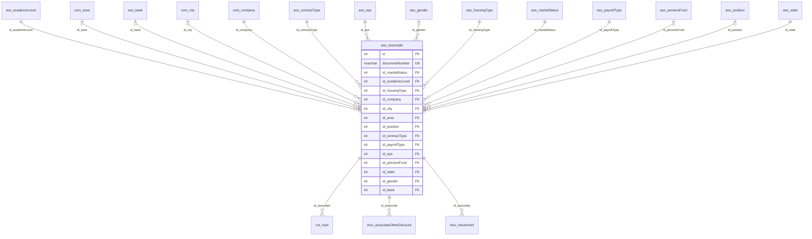

# aso.associate

## Descripción

Asociados del fondo: datos personales, laborales, financieros y de contacto.

**Módulo**: Asociados  
**Nombre en base de datos**: `[aso].[associate]`

## Estructura de la Tabla

| Columna | Tipo | Nulo | Clave | Default | Descripción |
|---------|------|------|-------|---------|-------------|
| name | NVARCHAR(500) | ✓ | - | - | - |
| documentNumber | NVARCHAR(15) | ✗ | UQ | - | - |
| documentCity | NVARCHAR(50) | ✓ | - | - | - |
| accountNumber | NVARCHAR(50) | ✓ | - | - | - |
| email | NVARCHAR(50) | ✓ | - | - | - |
| photo | NVARCHAR(150) | ✓ | - | - | - |
| birthDate | DATETIME2(0) | ✓ | - | - | - |
| id_maritalStatus | INT | ✗ | FK | - | Referencia a aso.maritalStatus |
| id_academicLevel | INT | ✗ | FK | - | Referencia a aso.academicLevel |
| numberOfChildren | INT | ✓ | - | - | - |
| id_housingType | INT | ✗ | FK | - | Referencia a aso.housingType |
| commercialValue | INT | ✓ | - | - | - |
| mortgageValue | INT | ✓ | - | - | - |
| id_company | INT | ✗ | FK | - | Referencia a com.company |
| id_city | INT | ✓ | FK | - | Referencia a com.city |
| id_area | INT | ✓ | FK | - | Referencia a com.area |
| office | NVARCHAR(150) | ✓ | - | - | - |
| id_position | INT | ✓ | FK | - | Referencia a aso.position |
| officePhone | NVARCHAR(50) | ✓ | - | - | - |
| companyEntryDate | DATETIME2(0) | ✓ | - | - | - |
| fundEntryDate | DATETIME2(0) | ✗ | - | - | - |
| isReinstated | BIT | ✗ | - | - | - |
| retirementDate | DATETIME2(0) | ✓ | - | - | - |
| retirementReason | NVARCHAR(200) | ✓ | - | - | - |
| netSalary | FLOAT | ✓ | - | - | - |
| id_contractType | INT | ✗ | FK | - | Referencia a aso.contractType |
| id_payrollType | INT | ✗ | FK | - | Referencia a aso.payrollType |
| savingsValue | FLOAT | ✓ | - | - | - |
| contributionValue | INT | ✓ | - | - | - |
| contributionPercentage | FLOAT | ✗ | - | - | - |
| additionalSavings | INT | ✗ | - | - | - |
| contributionPeriod | INT | ✓ | - | - | - |
| lastLoanDate | DATETIME2(0) | ✓ | - | - | - |
| id_eps | INT | ✗ | FK | - | Referencia a aso.eps |
| id_pensionFund | INT | ✓ | FK | - | Referencia a aso.pensionFund |
| id_state | INT | ✗ | FK | - | Referencia a aso.state |
| isInPayroll | BIT | ✗ | - | - | - |
| nextSalaryDate | DATETIME2(0) | ✗ | - | - | - |
| approvalDate | DATETIME2(0) | ✗ | - | - | - |
| actNumber | NVARCHAR(50) | ✓ | - | - | - |
| severanceValue | INT | ✓ | - | - | - |
| severanceDate | DATETIME2(0) | ✓ | - | - | - |
| currentDiscounts | INT | ✓ | - | - | - |
| spouse | NVARCHAR(50) | ✓ | - | - | - |
| spouseCompany | NVARCHAR(50) | ✓ | - | - | - |
| spousePhone | NVARCHAR(50) | ✓ | - | - | - |
| totalContributions | FLOAT | ✓ | - | - | - |
| totalSavings | FLOAT | ✓ | - | - | - |
| earnings | FLOAT | ✓ | - | - | - |
| isInternetUser | BIT | ✗ | - | - | - |
| otherIncome | FLOAT | ✓ | - | - | - |
| totalPortfolio | FLOAT | ✓ | - | - | - |
| totalInterests | FLOAT | ✓ | - | - | - |
| password | NVARCHAR(20) | ✓ | - | - | - |
| isDataCredito | BIT | ✗ | - | - | - |
| associateAddress | NVARCHAR(150) | ✓ | - | - | - |
| associatePhone | NVARCHAR(150) | ✓ | - | - | - |
| cellphone | NVARCHAR(150) | ✓ | - | - | - |
| isHeadOfHousehold | BIT | ✗ | - | - | - |
| stratum | NVARCHAR(2) | ✓ | - | - | - |
| id_gender | INT | ✓ | FK | - | Referencia a aso.gender |
| id_bank | INT | ✓ | FK | - | Referencia a aso.bank |
| lastUpdateDate | DATETIME2(0) | ✓ | - | - | - |
| documentType | NVARCHAR(20) | ✓ | - | - | - |
| residenceType | NVARCHAR(80) | ✓ | - | - | - |
| residenceNeighborhood | NVARCHAR(80) | ✓ | - | - | - |
| residenceCity | NVARCHAR(80) | ✓ | - | - | - |
| residenceDepartment | NVARCHAR(80) | ✓ | - | - | - |
| isPublicResources | BIT | ✗ | - | - | - |
| isPublicRecognition | BIT | ✗ | - | - | - |
| publicRecognitionText | NVARCHAR(80) | ✓ | - | - | - |
| isPublicPower | BIT | ✗ | - | - | - |
| isPublicFamily | BIT | ✗ | - | - | - |
| publicFamilyText | NVARCHAR(80) | ✓ | - | - | - |
| correspondenceEmail | NVARCHAR(80) | ✓ | - | - | - |
| accountType | NVARCHAR(20) | ✓ | - | - | - |
| bankAccount | NVARCHAR(80) | ✓ | - | - | - |
| isOtherIncome | BIT | ✗ | - | - | - |
| otherIncomeText | NVARCHAR(80) | ✓ | - | - | - |
| monthlyExpenses | FLOAT | ✓ | - | - | - |
| totalAssets | FLOAT | ✓ | - | - | - |
| totalLiabilities | FLOAT | ✓ | - | - | - |
| isAdminPublicResources | BIT | ✗ | - | - | - |
| isForeignCurrency | BIT | ✗ | - | - | - |
| transactionType | NVARCHAR(80) | ✓ | - | - | - |
| isForeignAccount | BIT | ✗ | - | - | - |
| bankName | NVARCHAR(80) | ✓ | - | - | - |
| bankAccountNumber | NVARCHAR(80) | ✓ | - | - | - |
| bankAccountCity | NVARCHAR(80) | ✓ | - | - | - |
| ciiuCode | NVARCHAR(80) | ✓ | - | - | - |
| systemDate | DATETIME2(0) | ✓ | - | - | - |

### Columnas Estándar

| Columna | Tipo | Nulo | Descripción |
|---------|------|------|-------------|
| id | INT | ✗ | Clave primaria auto-incremental |
| uid | NVARCHAR(500) | ✗ | Control multiempresa (User ID) |
| eid | NVARCHAR(50) | ✗ | Control multiempresa (Entity ID) |
| id_user_creator | INT | ✓ | Usuario que creó el registro |
| id_user_modifier | INT | ✓ | Usuario que modificó el registro por última vez |
| dateCreation | DATETIME2(0) | ✓ | Fecha y hora de creación |
| dateModification | DATETIME2(0) | ✓ | Fecha y hora de última modificación |
| isActive | BIT | ✗ | Registro activo (borrado lógico) |
| isWebCreated | BIT | ✗ | Creado desde la web (legado: CreaWeb) |
| isWebUpdated | BIT | ✗ | Actualizado desde la web (legado: ActuWeb) |

### Índices Únicos

- `UQ__aso__associate__eid_documentNumber` (eid, documentNumber) — filtro `([isActive]=(1))`

## Diagrama ER

Tabla y sus relaciones directas (sin las columnas de auditoría).

## Relaciones

### Relaciones Salientes (Foreign Keys)

| Columna | Referencia | Constraint |
|---------|------------|------------|
| id_academicLevel | [`aso.academicLevel`](../aso/academic-level.md).id | `FK__aso__associate__id_academicLevel` |
| id_area | [`com.area`](../com/area.md).id | `FK__aso__associate__id_area` |
| id_bank | [`aso.bank`](../aso/bank.md).id | `FK__aso__associate__id_bank` |
| id_city | [`com.city`](../com/city.md).id | `FK__aso__associate__id_city` |
| id_company | [`com.company`](../com/company.md).id | `FK__aso__associate__id_company` |
| id_contractType | [`aso.contractType`](../aso/contract-type.md).id | `FK__aso__associate__id_contractType` |
| id_eps | [`aso.eps`](../aso/eps.md).id | `FK__aso__associate__id_eps` |
| id_gender | [`aso.gender`](../aso/gender.md).id | `FK__aso__associate__id_gender` |
| id_housingType | [`aso.housingType`](../aso/housing-type.md).id | `FK__aso__associate__id_housingType` |
| id_maritalStatus | [`aso.maritalStatus`](../aso/marital-status.md).id | `FK__aso__associate__id_maritalStatus` |
| id_payrollType | [`aso.payrollType`](../aso/payroll-type.md).id | `FK__aso__associate__id_payrollType` |
| id_pensionFund | [`aso.pensionFund`](../aso/pension-fund.md).id | `FK__aso__associate__id_pensionFund` |
| id_position | [`aso.position`](../aso/position.md).id | `FK__aso__associate__id_position` |
| id_state | [`aso.state`](../aso/state.md).id | `FK__aso__associate__id_state` |

### Relaciones Entrantes

| Tabla | Columna | Constraint |
|-------|---------|------------|
| [`cre.loan`](../cre/loan.md) | id_associate | `FK__cre__loan__id_associate` |
| [`mov.associateOtherDiscount`](../mov/associate-other-discount.md) | id_associate | `FK__mov__associateOtherDiscount__id_associate` |
| [`mov.movement`](../mov/movement.md) | id_associate | `FK__mov__movement__id_associate` |

## Objetos Relacionados

| Objeto | Tipo |
|--------|------|
| `aso.associate_act` | Procedimiento |
| `aso.associate_ins_bulk` | Procedimiento |
| `aso.associate_sel` | Procedimiento |
| `aso.associate_typ` | Tipo tabla |
| `aso.associate_upd_bulk` | Procedimiento |
| `aso.associate_view` | Vista |
| `aso.associate_view_base` | Vista |

---

**Nota**: Documentación generada desde el esquema real de la base de datos `pro_safe` con la skill `data-dictionary` (IDAE.ClaudeConfig).
