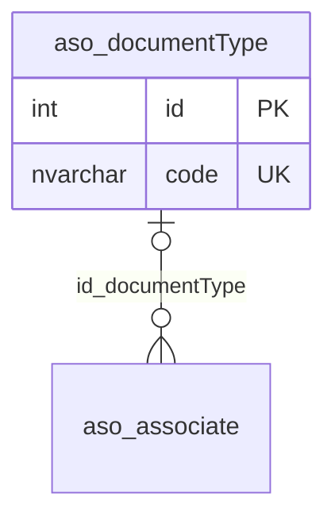

# aso.documentType

## Descripción

Tabla aso.documentType del módulo Asociados.

**Módulo**: Asociados  
**Nombre en base de datos**: `[aso].[documentType]`

## Estructura de la Tabla

| Columna | Tipo | Nulo | Clave | Default | Descripción |
|---------|------|------|-------|---------|-------------|
| name | NVARCHAR(500) | ✓ | - | - | - |
| code | NVARCHAR(20) | ✗ | UQ | - | - |

### Columnas Estándar

| Columna | Tipo | Nulo | Descripción |
|---------|------|------|-------------|
| id | INT | ✗ | Clave primaria auto-incremental |
| uid | NVARCHAR(500) | ✗ | Control multiempresa (User ID) |
| eid | NVARCHAR(50) | ✗ | Control multiempresa (Entity ID) |
| id_user_creator | INT | ✓ | Usuario que creó el registro |
| id_user_modifier | INT | ✓ | Usuario que modificó el registro por última vez |
| dateCreation | DATETIME2(0) | ✓ | Fecha y hora de creación |
| dateModification | DATETIME2(0) | ✓ | Fecha y hora de última modificación |
| isActive | BIT | ✗ | Registro activo (borrado lógico) |
| isWebUpdated | BIT | ✗ | Actualizado desde la web (legado: ActuWeb) |
| isWebCreated | BIT | ✗ | Creado desde la web (legado: CreaWeb) |

### Índices Únicos

- `UQ__aso__documentType__eid_code` (eid, code) — filtro `([isActive]=(1))`

## Diagrama ER

Tabla y sus relaciones directas (sin las columnas de auditoría).

## Relaciones

### Relaciones Salientes (Foreign Keys)

*Esta tabla no tiene relaciones salientes (aparte de las columnas de auditoría).*

### Relaciones Entrantes

| Tabla | Columna | Constraint |
|-------|---------|------------|
| [`aso.associate`](../aso/associate.md) | id_documentType | `FK__aso__associate__id_documentType` |

## Objetos Relacionados

| Objeto | Tipo |
|--------|------|
| `aso.documentType_act` | Procedimiento |
| `aso.documentType_ins_bulk` | Procedimiento |
| `aso.documentType_sel` | Procedimiento |
| `aso.documentType_typ` | Tipo tabla |
| `aso.documentType_upd_bulk` | Procedimiento |
| `aso.documentType_view` | Vista |
| `aso.documentType_view_base` | Vista |

---

**Nota**: Documentación generada desde el esquema real de la base de datos `pro_safe` con la skill `data-dictionary` (IDAE.ClaudeConfig).
