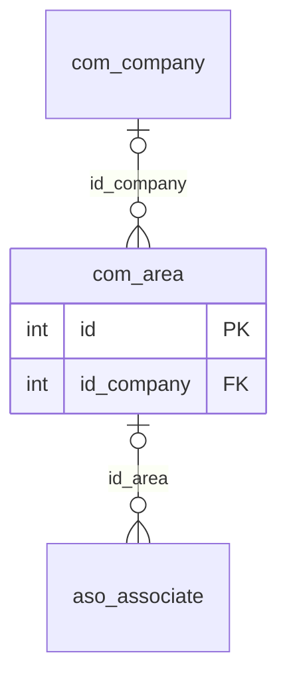

# com.area

## Descripción

Catálogo de áreas. Cada área puede pertenecer a una empresa; las áreas sin empresa se listan siempre.

**Módulo**: Organización  
**Nombre en base de datos**: `[com].[area]`

## Estructura de la Tabla

| Columna | Tipo | Nulo | Clave | Default | Descripción |
|---------|------|------|-------|---------|-------------|
| name | NVARCHAR(500) | ✓ | - | - | - |
| id_company | INT | ✓ | FK | - | Empresa a la que pertenece el área (opcional) |

### Columnas Estándar

| Columna | Tipo | Nulo | Descripción |
|---------|------|------|-------------|
| id | INT | ✗ | Clave primaria auto-incremental |
| uid | NVARCHAR(500) | ✗ | Control multiempresa (User ID) |
| eid | NVARCHAR(50) | ✗ | Control multiempresa (Entity ID) |
| id_user_creator | INT | ✓ | Usuario que creó el registro |
| id_user_modifier | INT | ✓ | Usuario que modificó el registro por última vez |
| dateCreation | DATETIME2(0) | ✓ | Fecha y hora de creación |
| dateModification | DATETIME2(0) | ✓ | Fecha y hora de última modificación |
| isActive | BIT | ✗ | Registro activo (borrado lógico) |
| isWebUpdated | BIT | ✗ | Actualizado desde la web (legado: ActuWeb) |
| isWebCreated | BIT | ✗ | Creado desde la web (legado: CreaWeb) |

## Diagrama ER

Tabla y sus relaciones directas (sin las columnas de auditoría).

## Relaciones

### Relaciones Salientes (Foreign Keys)

| Columna | Referencia | Constraint |
|---------|------------|------------|
| id_company | [`com.company`](../com/company.md).id | `FK__com__area__id_company` |

### Relaciones Entrantes

| Tabla | Columna | Constraint |
|-------|---------|------------|
| [`aso.associate`](../aso/associate.md) | id_area | `FK__aso__associate__id_area` |

## Objetos Relacionados

| Objeto | Tipo |
|--------|------|
| `com.area_act` | Procedimiento |
| `com.area_ins_bulk` | Procedimiento |
| `com.area_sel` | Procedimiento |
| `com.area_sel_by_idCompany` | Procedimiento |
| `com.area_typ` | Tipo tabla |
| `com.area_upd_bulk` | Procedimiento |
| `com.area_view` | Vista |
| `com.area_view_base` | Vista |

---

**Nota**: Documentación generada desde el esquema real de la base de datos `pro_safe` con la skill `data-dictionary` (IDAE.ClaudeConfig).
