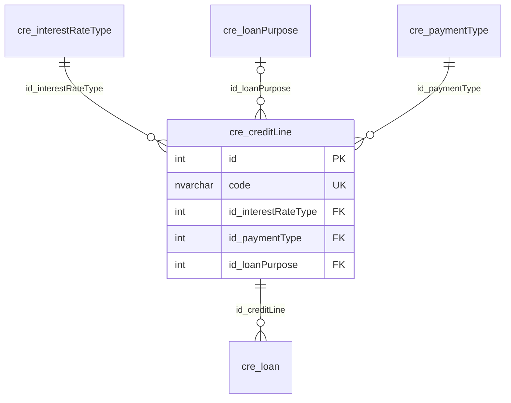

# cre.creditLine

## Descripción

Líneas de crédito (modalidades) con sus condiciones: tasa, plazos, forma de pago y requisitos.

**Módulo**: Créditos  
**Nombre en base de datos**: `[cre].[creditLine]`  
**Origen (migración)**: `app_febancol.dbo.MODALIDAD`

## Estructura de la Tabla

| Columna | Tipo | Nulo | Clave | Default | Descripción |
|---------|------|------|-------|---------|-------------|
| name | NVARCHAR(500) | ✓ | - | - | Descripción de la línea (legado: Descripcion) |
| code | NVARCHAR(10) | ✗ | UQ | - | Código de la línea, llave natural (legado: IdModalidad) |
| isAvailable | BIT | ✗ | - | - | Línea habilitada para nuevos créditos (legado: Activa) |
| currentRate | DECIMAL(9,4) | ✗ | - | - | Tasa corriente anual en % (legado: TasaCorriente) |
| lateRate | DECIMAL(9,4) | ✗ | - | - | Interés de mora (legado: TasaMora) |
| id_interestRateType | INT | ✗ | FK | - | Tipo de tasa: anticipada o vencida (legado: IdTipoTasa) |
| id_paymentType | INT | ✗ | FK | - | Forma de pago (legado: IdTipoPago) |
| id_loanPurpose | INT | ✓ | FK | - | Destino del crédito (legado: IdDestino) |
| minTerm | INT | ✗ | - | - | Plazo mínimo en meses (legado: PlazoMin) |
| maxTerm | INT | ✗ | - | - | Plazo máximo en meses (legado: PlazoMax) |
| periodicityDays | INT | ✓ | - | - | Periodicidad de pago en días: 0, 30, 60, 90 o 180 (legado: Periodicidad) |
| maxAmount | INT | ✓ | - | - | Monto máximo a solicitar (legado: MontoFijo) |
| leveragePercentage | DECIMAL(9,4) | ✗ | - | - | Apalancamiento requerido en % (legado: PorApalancamiento) |
| portfolioPayoffPercentage | DECIMAL(9,4) | ✓ | - | - | % requerido para recoger cartera (legado: PorcMinimoPagar) |
| savingsPercentage | DECIMAL(9,4) | ✓ | - | - | Porcentaje de ahorros (legado: PorcAhorros) |
| contributionsPercentage | DECIMAL(9,4) | ✓ | - | - | Porcentaje de aportes (legado: PorAportes) |
| minAffiliationTime | INT | ✓ | - | - | Tiempo mínimo de afiliación (legado: TMInimoAfiliacion) |
| timeSinceLastLoan | INT | ✓ | - | - | Tiempo desde el último préstamo (legado: TUltimoPrestamo) |
| severanceValue | INT | ✓ | - | - | Valor de las cesantías (legado: Cesantias) |
| requiresRealEstate | BIT | ✗ | - | - | Requiere finca raíz (legado: ConFincaRaiz) |
| allowsPledge | BIT | ✗ | - | - | Permite pignorar (legado: Pignorar) |
| requiresCommitteeReview | BIT | ✗ | - | - | Requiere evaluación del comité (legado: EvaluacionComite) |
| allowsApprovalWithoutCompliance | BIT | ✗ | - | - | Permite aprobar sin cumplir requisitos (legado: AprobarSincumplir) |
| chargesInsurance | BIT | ✗ | - | - | Cobra seguro (legado: CobraSeguro) |
| chargesMutualProtection | BIT | ✗ | - | - | Cobra amparo mutual (legado: CobraAmparo) |

### Columnas Estándar

| Columna | Tipo | Nulo | Descripción |
|---------|------|------|-------------|
| id | INT | ✗ | Clave primaria auto-incremental |
| uid | NVARCHAR(500) | ✗ | Control multiempresa (User ID) |
| eid | NVARCHAR(50) | ✗ | Control multiempresa (Entity ID) |
| id_user_creator | INT | ✓ | Usuario que creó el registro |
| id_user_modifier | INT | ✓ | Usuario que modificó el registro por última vez |
| dateCreation | DATETIME2(0) | ✓ | Fecha y hora de creación |
| dateModification | DATETIME2(0) | ✓ | Fecha y hora de última modificación |
| isActive | BIT | ✗ | Registro activo (borrado lógico) |
| isWebUpdated | BIT | ✗ | Actualizado desde la web (legado: ActuWeb) |
| isWebCreated | BIT | ✗ | Creado desde la web (legado: CreaWeb) |

### Índices Únicos

- `UQ__cre__creditLine__eid_code` (eid, code) — filtro `([isActive]=(1))`

## Diagrama ER

Tabla y sus relaciones directas (sin las columnas de auditoría).

## Relaciones

### Relaciones Salientes (Foreign Keys)

| Columna | Referencia | Constraint |
|---------|------------|------------|
| id_interestRateType | [`cre.interestRateType`](../cre/interest-rate-type.md).id | `FK__cre__creditLine__id_interestRateType` |
| id_loanPurpose | [`cre.loanPurpose`](../cre/loan-purpose.md).id | `FK__cre__creditLine__id_loanPurpose` |
| id_paymentType | [`cre.paymentType`](../cre/payment-type.md).id | `FK__cre__creditLine__id_paymentType` |

### Relaciones Entrantes

| Tabla | Columna | Constraint |
|-------|---------|------------|
| [`cre.loan`](../cre/loan.md) | id_creditLine | `FK__cre__loan__id_creditLine` |

## Objetos Relacionados

| Objeto | Tipo |
|--------|------|
| `cre.creditLine_act` | Procedimiento |
| `cre.creditLine_ins_bulk` | Procedimiento |
| `cre.creditLine_sel` | Procedimiento |
| `cre.creditLine_typ` | Tipo tabla |
| `cre.creditLine_upd_bulk` | Procedimiento |
| `cre.creditLine_view` | Vista |
| `cre.creditLine_view_base` | Vista |

## Notas Técnicas

- La llave natural es `code` (legado IdModalidad); la descripción no es única en el sistema legado.
- `isAvailable` es la marca Activa del legado. No se usa `isActive` para no ocultar líneas inactivas que siguen referenciadas por créditos.

---

**Nota**: Documentación generada desde el esquema real de la base de datos `pro_safe` con la skill `data-dictionary` (IDAE.ClaudeConfig).
