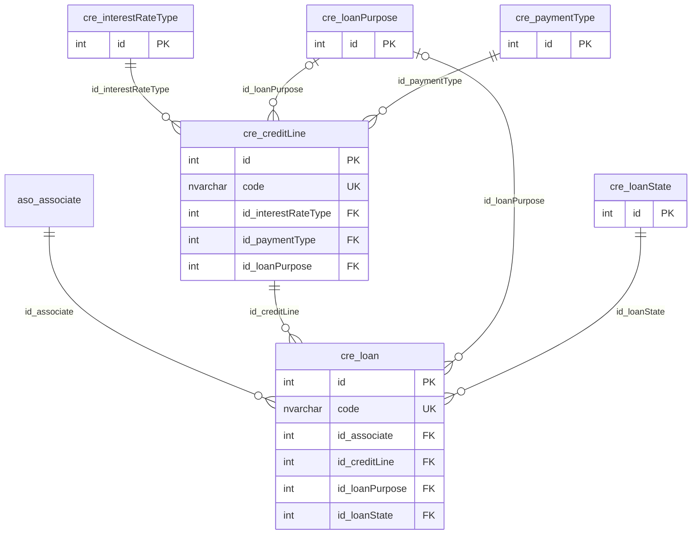

# Diagrama ER - Créditos

Tablas del módulo Créditos (solo llaves PK, FK y UK) y las tablas de otros módulos con las que se relacionan (solo el nombre). Se omiten las relaciones de auditoría con el usuario.

---

**Nota**: Diagrama generado desde el esquema real de la base de datos `pro_safe` con la skill `data-dictionary` (IDAE.ClaudeConfig).
