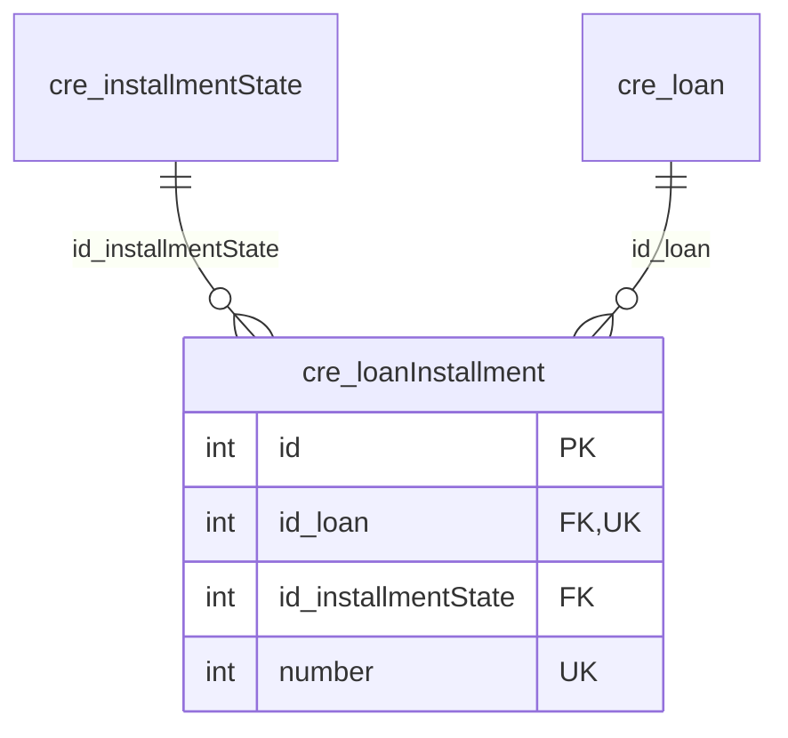

# cre.loanInstallment

## Descripción

Plan de cuotas de cada crédito, con el estado de cada cuota. Consolida las dos tablas de cuotas del legado.

**Módulo**: Créditos  
**Nombre en base de datos**: `[cre].[loanInstallment]`  
**Origen (migración)**: `app_febancol.dbo.SOL_CUOTAS + app_febancol.dbo.SIM_CUOTA`

## Estructura de la Tabla

| Columna | Tipo | Nulo | Clave | Default | Descripción |
|---------|------|------|-------|---------|-------------|
| name | NVARCHAR(500) | ✓ | - | - | Sin uso (la cuota se identifica por id_loan y number) |
| id_loan | INT | ✗ | FK, UQ | - | Crédito al que pertenece la cuota (legado: IdSolicitud, resuelto por CodigoCredito) |
| id_installmentState | INT | ✗ | FK | - | Estado de la cuota: PENDIENTE o PAGADA (legado: Cancelada en SOL_CUOTAS; calculado por saldo en SIM_CUOTA) |
| number | INT | ✗ | UQ | - | Número de la cuota; en SOL_CUOTAS la cuota 0 es el periodo inicial de solo intereses (legado: NCuota) |
| dueDate | DATETIME2(0) | ✗ | - | - | Fecha de vencimiento de la cuota (legado: Fecha) |
| capitalAmount | INT | ✗ | - | - | Abono a capital de la cuota (legado: VlrCapital) |
| interestAmount | INT | ✗ | - | - | Interés de la cuota (legado: VlrInteres) |
| lifeInsurance | INT | ✓ | - | - | Seguro de vida de la cuota (legado: SeguroVida en SOL_CUOTAS, Seguro en SIM_CUOTA) |
| capitalBalance | INT | ✗ | - | - | Saldo de capital del crédito después de pagar la cuota (legado: SaldoCap) |
| accumulatedInterest | INT | ✓ | - | - | Interés programado acumulado hasta esta cuota; no es interés efectivamente pagado (legado: InteresesPag) |
| periodDays | INT | ✓ | - | - | Días del periodo de la cuota; solo viene de SOL_CUOTAS (legado: DiasAnt) |

### Columnas Estándar

| Columna | Tipo | Nulo | Descripción |
|---------|------|------|-------------|
| id | INT | ✗ | Clave primaria auto-incremental |
| uid | NVARCHAR(500) | ✗ | Control multiempresa (User ID) |
| eid | NVARCHAR(50) | ✗ | Control multiempresa (Entity ID) |
| id_user_creator | INT | ✓ | Usuario que creó el registro |
| id_user_modifier | INT | ✓ | Usuario que modificó el registro por última vez |
| dateCreation | DATETIME2(0) | ✓ | Fecha y hora de creación |
| dateModification | DATETIME2(0) | ✓ | Fecha y hora de última modificación |
| isActive | BIT | ✗ | Registro activo (borrado lógico) |
| isWebUpdated | BIT | ✗ | Actualizado desde la web (legado: ActuWeb) |
| isWebCreated | BIT | ✗ | Creado desde la web (legado: CreaWeb) |

### Índices Únicos

- `UQ__cre__loanInstallment__id_loan_number` (id_loan, number) — filtro `([isActive]=(1))`

## Diagrama ER

Tabla y sus relaciones directas (sin las columnas de auditoría).

## Relaciones

### Relaciones Salientes (Foreign Keys)

| Columna | Referencia | Constraint |
|---------|------------|------------|
| id_installmentState | [`cre.installmentState`](../cre/installment-state.md).id | `FK__cre__loanInstallment__id_installmentState` |
| id_loan | [`cre.loan`](../cre/loan.md).id | `FK__cre__loanInstallment__id_loan` |

### Relaciones Entrantes

*Ninguna tabla referencia a esta tabla.*

## Objetos Relacionados

| Objeto | Tipo |
|--------|------|
| `cre.loanInstallment_act` | Procedimiento |
| `cre.loanInstallment_ins_bulk` | Procedimiento |
| `cre.loanInstallment_sel` | Procedimiento |
| `cre.loanInstallment_sel_by_idLoan` | Procedimiento |
| `cre.loanInstallment_typ` | Tipo tabla |
| `cre.loanInstallment_upd_bulk` | Procedimiento |
| `cre.loanInstallment_view` | Vista |
| `cre.loanInstallment_view_base` | Vista |

## Notas Técnicas

- La llave natural es (`id_loan`, `number`). El crédito se resuelve por IdSolicitud → SOLICITUD_PRESTAMOS.CodigoCredito → `cre.loan.code`.
- SOL_CUOTAS guarda las cuotas de los créditos con pago en primas y de cuotas fijas; su estado sale del indicador Cancelada, que actualizaban los pagos.
- SIM_CUOTA guarda las cuotas de los créditos de cuota fija mensual; su Cancelada nunca se actualizaba, así que el estado se calcula con la regla del legado: la cuota está PAGADA si su saldo de capital (SaldoCap) es mayor o igual al saldo de capital actual del crédito. Solo se migran los créditos en estado 4 (EN PROCESO) o 9999 (FINALIZADA).
- No se migran SOL_CUOTAS_ANTERIOR (copia de respaldo), SO_PROXIMACUOTA / SO_PROXIMACUOTAOLD (caché de la próxima cuota, que es la primera PENDIENTE) ni las cuotas de créditos que no existen en `cre.loan`.
- Los montos float del legado se redondean a enteros.

---

**Nota**: Documentación generada desde el esquema real de la base de datos `pro_safe` con la skill `data-dictionary` (IDAE.ClaudeConfig).
