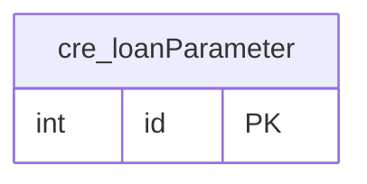

# cre.loanParameter

## Descripción

Parámetros para crear créditos de cada empresa: día de pago de las cuotas y consecutivo del código de crédito. Hay un registro activo por empresa (eid).

**Módulo**: Créditos  
**Nombre en base de datos**: `[cre].[loanParameter]`  
**Origen (migración)**: `app_febancol.dbo.PARAMETRO`

## Estructura de la Tabla

| Columna | Tipo | Nulo | Clave | Default | Descripción |
|---------|------|------|-------|---------|-------------|
| name | NVARCHAR(500) | ✓ | - | - | Nombre descriptivo del registro de parámetros |
| dueDay | INT | ✗ | - | - | Día del mes en que vencen las cuotas; define la fecha de la primera cuota por defecto y el día de las primas (legado: DiaPago) |
| currentPeriod | NVARCHAR(10) | ✗ | - | - | Periodo AAMM del último código de crédito generado (legado: PeriodoActual) |
| currentLoanNumber | INT | ✗ | - | - | Último consecutivo usado en currentPeriod (legado: CreditoActual) |

### Columnas Estándar

| Columna | Tipo | Nulo | Descripción |
|---------|------|------|-------------|
| id | INT | ✗ | Clave primaria auto-incremental |
| uid | NVARCHAR(500) | ✗ | Control multiempresa (User ID) |
| eid | NVARCHAR(50) | ✗ | Control multiempresa (Entity ID) |
| id_user_creator | INT | ✓ | Usuario que creó el registro |
| id_user_modifier | INT | ✓ | Usuario que modificó el registro por última vez |
| dateCreation | DATETIME2(0) | ✓ | Fecha y hora de creación |
| dateModification | DATETIME2(0) | ✓ | Fecha y hora de última modificación |
| isActive | BIT | ✗ | Registro activo (borrado lógico) |
| isWebUpdated | BIT | ✗ | Actualizado desde la web (legado: ActuWeb) |
| isWebCreated | BIT | ✗ | Creado desde la web (legado: CreaWeb) |

### Índices Únicos

- `UQ__cre__loanParameter__eid` (eid) — filtro `([isActive]=(1))`

## Diagrama ER

Tabla y sus relaciones directas (sin las columnas de auditoría).

## Relaciones

### Relaciones Salientes (Foreign Keys)

*Esta tabla no tiene relaciones salientes (aparte de las columnas de auditoría).*

### Relaciones Entrantes

*Ninguna tabla referencia a esta tabla.*

## Objetos Relacionados

| Objeto | Tipo |
|--------|------|
| `cre.loanParameter_act` | Procedimiento |
| `cre.loanParameter_ins_bulk` | Procedimiento |
| `cre.loanParameter_next_code` | Procedimiento |
| `cre.loanParameter_sel` | Procedimiento |
| `cre.loanParameter_typ` | Tipo tabla |
| `cre.loanParameter_upd_bulk` | Procedimiento |
| `cre.loanParameter_view` | Vista |
| `cre.loanParameter_view_base` | Vista |

## Notas Técnicas

- El código de un crédito nuevo lo genera `cre.loanParameter_next_code` con el formato AAMM-NNNN. Bloquea el registro (UPDLOCK) para que dos créditos simultáneos no repitan consecutivo.
- Cuando cambia el mes, el consecutivo se reinicia desde el código más alto que ya exista en `cre.loan` para ese mes. Así continúa la numeración de los créditos migrados.
- Se carga con `Migration/33_loanParameter.sql` desde PARAMETRO, o con `DML/08_loanParameter.sql` (día de pago 30, sin consecutivo) cuando no se ejecuta la migración.

---

**Nota**: Documentación generada desde el esquema real de la base de datos `pro_safe` con la skill `data-dictionary` (IDAE.ClaudeConfig).
