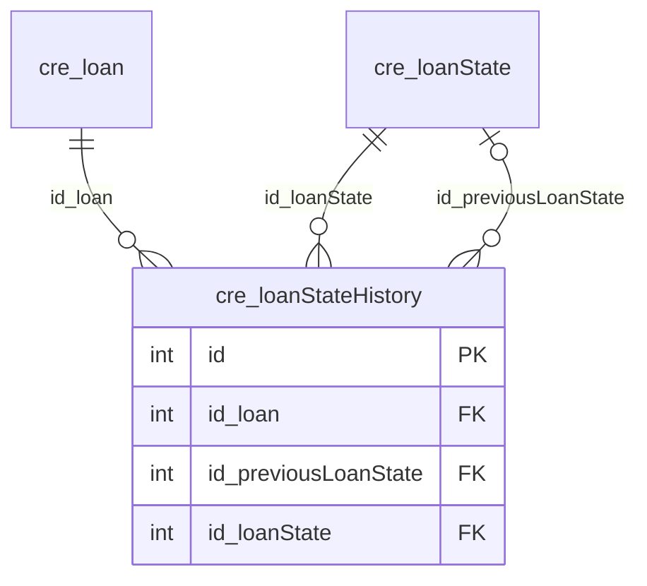

# cre.loanStateHistory

## Descripción

Tabla cre.loanStateHistory del módulo Créditos.

**Módulo**: Créditos  
**Nombre en base de datos**: `[cre].[loanStateHistory]`

## Estructura de la Tabla

| Columna | Tipo | Nulo | Clave | Default | Descripción |
|---------|------|------|-------|---------|-------------|
| name | NVARCHAR(500) | ✓ | - | - | - |
| id_loan | INT | ✗ | FK | - | Referencia a cre.loan |
| id_previousLoanState | INT | ✓ | FK | - | Referencia a cre.loanState |
| id_loanState | INT | ✗ | FK | - | Referencia a cre.loanState |
| changeDate | DATETIME2(0) | ✗ | - | (getdate()) | - |
| rejectionReason | NVARCHAR(MAX) | ✓ | - | - | - |

### Columnas Estándar

| Columna | Tipo | Nulo | Descripción |
|---------|------|------|-------------|
| id | INT | ✗ | Clave primaria auto-incremental |
| uid | NVARCHAR(500) | ✗ | Control multiempresa (User ID) |
| eid | NVARCHAR(50) | ✗ | Control multiempresa (Entity ID) |
| id_user_creator | INT | ✓ | Usuario que creó el registro |
| id_user_modifier | INT | ✓ | Usuario que modificó el registro por última vez |
| dateCreation | DATETIME2(0) | ✓ | Fecha y hora de creación |
| dateModification | DATETIME2(0) | ✓ | Fecha y hora de última modificación |
| isActive | BIT | ✗ | Registro activo (borrado lógico) |
| isWebUpdated | BIT | ✗ | Actualizado desde la web (legado: ActuWeb) |
| isWebCreated | BIT | ✗ | Creado desde la web (legado: CreaWeb) |

## Diagrama ER

Tabla y sus relaciones directas (sin las columnas de auditoría).

## Relaciones

### Relaciones Salientes (Foreign Keys)

| Columna | Referencia | Constraint |
|---------|------------|------------|
| id_loan | [`cre.loan`](../cre/loan.md).id | `FK__cre__loanStateHistory__id_loan` |
| id_loanState | [`cre.loanState`](../cre/loan-state.md).id | `FK__cre__loanStateHistory__id_loanState` |
| id_previousLoanState | [`cre.loanState`](../cre/loan-state.md).id | `FK__cre__loanStateHistory__id_previousLoanState` |

### Relaciones Entrantes

*Ninguna tabla referencia a esta tabla.*

## Objetos Relacionados

| Objeto | Tipo |
|--------|------|
| `cre.loanStateHistory_act` | Procedimiento |
| `cre.loanStateHistory_ins_bulk` | Procedimiento |
| `cre.loanStateHistory_sel` | Procedimiento |
| `cre.loanStateHistory_sel_by_idLoan` | Procedimiento |
| `cre.loanStateHistory_typ` | Tipo tabla |
| `cre.loanStateHistory_upd_bulk` | Procedimiento |
| `cre.loanStateHistory_view` | Vista |
| `cre.loanStateHistory_view_base` | Vista |

---

**Nota**: Documentación generada desde el esquema real de la base de datos `pro_safe` con la skill `data-dictionary` (IDAE.ClaudeConfig).
