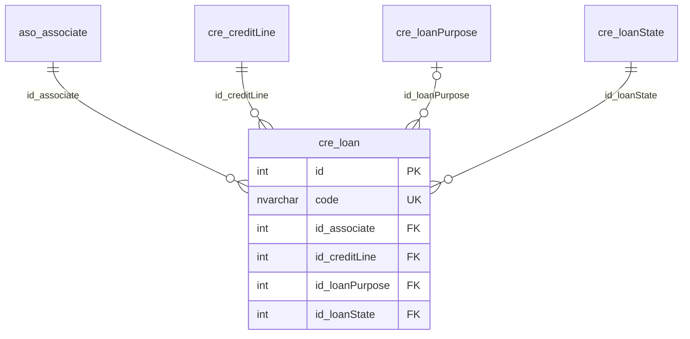

# cre.loan

## Descripción

Créditos (solicitudes de préstamo) de los asociados: condiciones, fechas, saldos, intereses y liquidación.

**Módulo**: Créditos  
**Nombre en base de datos**: `[cre].[loan]`  
**Origen (migración)**: `app_febancol.dbo.SOLICITUD_PRESTAMOS`

## Estructura de la Tabla

| Columna | Tipo | Nulo | Clave | Default | Descripción |
|---------|------|------|-------|---------|-------------|
| name | NVARCHAR(500) | ✓ | - | - | Sin uso (el crédito se identifica por code) |
| code | NVARCHAR(20) | ✗ | UQ | - | Código del crédito, llave natural (legado: CodigoCredito) |
| id_associate | INT | ✗ | FK | - | Asociado titular (legado: IdAsociado, resuelto por documento) |
| id_creditLine | INT | ✗ | FK | - | Línea de crédito (legado: IdModalidad, resuelto por código) |
| id_loanPurpose | INT | ✓ | FK | - | Destino del crédito (legado: IdDestino) |
| id_loanState | INT | ✗ | FK | - | Estado del crédito (legado: IdEstado) |
| requestDate | DATETIME2(0) | ✗ | - | - | Fecha de la solicitud (legado: Fecha) |
| approvalDate | DATETIME2(0) | ✓ | - | - | Fecha de aprobación (legado: FechaAprobacion) |
| startDate | DATETIME2(0) | ✓ | - | - | Fecha de inicio (legado: FechaInicial) |
| endDate | DATETIME2(0) | ✓ | - | - | Fecha de finalización (legado: FechaFin) |
| nextInstallmentDate | DATETIME2(0) | ✓ | - | - | Fecha de la próxima cuota (legado: FecProxCuota) |
| lastPaymentDate | DATETIME2(0) | ✓ | - | - | Fecha del último pago (legado: UltimoPago) |
| lastLoanDate | DATETIME2(0) | ✓ | - | - | Fecha del último préstamo del asociado (legado: UltimoPrestamo) |
| requestedAmount | INT | ✗ | - | - | Monto solicitado (legado: Monto) |
| approvedAmount | INT | ✓ | - | - | Monto aprobado (legado: MontoAprobado) |
| requestedTerm | INT | ✗ | - | - | Plazo solicitado (legado: PlazoSolicitado) |
| approvedTerm | INT | ✓ | - | - | Plazo aprobado (legado: PlazoAprobado) |
| rate | DECIMAL(12,8) | ✗ | - | - | Tasa como fracción mensual (legado: Tasa) |
| installmentAmount | INT | ✗ | - | - | Valor de la cuota (legado: VlrCuota) |
| capitalBalance | INT | ✓ | - | - | Saldo de capital (legado: SaldoCapital) |
| pendingInstallments | INT | ✓ | - | - | Número de cuotas pendientes (legado: NCuotasPend) |
| capitalAmount | INT | ✓ | - | - | Valor de capital (legado: Vlrcapital) |
| interestAmount | INT | ✓ | - | - | Valor de interés (legado: VlrInteres) |
| paidInterest | INT | ✓ | - | - | Intereses pagados (legado: IntPagados) |
| accruedInterest | INT | ✓ | - | - | Intereses causados (legado: IntCausados) |
| advanceInterest | INT | ✓ | - | - | Intereses anticipados (legado: IntAnticipados) |
| portfolioInsurance | INT | ✓ | - | - | Seguro de cartera, A.M. cartera (legado: SeguroCartera) |
| mutualProtection | INT | ✓ | - | - | Amparo mutual, A.M. vida (legado: AmparoMutual) |
| uncoveredAmount | INT | ✓ | - | - | Monto descubierto (legado: MontoDescubierto) |
| interestRefund | INT | ✓ | - | - | Reintegro de intereses (legado: RIntereses) |
| insuranceRefund | INT | ✓ | - | - | Reintegro A.M. (legado: RSeguro) |
| mutualProtectionRefund | INT | ✓ | - | - | Reintegro A.M. vida (legado: RAmparo) |
| refinancedPortfolio | INT | ✓ | - | - | Cartera recogida (legado: CRecoge) |
| totalReceived | INT | ✓ | - | - | Total recibido (legado: TRecibido) |
| bonusPaymentAmount | INT | ✓ | - | - | Pago en primas (legado: MontoPrimas) |
| bonusLoanRequest | INT | ✓ | - | - | IdSolicitud legado de la solicitud de primas asociada, 0 = ninguna (legado: SolicitudPrimas) |
| leverage | DECIMAL(9,4) | ✓ | - | - | Apalancamiento (legado: Apalancamiento) |
| totalSavings | INT | ✓ | - | - | Total de ahorros del asociado al solicitar (legado: TAhorros) |
| totalContributions | INT | ✓ | - | - | Total de aportes del asociado al solicitar (legado: TAportes) |
| totalObligations | INT | ✓ | - | - | Total de obligaciones (legado: TObligaciones) |
| otherIncome | INT | ✓ | - | - | Otros ingresos (legado: OIngresos) |
| studyFee | INT | ✓ | - | - | Valor del estudio (legado: VlrEstudio) |
| supplierPayment | INT | ✓ | - | - | Pago a proveedor (legado: PagoProveedor) |
| previousCode | INT | ✓ | - | - | Código anterior (legado: Cod_Anterior) |
| cancelsBalances | BIT | ✗ | - | - | Cancela saldos (legado: CancelaSaldos) |
| hasBonusPayment | BIT | ✗ | - | - | Pago con primas (legado: PagoPrimas) |
| isFixedTerm | BIT | ✗ | - | - | Plazo fijo (legado: PlazoFijo) |
| isFromInternet | BIT | ✗ | - | - | Solicitud recibida por internet (legado: VieneInternet) |
| isInPayroll | BIT | ✗ | - | - | Dentro de nómina (legado: DentroNomina) |
| isPayrollDeduction | BIT | ✗ | - | - | Se descuenta por nómina (legado: DescontarNomina) |
| isInterestOnly | BIT | ✗ | - | - | Paga solo interés (legado: SoloInteres) |
| rejectionReason | NVARCHAR(MAX) | ✓ | - | - | Motivo del rechazo (legado: MotivoRechazo) |
| user | NVARCHAR(50) | ✓ | - | - | Login del usuario que registró el crédito (legado: IdUsuario) |

### Columnas Estándar

| Columna | Tipo | Nulo | Descripción |
|---------|------|------|-------------|
| id | INT | ✗ | Clave primaria auto-incremental |
| uid | NVARCHAR(500) | ✗ | Control multiempresa (User ID) |
| eid | NVARCHAR(50) | ✗ | Control multiempresa (Entity ID) |
| id_user_creator | INT | ✓ | Usuario que creó el registro |
| id_user_modifier | INT | ✓ | Usuario que modificó el registro por última vez |
| dateCreation | DATETIME2(0) | ✓ | Fecha y hora de creación |
| dateModification | DATETIME2(0) | ✓ | Fecha y hora de última modificación |
| isActive | BIT | ✗ | Registro activo (borrado lógico) |
| isWebUpdated | BIT | ✗ | Actualizado desde la web (legado: ActuWeb) |
| isWebCreated | BIT | ✗ | Creado desde la web (legado: CreaWeb) |

### Índices Únicos

- `UQ__cre__loan__eid_code` (eid, code) — filtro `([isActive]=(1))`

## Diagrama ER

Tabla y sus relaciones directas (sin las columnas de auditoría).

## Relaciones

### Relaciones Salientes (Foreign Keys)

| Columna | Referencia | Constraint |
|---------|------------|------------|
| id_associate | [`aso.associate`](../aso/associate.md).id | `FK__cre__loan__id_associate` |
| id_creditLine | [`cre.creditLine`](../cre/credit-line.md).id | `FK__cre__loan__id_creditLine` |
| id_loanPurpose | [`cre.loanPurpose`](../cre/loan-purpose.md).id | `FK__cre__loan__id_loanPurpose` |
| id_loanState | [`cre.loanState`](../cre/loan-state.md).id | `FK__cre__loan__id_loanState` |

### Relaciones Entrantes

*Ninguna tabla referencia a esta tabla.*

## Objetos Relacionados

| Objeto | Tipo |
|--------|------|
| `cre.loan_act` | Procedimiento |
| `cre.loan_ins_bulk` | Procedimiento |
| `cre.loan_sel` | Procedimiento |
| `cre.loan_sel_by_idAssociate` | Procedimiento |
| `cre.loan_typ` | Tipo tabla |
| `cre.loan_upd_bulk` | Procedimiento |
| `cre.loan_view` | Vista |
| `cre.loan_view_base` | Vista |

## Notas Técnicas

- La llave natural es `code` (legado CodigoCredito). El IdSolicitud legado no se conserva.
- `rate` es una fracción mensual: rate × 1200 = tasa anual de la línea (p. ej. 0.0174 = 20,88 % anual).
- La migración omite los créditos cuyo asociado o línea de crédito no existe en el sistema legado (96 de 4 asociados inexistentes y 53 con la modalidad 1020AG).
- Las fechas centinela 1899-12-30 del legado se migran como NULL y los montos float se redondean a enteros.

---

**Nota**: Documentación generada desde el esquema real de la base de datos `pro_safe` con la skill `data-dictionary` (IDAE.ClaudeConfig).
