# Diccionario de Datos - SAFE

Diccionario de datos de la base de datos `pro_safe` de SAFE (fondo de empleados). Los objetos viven en `IDAE.SAFE.DBObjects` y la base se reconstruye desde cero con `UTIL.DBUpgrader`; los datos históricos se migran desde la base legada `app_febancol`.

## Estadísticas

- **Total de tablas**: 32
- **Módulos**: 5
- **Base de datos**: SQL Server (`pro_safe`)

## Convenciones

- Esquema por dominio y nombres en inglés camelCase; las llaves foráneas se llaman `id_<tabla>`.
- Todas las tablas tienen `id` (INT IDENTITY, PK), `uid`/`eid` (multiempresa), auditoría (`id_user_creator`, `id_user_modifier`, `dateCreation`, `dateModification`) e `isActive` (borrado lógico).
- Por cada tabla existen las vistas `<tabla>_view` (columnas de las FK expandidas) y `<tabla>_view_base` (solo el nombre de cada FK), el tipo `<tabla>_typ` y los procedimientos `_sel`, `_act`, `_ins_bulk` y `_upd_bulk`.
- El orden de columnas de la tabla y de `<tabla>_typ` debe coincidir con el orden de propiedades del `...Object.cs` del backend (los parámetros tipo tabla se enlazan por posición).
- `isWebCreated` / `isWebUpdated` vienen de `CreaWeb` / `ActuWeb` del sistema legado.

## Mapa de Relaciones

Todas las tablas y sus relaciones (sin columnas ni relaciones de auditoría). El detalle de columnas está en el diagrama ER de cada módulo.

```mermaid
erDiagram
    aso_academicLevel
    aso_associate
    aso_bank
    aso_contractType
    aso_eps
    aso_gender
    aso_housingType
    aso_maritalStatus
    aso_payrollType
    aso_pensionFund
    aso_position
    aso_state
    com_area
    com_city
    com_company
    com_group
    cre_creditLine
    cre_interestRateType
    cre_loan
    cre_loanPurpose
    cre_loanState
    cre_paymentType
    mov_associateOtherDiscount
    mov_discount
    mov_discountImp
    mov_movement
    mov_movementState
    mov_movementType
    mov_operationType
    mov_otherDiscount
    use_profile
    use_user
    aso_academicLevel ||--o{ aso_associate : "id_academicLevel"
    com_area |o--o{ aso_associate : "id_area"
    aso_bank |o--o{ aso_associate : "id_bank"
    com_city |o--o{ aso_associate : "id_city"
    com_company ||--o{ aso_associate : "id_company"
    aso_contractType ||--o{ aso_associate : "id_contractType"
    aso_eps ||--o{ aso_associate : "id_eps"
    aso_gender |o--o{ aso_associate : "id_gender"
    aso_housingType ||--o{ aso_associate : "id_housingType"
    aso_maritalStatus ||--o{ aso_associate : "id_maritalStatus"
    aso_payrollType ||--o{ aso_associate : "id_payrollType"
    aso_pensionFund |o--o{ aso_associate : "id_pensionFund"
    aso_position |o--o{ aso_associate : "id_position"
    aso_state ||--o{ aso_associate : "id_state"
    com_company |o--o{ com_area : "id_company"
    com_group |o--o{ com_company : "id_group"
    cre_interestRateType ||--o{ cre_creditLine : "id_interestRateType"
    cre_loanPurpose |o--o{ cre_creditLine : "id_loanPurpose"
    cre_paymentType ||--o{ cre_creditLine : "id_paymentType"
    aso_associate ||--o{ cre_loan : "id_associate"
    cre_creditLine ||--o{ cre_loan : "id_creditLine"
    cre_loanPurpose |o--o{ cre_loan : "id_loanPurpose"
    cre_loanState ||--o{ cre_loan : "id_loanState"
    aso_associate ||--o{ mov_associateOtherDiscount : "id_associate"
    mov_movementType |o--o{ mov_associateOtherDiscount : "id_movementType"
    mov_operationType |o--o{ mov_associateOtherDiscount : "id_operationType"
    mov_otherDiscount ||--o{ mov_associateOtherDiscount : "id_otherDiscount"
    aso_associate ||--o{ mov_movement : "id_associate"
    mov_discount |o--o{ mov_movement : "id_discount"
    mov_discountImp |o--o{ mov_movement : "id_discountImp"
    mov_movementState ||--o{ mov_movement : "id_movementState"
    mov_movementType ||--o{ mov_movement : "id_movementType"
    mov_operationType ||--o{ mov_movement : "id_operationType"
    mov_movementType |o--o{ mov_otherDiscount : "id_movementType"
    mov_operationType |o--o{ mov_otherDiscount : "id_operationType"
    use_profile ||--o{ use_user : "id_profile"
```

## Módulos

### Asociados (`aso`)

Asociados del fondo y sus catálogos de información personal y laboral.

[Diagrama ER del módulo](./aso/er-diagram.md)

- [aso.academicLevel](./aso/academic-level.md) - Catálogo de niveles académicos.
- [aso.associate](./aso/associate.md) - Asociados del fondo: datos personales, laborales, financieros y de contacto.
- [aso.bank](./aso/bank.md) - Catálogo de bancos.
- [aso.contractType](./aso/contract-type.md) - Catálogo de tipos de contrato laboral.
- [aso.eps](./aso/eps.md) - Catálogo de EPS (entidades promotoras de salud).
- [aso.gender](./aso/gender.md) - Catálogo de géneros.
- [aso.housingType](./aso/housing-type.md) - Catálogo de tipos de vivienda.
- [aso.maritalStatus](./aso/marital-status.md) - Catálogo de estados civiles.
- [aso.payrollType](./aso/payroll-type.md) - Catálogo de tipos de nómina.
- [aso.pensionFund](./aso/pension-fund.md) - Catálogo de fondos de pensiones.
- [aso.position](./aso/position.md) - Catálogo de cargos.
- [aso.state](./aso/state.md) - Catálogo de estados del asociado.

### Organización (`com`)

Empresas, áreas, ciudades y grupos.

[Diagrama ER del módulo](./com/er-diagram.md)

- [com.area](./com/area.md) - Catálogo de áreas. Cada área puede pertenecer a una empresa; las áreas sin empresa se listan siempre.
- [com.city](./com/city.md) - Catálogo de ciudades.
- [com.company](./com/company.md) - Empresas a las que pertenecen los asociados.
- [com.group](./com/group.md) - Catálogo de grupos.

### Movimientos (`mov`)

Movimientos (transacciones) de los asociados y descuentos.

[Diagrama ER del módulo](./mov/er-diagram.md)

- [mov.associateOtherDiscount](./mov/associate-other-discount.md) - Otros descuentos asignados a cada asociado.
- [mov.discount](./mov/discount.md) - Descuentos aplicados (archivos de descuento).
- [mov.discountImp](./mov/discount-imp.md) - Descuentos importados.
- [mov.movement](./mov/movement.md) - Movimientos (transacciones) de los asociados.
- [mov.movementState](./mov/movement-state.md) - Catálogo de estados de movimiento.
- [mov.movementType](./mov/movement-type.md) - Catálogo de tipos de movimiento.
- [mov.operationType](./mov/operation-type.md) - Catálogo de tipos de operación.
- [mov.otherDiscount](./mov/other-discount.md) - Catálogo de otros descuentos.

### Créditos (`cre`)

Líneas de crédito, préstamos de los asociados y sus catálogos. Migrado desde MODALIDAD, SOLICITUD_PRESTAMOS y catálogos relacionados de app_febancol.

[Diagrama ER del módulo](./cre/er-diagram.md)

- [cre.creditLine](./cre/credit-line.md) - Líneas de crédito (modalidades) con sus condiciones: tasa, plazos, forma de pago y requisitos.
- [cre.interestRateType](./cre/interest-rate-type.md) - Catálogo de tipos de tasa de interés (1 ANTICIPADOS, 2 VENCIDOS). Conserva los ids del sistema legado.
- [cre.loan](./cre/loan.md) - Créditos (solicitudes de préstamo) de los asociados: condiciones, fechas, saldos, intereses y liquidación.
- [cre.loanPurpose](./cre/loan-purpose.md) - Catálogo de destinos (finalidad) del crédito. Conserva los ids del sistema legado.
- [cre.loanState](./cre/loan-state.md) - Catálogo de estados del crédito. Conserva los ids del sistema legado, que no son consecutivos (99 RECHAZADA, 999 CANCELADA POR EL ASOCIADO, 9999 FINALIZADA).
- [cre.paymentType](./cre/payment-type.md) - Catálogo de formas de pago de las líneas de crédito. Conserva los ids del sistema legado.

### Usuarios (`use`)

Usuarios y perfiles de la plataforma.

[Diagrama ER del módulo](./use/er-diagram.md)

- [use.profile](./use/profile.md) - Perfiles de usuario.
- [use.user](./use/user.md) - Usuarios de la plataforma.

---

**Nota**: Este diccionario se regenera con la skill `data-dictionary` de IDAE.ClaudeConfig; las descripciones se mantienen en `data-dictionary/products/safe.json`.
