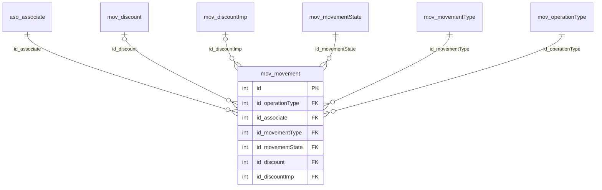

# mov.movement

## Descripción

Movimientos (transacciones) de los asociados.

**Módulo**: Movimientos  
**Nombre en base de datos**: `[mov].[movement]`

## Estructura de la Tabla

| Columna | Tipo | Nulo | Clave | Default | Descripción |
|---------|------|------|-------|---------|-------------|
| name | NVARCHAR(500) | ✓ | - | - | - |
| concept | NVARCHAR(200) | ✗ | - | - | - |
| id_operationType | INT | ✗ | FK | - | Referencia a mov.operationType |
| id_associate | INT | ✗ | FK | - | Referencia a aso.associate |
| id_movementType | INT | ✗ | FK | - | Referencia a mov.movementType |
| date | DATETIME2(0) | ✗ | - | - | - |
| amount | INT | ✗ | - | - | - |
| referenceDocument | NVARCHAR(50) | ✓ | - | - | - |
| id_movementState | INT | ✗ | FK | - | Referencia a mov.movementState |
| amountToReconcile | INT | ✓ | - | - | - |
| id_discount | INT | ✓ | FK | - | Referencia a mov.discount |
| id_discountImp | INT | ✓ | FK | - | Referencia a mov.discountImp |
| creationDate | DATETIME2(0) | ✓ | - | - | - |
| user | NVARCHAR(20) | ✓ | - | - | - |

### Columnas Estándar

| Columna | Tipo | Nulo | Descripción |
|---------|------|------|-------------|
| id | INT | ✗ | Clave primaria auto-incremental |
| uid | NVARCHAR(500) | ✗ | Control multiempresa (User ID) |
| eid | NVARCHAR(50) | ✗ | Control multiempresa (Entity ID) |
| id_user_creator | INT | ✓ | Usuario que creó el registro |
| id_user_modifier | INT | ✓ | Usuario que modificó el registro por última vez |
| dateCreation | DATETIME2(0) | ✓ | Fecha y hora de creación |
| dateModification | DATETIME2(0) | ✓ | Fecha y hora de última modificación |
| isActive | BIT | ✗ | Registro activo (borrado lógico) |
| isWebCreated | BIT | ✗ | Creado desde la web (legado: CreaWeb) |
| isWebUpdated | BIT | ✗ | Actualizado desde la web (legado: ActuWeb) |

## Diagrama ER

Tabla y sus relaciones directas (sin las columnas de auditoría).

## Relaciones

### Relaciones Salientes (Foreign Keys)

| Columna | Referencia | Constraint |
|---------|------------|------------|
| id_associate | [`aso.associate`](../aso/associate.md).id | `FK__mov__movement__id_associate` |
| id_discount | [`mov.discount`](../mov/discount.md).id | `FK__mov__movement__id_discount` |
| id_discountImp | [`mov.discountImp`](../mov/discount-imp.md).id | `FK__mov__movement__id_discountImp` |
| id_movementState | [`mov.movementState`](../mov/movement-state.md).id | `FK__mov__movement__id_movementState` |
| id_movementType | [`mov.movementType`](../mov/movement-type.md).id | `FK__mov__movement__id_movementType` |
| id_operationType | [`mov.operationType`](../mov/operation-type.md).id | `FK__mov__movement__id_operationType` |

### Relaciones Entrantes

*Ninguna tabla referencia a esta tabla.*

## Objetos Relacionados

| Objeto | Tipo |
|--------|------|
| `mov.movement_act` | Procedimiento |
| `mov.movement_ins_bulk` | Procedimiento |
| `mov.movement_sel` | Procedimiento |
| `mov.movement_sel_by_idAssociate` | Procedimiento |
| `mov.movement_typ` | Tipo tabla |
| `mov.movement_upd_bulk` | Procedimiento |
| `mov.movement_view` | Vista |
| `mov.movement_view_base` | Vista |

---

**Nota**: Documentación generada desde el esquema real de la base de datos `pro_safe` con la skill `data-dictionary` (IDAE.ClaudeConfig).
