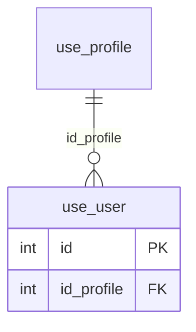

# use.user

## Descripción

Usuarios de la plataforma.

**Módulo**: Usuarios  
**Nombre en base de datos**: `[use].[user]`

## Estructura de la Tabla

| Columna | Tipo | Nulo | Clave | Default | Descripción |
|---------|------|------|-------|---------|-------------|
| name | NVARCHAR(500) | ✓ | - | - | - |
| login | NVARCHAR(20) | ✗ | - | - | - |
| password | NVARCHAR(500) | ✗ | - | - | - |
| email | NVARCHAR(50) | ✓ | - | - | - |
| phone | NVARCHAR(20) | ✓ | - | - | - |
| id_profile | INT | ✗ | FK | - | Referencia a use.profile |

### Columnas Estándar

| Columna | Tipo | Nulo | Descripción |
|---------|------|------|-------------|
| id | INT | ✗ | Clave primaria auto-incremental |
| uid | NVARCHAR(500) | ✗ | Control multiempresa (User ID) |
| eid | NVARCHAR(50) | ✗ | Control multiempresa (Entity ID) |
| id_user_creator | INT | ✓ | Usuario que creó el registro |
| id_user_modifier | INT | ✓ | Usuario que modificó el registro por última vez |
| dateCreation | DATETIME2(0) | ✓ | Fecha y hora de creación |
| dateModification | DATETIME2(0) | ✓ | Fecha y hora de última modificación |
| isActive | BIT | ✗ | Registro activo (borrado lógico) |

## Diagrama ER

Tabla y sus relaciones directas (sin las columnas de auditoría).

## Relaciones

### Relaciones Salientes (Foreign Keys)

| Columna | Referencia | Constraint |
|---------|------------|------------|
| id_profile | [`use.profile`](../use/profile.md).id | `FK__use__user__id_profile` |

### Relaciones Entrantes

| Tabla | Columna | Constraint |
|-------|---------|------------|
| [`aso.academicLevel`](../aso/academic-level.md) | id_user_creator | `FK__aso__academicLevel__id_user_creator` |
| [`aso.academicLevel`](../aso/academic-level.md) | id_user_modifier | `FK__aso__academicLevel__id_user_modifier` |
| [`aso.associate`](../aso/associate.md) | id_user_creator | `FK__aso__associate__id_user_creator` |
| [`aso.associate`](../aso/associate.md) | id_user_modifier | `FK__aso__associate__id_user_modifier` |
| [`aso.bank`](../aso/bank.md) | id_user_creator | `FK__aso__bank__id_user_creator` |
| [`aso.bank`](../aso/bank.md) | id_user_modifier | `FK__aso__bank__id_user_modifier` |
| [`aso.contractType`](../aso/contract-type.md) | id_user_creator | `FK__aso__contractType__id_user_creator` |
| [`aso.contractType`](../aso/contract-type.md) | id_user_modifier | `FK__aso__contractType__id_user_modifier` |
| [`aso.eps`](../aso/eps.md) | id_user_creator | `FK__aso__eps__id_user_creator` |
| [`aso.eps`](../aso/eps.md) | id_user_modifier | `FK__aso__eps__id_user_modifier` |
| [`aso.gender`](../aso/gender.md) | id_user_creator | `FK__aso__gender__id_user_creator` |
| [`aso.gender`](../aso/gender.md) | id_user_modifier | `FK__aso__gender__id_user_modifier` |
| [`aso.housingType`](../aso/housing-type.md) | id_user_creator | `FK__aso__housingType__id_user_creator` |
| [`aso.housingType`](../aso/housing-type.md) | id_user_modifier | `FK__aso__housingType__id_user_modifier` |
| [`aso.maritalStatus`](../aso/marital-status.md) | id_user_creator | `FK__aso__maritalStatus__id_user_creator` |
| [`aso.maritalStatus`](../aso/marital-status.md) | id_user_modifier | `FK__aso__maritalStatus__id_user_modifier` |
| [`aso.payrollType`](../aso/payroll-type.md) | id_user_creator | `FK__aso__payrollType__id_user_creator` |
| [`aso.payrollType`](../aso/payroll-type.md) | id_user_modifier | `FK__aso__payrollType__id_user_modifier` |
| [`aso.pensionFund`](../aso/pension-fund.md) | id_user_creator | `FK__aso__pensionFund__id_user_creator` |
| [`aso.pensionFund`](../aso/pension-fund.md) | id_user_modifier | `FK__aso__pensionFund__id_user_modifier` |
| [`aso.position`](../aso/position.md) | id_user_creator | `FK__aso__position__id_user_creator` |
| [`aso.position`](../aso/position.md) | id_user_modifier | `FK__aso__position__id_user_modifier` |
| [`aso.state`](../aso/state.md) | id_user_creator | `FK__aso__state__id_user_creator` |
| [`aso.state`](../aso/state.md) | id_user_modifier | `FK__aso__state__id_user_modifier` |
| [`com.area`](../com/area.md) | id_user_creator | `FK__com__area__id_user_creator` |
| [`com.area`](../com/area.md) | id_user_modifier | `FK__com__area__id_user_modifier` |
| [`com.city`](../com/city.md) | id_user_creator | `FK__com__city__id_user_creator` |
| [`com.city`](../com/city.md) | id_user_modifier | `FK__com__city__id_user_modifier` |
| [`com.company`](../com/company.md) | id_user_creator | `FK__com__company__id_user_creator` |
| [`com.company`](../com/company.md) | id_user_modifier | `FK__com__company__id_user_modifier` |
| [`com.group`](../com/group.md) | id_user_creator | `FK__com__group__id_user_creator` |
| [`com.group`](../com/group.md) | id_user_modifier | `FK__com__group__id_user_modifier` |
| [`cre.creditLine`](../cre/credit-line.md) | id_user_creator | `FK__cre__creditLine__id_user_creator` |
| [`cre.creditLine`](../cre/credit-line.md) | id_user_modifier | `FK__cre__creditLine__id_user_modifier` |
| [`cre.interestRateType`](../cre/interest-rate-type.md) | id_user_creator | `FK__cre__interestRateType__id_user_creator` |
| [`cre.interestRateType`](../cre/interest-rate-type.md) | id_user_modifier | `FK__cre__interestRateType__id_user_modifier` |
| [`cre.loan`](../cre/loan.md) | id_user_creator | `FK__cre__loan__id_user_creator` |
| [`cre.loan`](../cre/loan.md) | id_user_modifier | `FK__cre__loan__id_user_modifier` |
| [`cre.loanPurpose`](../cre/loan-purpose.md) | id_user_creator | `FK__cre__loanPurpose__id_user_creator` |
| [`cre.loanPurpose`](../cre/loan-purpose.md) | id_user_modifier | `FK__cre__loanPurpose__id_user_modifier` |
| [`cre.loanState`](../cre/loan-state.md) | id_user_creator | `FK__cre__loanState__id_user_creator` |
| [`cre.loanState`](../cre/loan-state.md) | id_user_modifier | `FK__cre__loanState__id_user_modifier` |
| [`cre.paymentType`](../cre/payment-type.md) | id_user_creator | `FK__cre__paymentType__id_user_creator` |
| [`cre.paymentType`](../cre/payment-type.md) | id_user_modifier | `FK__cre__paymentType__id_user_modifier` |
| [`mov.associateOtherDiscount`](../mov/associate-other-discount.md) | id_user_creator | `FK__mov__associateOtherDiscount__id_user_creator` |
| [`mov.associateOtherDiscount`](../mov/associate-other-discount.md) | id_user_modifier | `FK__mov__associateOtherDiscount__id_user_modifier` |
| [`mov.discount`](../mov/discount.md) | id_user_creator | `FK__mov__discount__id_user_creator` |
| [`mov.discount`](../mov/discount.md) | id_user_modifier | `FK__mov__discount__id_user_modifier` |
| [`mov.discountImp`](../mov/discount-imp.md) | id_user_creator | `FK__mov__discountImp__id_user_creator` |
| [`mov.discountImp`](../mov/discount-imp.md) | id_user_modifier | `FK__mov__discountImp__id_user_modifier` |
| [`mov.movement`](../mov/movement.md) | id_user_creator | `FK__mov__movement__id_user_creator` |
| [`mov.movement`](../mov/movement.md) | id_user_modifier | `FK__mov__movement__id_user_modifier` |
| [`mov.movementState`](../mov/movement-state.md) | id_user_creator | `FK__mov__movementState__id_user_creator` |
| [`mov.movementState`](../mov/movement-state.md) | id_user_modifier | `FK__mov__movementState__id_user_modifier` |
| [`mov.movementType`](../mov/movement-type.md) | id_user_creator | `FK__mov__movementType__id_user_creator` |
| [`mov.movementType`](../mov/movement-type.md) | id_user_modifier | `FK__mov__movementType__id_user_modifier` |
| [`mov.operationType`](../mov/operation-type.md) | id_user_creator | `FK__mov__operationType__id_user_creator` |
| [`mov.operationType`](../mov/operation-type.md) | id_user_modifier | `FK__mov__operationType__id_user_modifier` |
| [`mov.otherDiscount`](../mov/other-discount.md) | id_user_creator | `FK__mov__otherDiscount__id_user_creator` |
| [`mov.otherDiscount`](../mov/other-discount.md) | id_user_modifier | `FK__mov__otherDiscount__id_user_modifier` |
| [`use.profile`](../use/profile.md) | id_user_creator | `FK__use__profile__id_user_creator` |
| [`use.profile`](../use/profile.md) | id_user_modifier | `FK__use__profile__id_user_modifier` |
| [`use.user`](../use/user.md) | id_user_creator | `FK__use__user__id_user_creator` |
| [`use.user`](../use/user.md) | id_user_modifier | `FK__use__user__id_user_modifier` |

## Objetos Relacionados

| Objeto | Tipo |
|--------|------|
| `use.user_act` | Procedimiento |
| `use.user_ins_bulk` | Procedimiento |
| `use.user_sel` | Procedimiento |
| `use.user_typ` | Tipo tabla |
| `use.user_upd_bulk` | Procedimiento |
| `use.user_view` | Vista |
| `use.user_view_base` | Vista |

---

**Nota**: Documentación generada desde el esquema real de la base de datos `pro_safe` con la skill `data-dictionary` (IDAE.ClaudeConfig).
