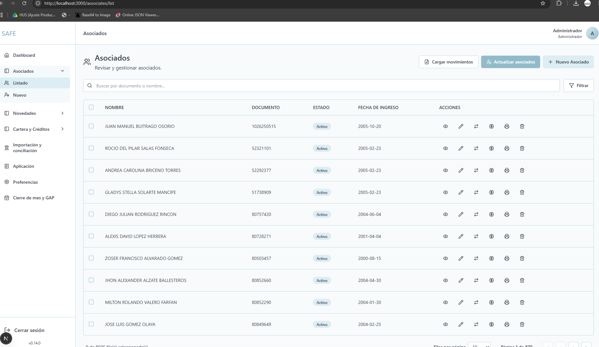
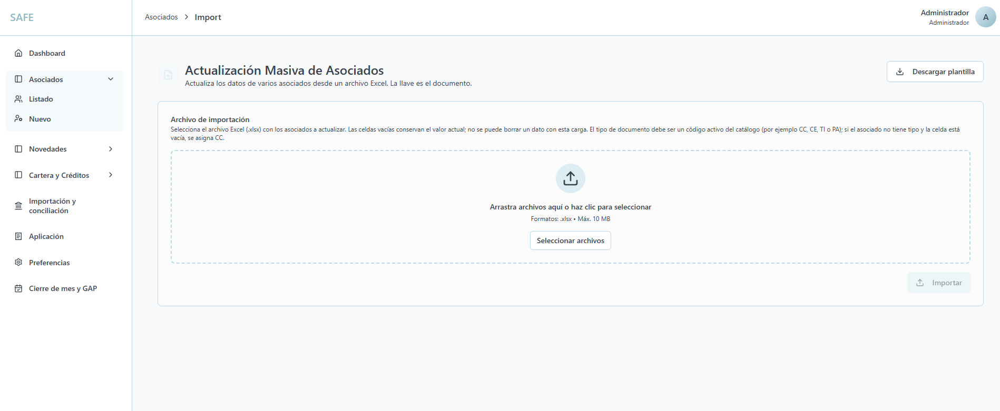
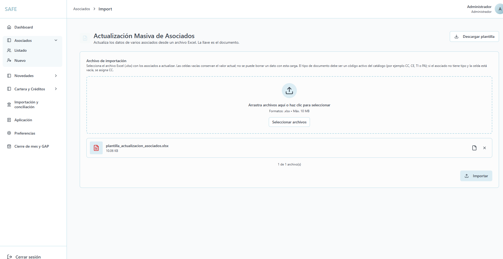
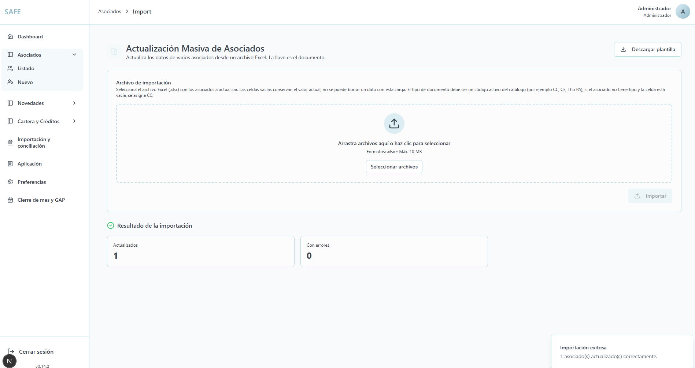

# Catálogo de Tipos de Documento

Este documento describe el catálogo **Tipo de Documento** de SAFE. Los tipos de documento de los asociados (CC, CE, TI, PA…) dejan de estar fijos en la aplicación y se administran desde **Preferencias**. El formulario, el detalle y el filtro avanzado de asociados usan este catálogo, de modo que un tipo nuevo queda disponible en toda la aplicación sin cambios de código.

## Referencias

- [SO-2282: Administrar el tipo de documento como catálogo y usarlo en asociados](https://softwaresamm.atlassian.net/browse/SO-2282)
- [SO-2289: Asignar el tipo de documento del catálogo al importar asociados desde Excel](https://softwaresamm.atlassian.net/browse/SO-2289)
- Diccionario de datos: [`aso.documentType`](./database/aso/document-type.md) y [`aso.associate`](./database/aso/associate.md)

## Información de Versiones

### Versión de Lanzamiento

:::info **FEB V.0.15.0**
:::

### Versiones Requeridas

| Aplicación      | Versión Mínima                    | Descripción                                             |
| --------------- | --------------------------------- | ------------------------------------------------------- |
| SAFE DBObjects  | `Migration/34_documentType.sql`   | Tabla del catálogo y enlace de los asociados existentes |
| SAFE            | >= v0.15.0                        | Plataforma SAFE (frontend y API)                        |

## Requisitos Previos

Antes de usar la funcionalidad, asegúrese de tener:

- Los objetos de base de datos de SO-2282 desplegados (tabla, tipo, procedimientos y vistas de `aso.documentType` y `aso.associate`)
- La migración `Migration/34_documentType.sql` ejecutada después de `17_associate.sql`
- Un usuario autorizado para ingresar a **Preferencias**

## Configuración

### Paso 1: Desplegar la base de datos y ejecutar la migración

Despliegue en este orden: **DBObjects → Backend → FrontendWeb**. La migración `Migration/34_documentType.sql`:

1. Crea los tipos base con identificadores fijos: `1` CC (Cédula de Ciudadanía), `2` CE (Cédula de Extranjería), `3` TI (Tarjeta de Identidad) y `4` PA (Pasaporte).
2. Agrega al catálogo cualquier otro código que ya usen los asociados (con el código como nombre), para que ningún asociado pierda su tipo.
3. Enlaza cada asociado al catálogo según el código de texto que tenía.
4. Asigna **CC** a los asociados que no tenían tipo de documento.

### Paso 2: Administrar el catálogo

1. Ingrese a **Preferencias > Catálogos de Configuración General > Tipo de Documento**.
2. Cree, edite o inactive tipos de documento con los campos **Código** y **Nombre** (ambos obligatorios).

:::warning Código único
El código del tipo de documento es único entre los registros activos. Si intenta repetirlo, se muestra: *"Ya existe un tipo de documento con este código. El código del tipo de documento es único."*
:::

### Paso 3: Usar el tipo de documento en asociados

| Pantalla                                  | Uso                                                        |
| ----------------------------------------- | ---------------------------------------------------------- |
| **Asociados > Nuevo / Editar**            | Campo **Tipo de Documento**, con los tipos del catálogo; un asociado nuevo inicia en CC |
| **Asociados > Detalle**                   | Muestra el nombre del tipo de documento del catálogo       |
| **Asociados > Listado > Filtro avanzado** | Filtro **Tipo de documento**                               |
| **Asociados > Actualización Masiva** (Excel) | Columna **Tipo Documento** con el código del catálogo (ver Paso 4) |

### Paso 4: Actualizar el tipo de documento por Excel

La **Actualización Masiva de Asociados** (`/associates/import`) actualiza asociados existentes, ubicados por número de documento.

1. En **Asociados > Listado**, haga clic en **Actualizar asociados**.

   

2. Haga clic en **Descargar plantilla**. La indicación de la pantalla resume las reglas del tipo de documento.

   

3. Diligencie la plantilla, selecciónela y haga clic en **Importar**.

   

4. Revise el **Resultado de la importación**: asociados actualizados y filas con errores.

   

En la columna **Tipo Documento** de la plantilla:

1. Escriba el **código** de un tipo de documento activo del catálogo (p. ej. `CC`, `CE`, `TI`, `PA`). No importan mayúsculas ni espacios alrededor: ` ce ` se guarda como `CE`.
2. Si deja la celda vacía, el asociado conserva su tipo de documento actual.
3. Si el código no existe o está inactivo, la fila se rechaza y el error se muestra en los resultados de la carga, en la columna **Tipo Documento**.

:::note
La carga nunca crea tipos de documento nuevos: créelos primero en **Preferencias > Tipo de Documento**.
:::

## Casos Especiales

:::note Comportamientos Predefinidos
Se conserva la columna de texto `aso.associate.documentType` con el código del tipo (por compatibilidad); al elegir un tipo en el formulario se actualizan el enlace y el código.
:::

| Caso                                   | Resultado                                                                 |
| -------------------------------------- | ------------------------------------------------------------------------- |
| Asociado sin tipo antes de la migración | Queda como **CC**                                                        |
| Asociado con un código fuera de los tipos base | Se crea ese código en el catálogo y el asociado queda enlazado    |
| Celda **Tipo Documento** vacía en la carga por Excel | El asociado conserva su tipo; si no tiene ninguno, queda como **CC** |
| Código inexistente o inactivo en la carga por Excel | La fila se rechaza: *"El tipo de documento 'XX' no existe o está inactivo en el catálogo de tipos de documento"* |

## Resultado Esperado

Una vez desplegada la funcionalidad:

1. **Catálogo administrable**: el tipo de documento se gestiona en Preferencias como los demás catálogos.
2. **Asociados enlazados**: todos los asociados tienen un tipo de documento del catálogo.
3. **Filtro por tipo**: el listado de asociados permite filtrar por tipo de documento.

## Resolución de Problemas

### Un tipo de documento no aparece en el formulario

Verifique que:

- El tipo de documento esté activo en **Preferencias > Tipo de Documento**
- Se haya recargado la pantalla después de crearlo

### La carga por Excel rechaza la fila por el tipo de documento

Verifique que el valor de la columna **Tipo Documento** sea el **código** (no el nombre) de un tipo activo en **Preferencias > Tipo de Documento**.

### Un asociado aparece sin tipo de documento

Verifique que la migración `Migration/34_documentType.sql` se haya ejecutado en la base de datos del ambiente.
