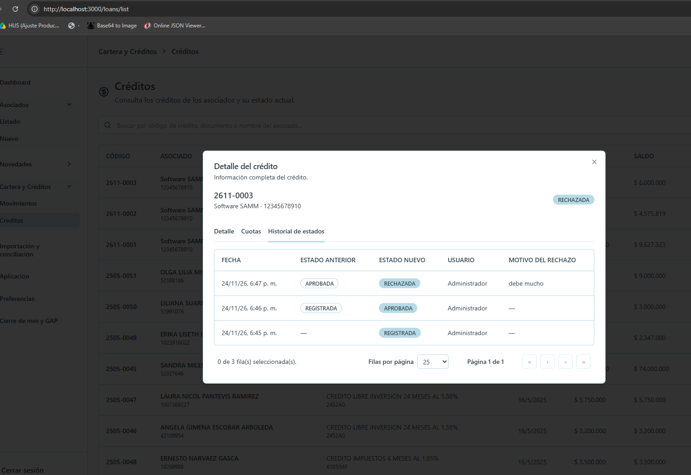

# Consultar el Historial de Cambios de Estado de los Créditos

Este documento describe el historial de cambios de estado de los créditos. Cada vez que un crédito cambia de estado, SAFE registra el estado anterior, el estado nuevo, la fecha y hora del cambio, el usuario que lo realizó y, si el cambio fue a RECHAZADA, el motivo del rechazo. El historial se consulta desde el detalle del crédito y permite auditar su ciclo de vida sin consultar la base de datos.

## Referencias

- [SO-2280: Registrar y consultar el historial de cambios de estado de los créditos](https://softwaresamm.atlassian.net/browse/SO-2280)
- [SO-2279: Permitir pagar cuotas de créditos del asociado al registrar movimientos](https://softwaresamm.atlassian.net/browse/SO-2279) (registra el paso automático a FINALIZADA)

## Información de Versiones

### Versión de Lanzamiento

:::info **FEB V.0.15.0**
:::

### Versiones Requeridas

| Aplicación    | Versión Mínima | Descripción                                             |
| ------------- | -------------- | ------------------------------------------------------- |
| SAFE          | >= v0.15.0     | Plataforma SAFE (frontend y API)                        |
| BASE DE DATOS | SO-2280        | Tabla `cre.loanStateHistory` con su tipo, SP y vistas   |

## Requisitos Previos

Antes de usar la funcionalidad, asegúrese de tener:

- La aplicación y la base de datos actualizadas a las versiones indicadas en la tabla anterior
- Un usuario autorizado para ingresar a la plataforma

:::important Importante
El historial empieza a registrarse desde la actualización. Los créditos creados o modificados antes no tienen historial: el aplicativo anterior no guardaba los cambios de estado, por lo que no hay información que migrar.
:::

## Configuración

### Paso 1: Actualizar la base de datos

Ejecute, en este orden, los scripts de `cre.loanStateHistory` del repositorio `IDAE.SAFE.DBObjects`:

```sql title="Orden de ejecución de los objetos de cre.loanStateHistory"
-- 1. Tables/cre.loanStateHistory/DDL/Create.sql
-- 2. Tables/cre.loanStateHistory/DDL/Alter.sql
-- 3. Types/cre.loanStateHistory/cre.loanStateHistory_typ.sql
-- 4. StoredProcedures/cre.loanStateHistory: _ins_bulk, _upd_bulk, _act
-- 5. Views/cre.loanStateHistory: _view, _view_base
-- 6. StoredProcedures/cre.loanStateHistory: _sel, _sel_by_idLoan
```

:::note Información
El detalle de las columnas y relaciones está en el diccionario de datos: [cre.loanStateHistory](./database/cre/loan-state-history.md).
:::

### Paso 2: Consultar el historial

1. Ingrese a **Cartera y Créditos > Créditos** y abra el detalle del crédito.
2. Seleccione la pestaña **Historial de estados**.

## Casos Especiales

:::note Comportamientos Predefinidos
El historial se registra automáticamente en la misma operación que cambia el estado: si el cambio de estado falla, no queda registro, y viceversa.
:::

| Caso                                  | Estado anterior → nuevo        | Descripción                                                                 |
| ------------------------------------- | ------------------------------ | --------------------------------------------------------------------------- |
| Creación del crédito                  | — → REGISTRADA                 | Primer registro del historial; no hay estado anterior                       |
| Cambio de estado manual               | Estado actual → estado elegido | Desde la acción de cambiar estado en el listado de créditos                 |
| Rechazo                               | Estado actual → RECHAZADA      | Se guarda el motivo del rechazo                                             |
| Pago de la última cuota               | EN PROCESO → FINALIZADA        | Al pagar la última cuota pendiente desde Movimientos; la fecha es la hora en que se aplica el pago |

## Resultado Esperado

Una vez actualizada la aplicación:

1. **Registro automático**: cada cambio de estado de un crédito queda registrado con estado anterior, estado nuevo, fecha y hora, y usuario.
2. **Consulta en el detalle**: la pestaña **Historial de estados** del detalle del crédito muestra los cambios del más reciente al más antiguo.
3. **Motivo de rechazo**: los cambios a RECHAZADA muestran el motivo registrado.

### Pestaña Historial de estados



## Resolución de Problemas

### El historial del crédito aparece vacío

Verifique que:

- El crédito haya cambiado de estado después de la actualización (los créditos anteriores no tienen historial)
- Los objetos de base de datos de `cre.loanStateHistory` estén creados

### Un cambio de estado no aparece en el historial

Confirme que el cambio se hizo desde la aplicación (acción de cambiar estado, creación del crédito o pago de cuotas). Los cambios hechos directamente en la base de datos no se registran.
