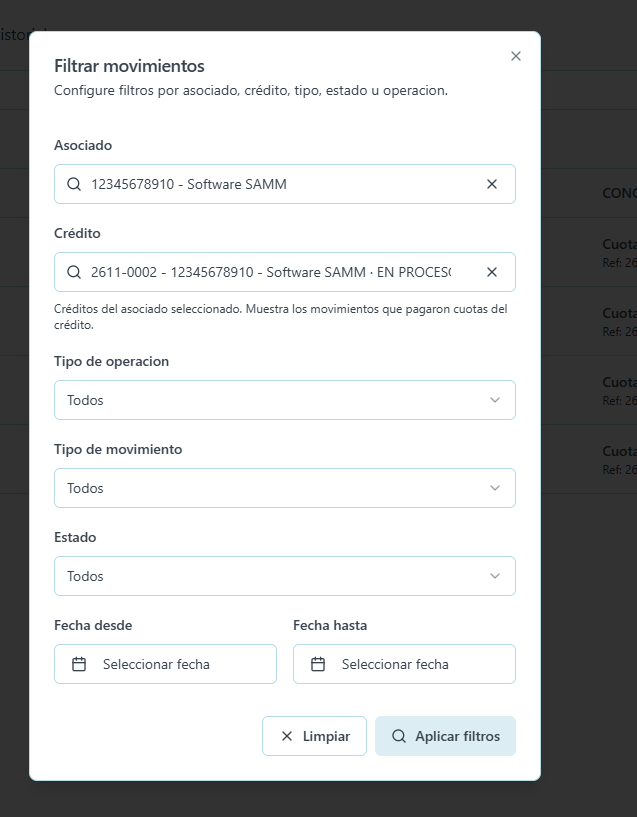

# Buscar y Filtrar Movimientos

Este documento describe el buscador y el filtro avanzado del listado de movimientos de SAFE. El buscador encuentra movimientos por concepto, referencia o asociado, y el filtro avanzado permite consultar los movimientos de un crédito, buscándolo por su código, solo o combinado con el asociado.

## Referencias

- [SO-2286: Corregir el buscador de movimientos y filtrar movimientos por crédito](https://softwaresamm.atlassian.net/browse/SO-2286)
- Guías relacionadas: [Buscar Asociados por Documento y Nombre](./associate-search.md), [Pagar cuotas de créditos desde un movimiento](./loan-installment-payment.md)
- Diccionario de datos: [`mov.movement`](./database/mov/movement.md)

## Información de Versiones

### Versión de Lanzamiento

:::info **FEB V.0.15.0**
:::

### Versiones Requeridas

| Aplicación | Versión Mínima | Descripción                      |
| ---------- | -------------- | -------------------------------- |
| SAFE       | >= v0.15.0     | Plataforma SAFE (frontend y API) |

## Requisitos Previos

Antes de usar la funcionalidad, asegúrese de tener:

- La aplicación actualizada a la versión mínima indicada en la tabla anterior (primero la API y luego el frontend)
- Un usuario autorizado para consultar movimientos

## Configuración

### Paso 1: Actualizar la aplicación

Esta funcionalidad no requiere cambios en la base de datos. Despliegue primero el backend y luego el frontend.

### Paso 2: Buscar movimientos

En **Cartera y Créditos > Movimientos**, escriba en el buscador parte del **concepto**, la **referencia**, el **documento** o el **nombre** del asociado. Cada palabra escrita debe aparecer en alguno de esos datos, en cualquier orden y sin importar mayúsculas ni tildes.

| Ejemplo de búsqueda | Resultado                                                              |
| ------------------- | ---------------------------------------------------------------------- |
| `consign`           | Movimientos cuyo concepto contiene "consign"                           |
| `41460469`          | Movimientos del asociado con ese documento                             |
| `vargas luz`        | Movimientos del asociado cuyo nombre contiene ambas palabras           |
| `consign vargas`    | Movimientos de ese asociado con "consign" en el concepto               |

Los resultados se muestran del movimiento más reciente al más antiguo.

### Paso 3: Filtrar por crédito

1. Haga clic en **Filtrar**.
2. En **Crédito**, escriba al menos 3 caracteres del código del crédito (por ejemplo `2611-00`) y elija el crédito. Cada opción muestra el código, el documento y nombre del asociado y el estado del crédito.
3. Opcionalmente elija el **Asociado**: en ese caso el campo **Crédito** sugiere solo los créditos de ese asociado.
4. Combine, si lo requiere, con el tipo de operación, tipo de movimiento, estado y fechas, y haga clic en **Aplicar filtros**.

El listado muestra los movimientos que pagaron cuotas del crédito (cuota capital, cuota interés y, si aplica, el traslado de ahorros) y una etiqueta **Crédito: código** que se puede quitar.

## Casos Especiales

:::note Comportamientos Predefinidos
Solo los movimientos generados al pagar cuotas desde **Nuevo movimiento** quedan asociados a un crédito; los movimientos anteriores no aparecen en el filtro por crédito.
:::

| Caso                                        | Resultado                                                          |
| ------------------------------------------- | ------------------------------------------------------------------ |
| Crédito elegido sin asociado                | Se filtra solo por el crédito                                      |
| Se cambia o se quita el asociado            | Se quita también el crédito elegido                                |
| Se quita la etiqueta del crédito            | Se conserva el filtro por asociado                                 |

## Resultado Esperado

Una vez actualizada la aplicación:

1. **Buscador funcional**: encuentra por concepto, referencia, documento o nombre del asociado.
2. **Filtro por crédito**: muestra los movimientos que pagaron cuotas de un crédito, buscándolo por su código.
3. **Filtros combinados**: la búsqueda, el asociado, el crédito y los demás filtros se aplican juntos.

## Resolución de Problemas

### El filtro por crédito no muestra movimientos

Verifique que el crédito tenga cuotas pagadas desde **Nuevo movimiento**; los movimientos registrados de otra forma no quedan enlazados al crédito.

### No aparece el crédito en el campo Crédito

Verifique que escribió al menos 3 caracteres del código y, si eligió un asociado, que el crédito sea de ese asociado.
