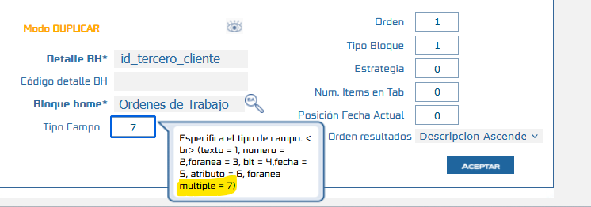
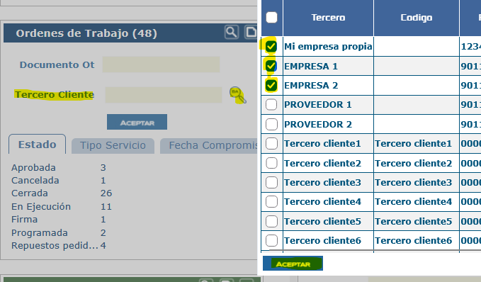

# Búsqueda Múltiple en Bloques Home

Este documento describe cómo configurar la búsqueda múltiple en los Bloques Home (BH) de SAMM New, permitiendo seleccionar varios registros en un mismo filtro. Antes, los filtros de los BH solo permitían buscar un registro a la vez: por ejemplo, el filtro de tercero admitía un único tercero y el filtro de zona una única zona. Ahora, mediante el nuevo tipo de campo `7` en el detalle del BH, se habilita un buscador con selección de múltiples registros.

## Referencias

- [SO-2217: Habilitar filtro de selección múltiple en los Bloques Home](https://softwaresamm.atlassian.net/browse/SO-2217)

## Información de Versiones

### Versión de Lanzamiento

:::info **v7.1.22.1**
:::

### Versiones Requeridas

| Aplicación    | Versión Mínima | Descripción       |
| ------------- | -------------- | ----------------- |
| SAMMNEW       | >= 7.1.22.1    | Aplicación web    |
| SAMMAPI       | >= 1.2.34.5    | API principal     |
| SAMM LOGICA   | >= 5.6.28.0    | Lógica de negocio |
| CAPA DATOS    | >= 2.1.21.1    | Capa de datos     |
| SAMM CORE     | >= 2.0.29.1    | Core del sistema  |
| BASE DE DATOS | >= C2.1.21.1   | Base de datos     |

## Requisitos Previos

Antes de iniciar la configuración, asegúrese de tener:

- Acceso al menú **Avanzado** > **Detalle Bloque Home** en SAMM New
- Un Bloque Home existente con al menos un filtro de búsqueda configurado en su detalle
- Todas las aplicaciones actualizadas a las versiones mínimas indicadas

:::important Importante
La búsqueda múltiple solo está disponible si todas las aplicaciones cumplen las versiones mínimas. Con versiones anteriores, el tipo de campo `7` no será reconocido.
:::

## Información del Servicio

No aplica para esta funcionalidad.

## Configuración

### Paso 1: Configurar el detalle del Bloque Home

Ingrese al menú **Avanzado** > **Detalle Bloque Home** y ubique el filtro que desea convertir en búsqueda múltiple (por ejemplo, tercero o zona). En la columna **Tipo campo** de ese filtro, coloque el valor `7`.

Una vez guardado el cambio, el filtro del Bloque Home mostrará un buscador que permite seleccionar varios registros a la vez.

:::tip Consejo
Puede aplicar el tipo de campo `7` a cada filtro del Bloque Home que requiera selección múltiple; los demás filtros conservan su comportamiento de selección única.
:::

## Casos Especiales

No aplica para esta funcionalidad.

## Resultado Esperado

Una vez completada la configuración:

1. **Filtro con selección múltiple**: El filtro configurado con tipo de campo `7` muestra un buscador que permite seleccionar varios registros.
2. **Filtrado por varios registros**: Al seleccionar más de un registro, el Bloque Home muestra la información correspondiente a todos los registros elegidos.
3. **Filtros restantes sin cambios**: Los filtros que no fueron configurados con el tipo de campo `7` mantienen su comportamiento de selección única.

### Visualización en el Bloque Home

## Resolución de Problemas

### El filtro no muestra la selección múltiple

Verifique que:

- El valor de **Tipo campo** del filtro sea exactamente `7`
- Los cambios en el detalle del Bloque Home hayan sido guardados
- Se esté editando el detalle del Bloque Home correcto
- Se haya recargado la página del Bloque Home después de guardar

### El tipo de campo 7 no es reconocido

Confirme que:

- Todas las aplicaciones cumplan las versiones mínimas indicadas en la sección **Versiones Requeridas**
- La base de datos esté actualizada a la versión `C2.1.21.1` o superior

### El Bloque Home no muestra resultados al seleccionar varios registros

Revise que:

- Los registros seleccionados tengan información asociada al Bloque Home
- Los demás filtros activos no estén limitando el resultado
- El filtro esté configurado sobre el campo correcto en el detalle del Bloque Home

## Errores Conocidos

No aplica para esta funcionalidad.

## QA — Pruebas

### Escenario 1: Configuración de un filtro con búsqueda múltiple

1. Ingrese a **Avanzado** > **Detalle Bloque Home**.
2. Seleccione el detalle de un Bloque Home con un filtro de tercero o zona.
3. Coloque el valor `7` en **Tipo campo** y guarde.
4. Ingrese al Bloque Home y recargue la página.

**Resultado esperado**: el filtro permite seleccionar varios registros a la vez.

### Escenario 2: Filtrado con varios registros seleccionados

1. Ingrese al Bloque Home configurado en el escenario anterior.
2. Seleccione al menos dos registros en el filtro de búsqueda múltiple.
3. Aplique el filtro.

**Resultado esperado**: el Bloque Home muestra la información correspondiente a todos los registros seleccionados.

### Escenario 3: Filtros de selección única no afectados

1. En el mismo Bloque Home, identifique un filtro que no tenga tipo de campo `7`.
2. Intente seleccionar más de un registro en ese filtro.

**Resultado esperado**: el filtro mantiene su comportamiento de selección única.