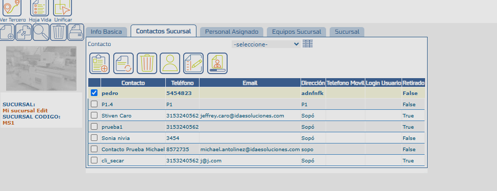

# Tab Contactos de la Sucursal

Este documento describe cómo usar el tab **Contactos Sucursal** del formulario de sucursales (`ter_sucursal`) para vincular, editar, desvincular contactos y crear usuarios de acceso, y cómo se habilitan los botones de acción según los contactos marcados.

## Referencias

- [SO-2274: SOL-30272 | Migrar las funcionalidades de las acciones de Tab Contactos de los tercero al Tab Contactos de la sucursales](https://softwaresamm.atlassian.net/browse/SO-2274)

## Información de Versiones

### Versión de Lanzamiento

:::info **v7.1.26.0 (provisional)**
:::

### Versiones Requeridas

| Aplicación | Versión Mínima       | Descripción              |
| ---------- | -------------------- | ------------------------ |
| SAMMNEW    | >= 7.1.26.0          | Aplicación web principal |

:::important Importante
La versión de lanzamiento es provisional hasta que el ticket se asocie a una fix version.
:::

## Requisitos Previos

Antes de usar el tab, asegúrese de tener:

- Una sucursal guardada y seleccionada en la grilla principal del formulario
- Contactos creados en el tercero al que pertenece la sucursal
- Los permisos de la tabla de abajo, según la acción que necesite

### Permisos

| Funcionalidad SAMM (`ter_contacto`) | Qué habilita                                       |
| ----------------------------------- | -------------------------------------------------- |
| `crear`                             | Botón de crear un contacto nuevo                   |
| `editar`                            | Botón de editar el contacto                        |
| `eliminar`                          | Botón de quitar el contacto de la sucursal         |
| `crearUsuario` (barra de herramientas) | Botón de crear usuario del contacto             |
| `ter_actMasiva`                     | Botón de actualización masiva de contactos         |

## Configuración

### Paso 1: Vincular un contacto a la sucursal

1. Seleccione el contacto en la lista desplegable **Contacto**.
2. Presione el botón de agregar (icono de selección de grilla).

La lista solo muestra contactos del tercero que aún no están vinculados a la sucursal y que no tienen usuario, o cuyo usuario es de perfil cliente.

### Paso 2: Seleccionar contactos en la grilla

Marque la casilla de la fila del contacto, o haga click sobre la fila.

:::note Habilitación de botones
**Editar**, **Crear usuario** y **Quitar** se habilitan solo cuando hay **exactamente un** contacto marcado. Con ninguno o con varios marcados quedan deshabilitados. **Actualización masiva** sí admite varios contactos marcados.
:::

### Paso 3: Ejecutar la acción

| Botón                 | Comportamiento                                                                                              |
| --------------------- | ----------------------------------------------------------------------------------------------------------- |
| Nuevo contacto        | Abre el formulario de contacto con el tercero y la sucursal actuales.                                       |
| Actualizar            | Recarga la grilla de contactos.                                                                             |
| Quitar                | Desvincula el contacto de la sucursal (`ter_contacto_sucursal.active = 0`). El contacto no se elimina del tercero y vuelve a la lista desplegable. |
| Crear usuario         | Abre el popup para crear el usuario del contacto. Aplica si el tercero es cliente y/o proveedor.            |
| Editar                | Abre el formulario del contacto marcado.                                                                    |
| Actualización masiva  | Abre el popup para actualizar los contactos marcados. Sin ninguno marcado, abre el popup en modo vacío.     |

## Casos Especiales

:::note Comportamientos Predefinidos
Con un solo contacto en la grilla, este queda seleccionado automáticamente.
:::

| Caso                                  | Comportamiento                                                                  |
| ------------------------------------- | ------------------------------------------------------------------------------- |
| Tercero que no es cliente ni proveedor | El botón **Crear usuario** permanece deshabilitado.                             |
| Contacto con usuario creado           | El **Login Usuario** aparece en la grilla al aceptar el popup de creación.      |

## Resultado Esperado

Una vez seleccionado un contacto:

1. **Selección por casilla**: al marcar una casilla, la fila queda seleccionada y los botones aplicables se habilitan sin necesidad de hacer click en la fila.
2. **Quitar**: el contacto desaparece de la grilla y se desvincula solo de esa sucursal.
3. **Crear usuario**: abre el popup sin bloquear la pantalla y, al aceptar, la grilla muestra el login creado.

### Vista del tab

## Resolución de Problemas

### Los botones Editar, Crear usuario o Quitar están deshabilitados

Verifique que:

- Haya **exactamente un** contacto marcado
- Su rol tenga los permisos `ter_contacto` de la tabla de permisos
- Para **Crear usuario**, el tercero de la sucursal esté marcado como cliente y/o proveedor

### El contacto no aparece en la lista desplegable

Confirme que:

- El contacto pertenece al tercero de la sucursal
- No esté ya vinculado a la sucursal
- No tenga un usuario de un perfil distinto a cliente
