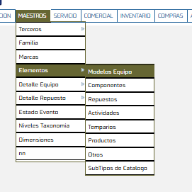
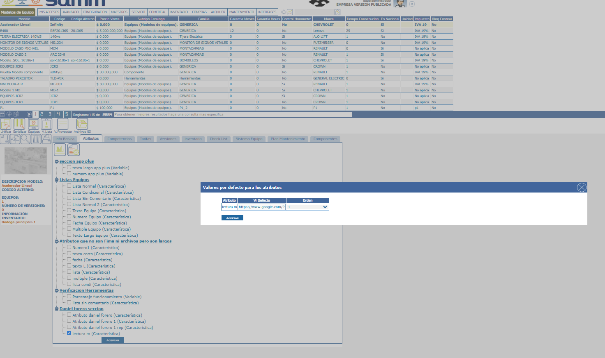

# Valores por Defecto en Atributos de Modelo

Este documento describe cómo configurar los valores por defecto de los atributos de un modelo de equipo desde el tab **Atributos**, incluyendo los atributos de tipo `lectura` y `hora`, cuyo valor no se almacenaba al pulsar **Aceptar**. Con la corrección, el valor configurado queda guardado y puede ser consumido por el App.

## Referencias

- [SO-2269 / SOL-34286: Visualización de valores por defecto en atributos tipo lectura](https://softwaresamm.atlassian.net/browse/SO-2269)
- [SO-2078 / OTT-3848: Habilitar apertura de links en campos de lectura del app](https://softwaresamm.atlassian.net/browse/SO-2078) — ver [Apertura de Links en Campos de Lectura](../app-tecnicos/linking-read-only-attributes.md)

## Información de Versiones

### Versión de Lanzamiento

:::info **v7.1.26.0 (provisional)**
:::

### Versiones Requeridas

| Aplicación | Versión Mínima | Descripción    |
| ---------- | -------------- | -------------- |
| SAMMNEW    | >= 7.1.26.0    | Aplicación web |

## Requisitos Previos

Antes de iniciar la configuración, asegúrese de tener:

- Acceso al módulo **Maestros → Elementos → Modelos Equipo**.
- Permisos para editar modelos de equipo.
- El atributo ya creado y asociado al modelo (marcado en el tab **Atributos**).

:::important Importante
Solo aparecen en la ventana de valores por defecto los atributos **marcados** en el modelo, activos y que no sean variables. Los atributos de tipo archivo y firma no admiten valor por defecto.
:::

## Configuración

### Paso 1: Abrir el modelo

1. Ingrese a **Maestros → Elementos → Modelos Equipo**.
2. Seleccione el modelo que desea configurar.

### Paso 2: Configurar los valores por defecto

1. En el modelo, abra el tab **Atributos**.
2. Marque los atributos que pertenecen al modelo (por ejemplo, un atributo de tipo `lectura`).
3. Pulse el botón de **valores por defecto** de la parte superior del tab. Se abre la ventana **Valores por defecto para los atributos**.
4. En la columna **Vr Defecto** escriba el valor del atributo. En la columna **Orden** puede cambiar su posición.
5. Pulse **Aceptar**.

:::tip Consejo
En un atributo de tipo `lectura` puede escribir un enlace que inicie con `http://` o `https://` para que el App 2.0 lo muestre como link navegable. Ver [Apertura de Links en Campos de Lectura](../app-tecnicos/linking-read-only-attributes.md).
:::

## Casos Especiales

| Tipo de atributo | Campo en la ventana       | Comportamiento al guardar                                               |
| ---------------- | ------------------------- | ----------------------------------------------------------------------- |
| `lectura`        | Texto                     | Se guarda el texto escrito; si se deja vacío, se limpia el valor.       |
| `hora`           | Selector de hora          | Se guarda la hora seleccionada (formato `hh:mm`).                       |
| Archivo y firma  | No se muestra             | No admiten valor por defecto.                                           |

## Resultado Esperado

Una vez completada la configuración:

1. **Valor guardado**: al reabrir la ventana, el atributo de tipo `lectura` o `hora` muestra el valor configurado.
2. **Valor vacío**: si se borra el valor y se pulsa **Aceptar**, el valor por defecto queda vacío.
3. **Equipo**: al crear un equipo del modelo, el atributo de lectura aparece con el valor por defecto.

## Resolución de Problemas

### El valor por defecto no se guarda

Verifique que:

- El atributo esté marcado en el tab **Atributos** del modelo.
- Haya pulsado **Aceptar** en la ventana de valores por defecto.
- La versión de SAMMNEW sea igual o superior a la indicada en este documento.

### El atributo no aparece en la ventana

Confirme que:

- El atributo esté activo y no sea de tipo variable, archivo o firma.
- El atributo pertenezca al modelo seleccionado.

### El App 2.0 no muestra el valor

Revise que:

- El procedimiento `mob_plantillasListaChequeoXEquipo` del cliente haya sido ajustado para devolver el valor por defecto.
- El dispositivo haya sincronizado la información más reciente.
