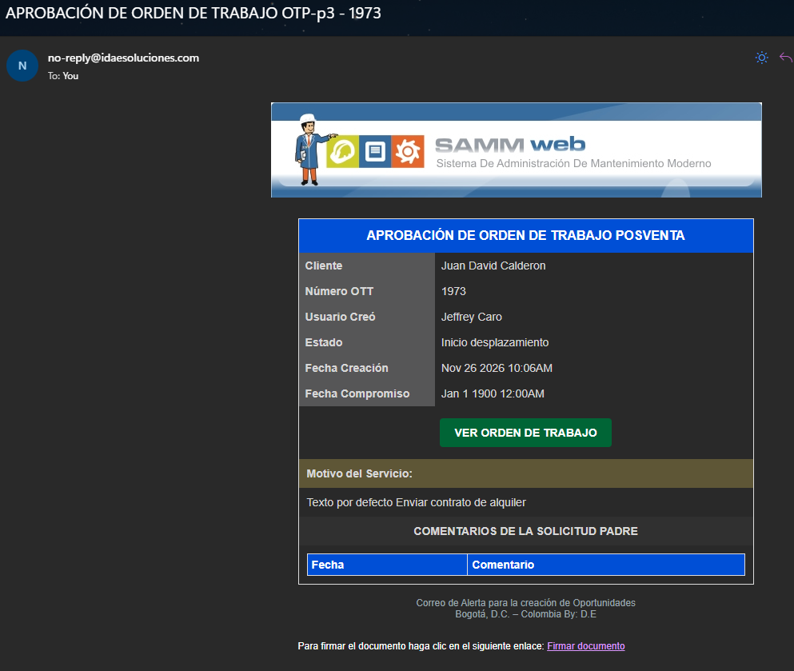

# Enlace Público de Firma en Correos

Este documento describe cómo configurar una regla de **Envío de Correo** para que el correo incluya el enlace público de firma del documento, permitiendo que el cliente firme sin iniciar sesión en SAMM. Antes de esta mejora, el botón **Firmar** generaba el enlace público, pero los correos configurados en `gen_envioCorreo` no podían incluirlo. Ahora la vista de la regla decide si el correo lleva el enlace y a qué reporte apunta, de modo que se puede incluir, por ejemplo, solo en las órdenes de trabajo de servicios preventivos.

## Referencias

- [SO-2291: SOL-34335 | Incluir link público de firma en correos configurados de envío](https://softwaresamm.atlassian.net/browse/SO-2291)
- [SO-2292: SOL-34335 | Exponer endpoints públicos de firma de documentos en SAMM API](https://softwaresamm.atlassian.net/browse/SO-2292)
- [SO-2293: SOL-34335 | Crear página pública de firma de documentos en ReportService](https://softwaresamm.atlassian.net/browse/SO-2293)
- [SO-2290: OTT-3904 | Mostrar encuesta y exigirla para firmar en documentos doc_documento del reporteador](https://softwaresamm.atlassian.net/browse/SO-2290)
- [SO-2251: Exigir encuesta para firmar el reporte solo cuando es obligatoria](https://softwaresamm.atlassian.net/browse/SO-2251)

## Información de Versiones

### Versión de Lanzamiento

:::info **SN 7.1.27.0 (provisional)**
:::

:::warning Versión provisional
La versión de lanzamiento es provisional; confirmarla con la fix version real al liberar.
:::

### Versiones Requeridas

| Aplicación    | Versión Mínima | Descripción                                   |
| ------------- | -------------- | --------------------------------------------- |
| SAMMNEW       | >= 7.1.27.0    | Aplicación web (plantilla estándar de correo) |
| SAMM LOGICA   | >= 5.6.30.3    | Motor de plantillas de correo                 |
| SR            | >= 6.0.0.17    | Página pública de firma (sitio de reportes clásico) |
| SAMMAPI       | Por confirmar (SO-2292) | Endpoints públicos de firma, solo con el servicio de reportes nuevo |
| REPORT SERVICE FRONTEND | Por confirmar (SO-2293) | Página pública `/firma`, solo con el servicio de reportes nuevo |

:::note Nota
Los valores de SAMM LOGICA, SAMMAPI y REPORT SERVICE FRONTEND deben ajustarse a la versión real que incluya el cambio. SR no requiere cambios para esta funcionalidad: la página pública de firma ya existía. SAMMAPI y el frontend de Report Service solo son necesarios cuando `tipoReportServices` está en `2`. El Backend de Report Service no tiene cambios.
:::

## Requisitos Previos

Antes de iniciar la configuración, asegúrese de tener:

- Las aplicaciones actualizadas a las versiones mínimas indicadas
- Una regla de correo existente en `gen_envioCorreo` (pantalla **Envío Correo**), con su vista en el campo **Tabla**
- Acceso para modificar la vista de la regla (normalmente a cargo del consultor)
- La clave `urlSAMMReportes` configurada en el `Web.config` de SAMM New, apuntando al sitio de reportes
- Un formato de reporte (`rep_reporte`) activo con el que el cliente firmará
- Solo con el servicio de reportes nuevo: `tipoReportServices` en `2`, `urlSAMMReportes` apuntando a la raíz del frontend (por ejemplo `https://<host>/sr_web`), `urlReportService` y `licencia` configuradas en SAMM API, el secreto JWT compartido con el Backend de Report Service, y el usuario `Superadministrador` existente y habilitado

:::important Importante
La plantilla estándar (`estandar.htm`) ahora incluye el marcador `[LINK_FIRMA]` debajo del cuerpo. Las reglas cuya vista no tenga la columna `LINK_FIRMA` siguen enviando el correo igual que antes: el marcador se reemplaza por vacío.
:::

## Información del Servicio

:::note Información
Solo aplica con el servicio de reportes nuevo (`tipoReportServices` en `2`). La página `/firma` de Report Service no pide sesión: llama a SAMM API a través de su propio servidor, y SAMM API usa internamente el usuario `Superadministrador`, sin enviar ningún token al navegador. Con el sitio de reportes clásico no se usan estos servicios.
:::

### Endpoints públicos de SAMM API

| Método | Ruta                          | Descripción                                                              |
| ------ | ----------------------------- | ------------------------------------------------------------------------ |
| GET    | `api/fir/publico/estado`      | Indica si el documento ya está firmado                                   |
| GET    | `api/fir/publico/reporte`     | Devuelve el PDF que el cliente debe revisar                              |
| POST   | `api/fir/publico/firmar`      | Registra la firma dibujada (cuerpo con `qry` y la firma en `base64`)      |

Los tres reciben el mismo valor `qry` del enlace del correo, tienen límite de intentos y solo aceptan documentos `doc_documento*` y reportes técnicos, con `id` y `r` numéricos. Si el documento ya está firmado, `firmar` responde con el código `YA_FIRMADO`. El PDF firmado se guarda en `gen_archivo` (código `archivofirma`) solo cuando la clave `archivosEnBD` es `1`.

## Configuración

### Paso 1: Agregar las columnas del enlace a la vista

En la vista de la regla (campo **Tabla** de **Envío Correo**, por ejemplo `v_OT_correo_creacion`) agregue al final del `SELECT` las columnas `qry_firma` y `LINK_FIRMA`. La vista debe exponer además la columna `id` del documento, que es la misma que el sistema usa para generar el PDF adjunto.

```sql title="Columnas a agregar a la vista de la regla (ejemplo con OT)"
-- t = código del documento, r = id del reporte con el que se firma
't=doc_documento_ot&key=f&r=' + CONVERT(varchar(20),
    (SELECT TOP 1 rr.id FROM rep_reporte rr
      WHERE rr.reporte_codigo = 'formatos/pri_OT' AND rr.active = 1
      ORDER BY rr.id))
  + '&id=' + CONVERT(varchar(20), [doc_documento.ot].[id]) + '&acep=1' AS [qry_firma],

-- Bloque que la plantilla muestra en el marcador [LINK_FIRMA]
'<p style="font-family:Arial,Helvetica,sans-serif;font-size:12px;">Para firmar el documento haga clic en el siguiente enlace: <a href="[[urlFirma]][[[qry_firma]]]">Firmar documento</a></p>' AS [LINK_FIRMA]
```

#### Parámetros de `qry_firma`

| Parámetro | Valor de ejemplo                   | Descripción                                                                 |
| --------- | ---------------------------------- | --------------------------------------------------------------------------- |
| `t`       | `doc_documento_ot`                 | Código del documento. El consultor lo cambia según el documento a firmar    |
| `key`     | `f`                                | Indica que es un enlace de firma. No se modifica                            |
| `r`       | `formatos/pri_OT` (por subconsulta) | Id del reporte (`rep_reporte`). Puede ir por subconsulta o con un id fijo   |
| `id`      | `[doc_documento.ot].[id]`          | Id del documento que se firma                                               |
| `acep`    | `1`                                | Fijo para el enlace de firma                                                |

:::tip Consejo
El consultor puede cambiar el valor de `t` y el formato de reporte (`reporte_codigo`) directamente en la vista, o reemplazar la subconsulta por el id del reporte "quemado", según le resulte más sencillo.
:::

### Paso 2: Restringir el enlace por tipo de documento (opcional)

Para que el enlace salga solo en algunos casos, envuelva `LINK_FIRMA` en un `CASE` que devuelva cadena vacía en los demás. Con cadena vacía el correo se envía sin enlace.

```sql title="Ejemplo: enlace solo para un subtipo de documento"
CASE WHEN [doc_documento_ot].[id_subtipoDocumento] = <id_subtipo_con_firma>
     THEN '<p style="font-family:Arial,Helvetica,sans-serif;font-size:12px;">Para firmar el documento haga clic en el siguiente enlace: <a href="[[urlFirma]][[[qry_firma]]]">Firmar documento</a></p>'
     ELSE ''
END AS [LINK_FIRMA]
```

### Paso 3: Usar la plantilla estándar

En la regla, deje la plantilla estándar (código `<n>_estandar` en **Envío Correo Código**). La plantilla ya incluye `[LINK_FIRMA]` debajo del cuerpo del correo (`[CUERPO]`), por lo que no requiere ningún cambio adicional.

Si el cliente usa una plantilla propia, agregue el marcador `[LINK_FIRMA]` en el punto del HTML donde debe aparecer el enlace.

### Paso 4: Probar el envío

Cambie el estado de un documento que dispare la regla (según su estrategia, subtipo y estado) y revise el correo recibido.

## Casos Especiales

:::note Comportamientos Predefinidos
El enlace público de firma no incluye datos de sesión del usuario: cualquier persona con el enlace puede abrir la página de firma del documento. Envíelo únicamente a los destinatarios previstos.
:::

| Caso                               | Configuración                                      | Descripción                                                                                           |
| ---------------------------------- | -------------------------------------------------- | ----------------------------------------------------------------------------------------------------- |
| Vista sin columna `LINK_FIRMA`     | Reglas existentes                                  | El correo se envía como antes; el marcador `[LINK_FIRMA]` se reemplaza por vacío                      |
| Enlace restringido por subtipo     | `CASE` en `LINK_FIRMA`                             | Solo los documentos que cumplen la condición llevan el enlace                                         |
| Sitio de reportes clásico          | `tipoReportServices` distinto de `2`               | El enlace abre `.../servicios/reporte/rep_indicador.aspx` del sitio configurado en `urlSAMMReportes`  |
| Servicio de reportes nuevo         | `tipoReportServices` en `2`                        | El enlace se arma como `.../firma` sobre `urlSAMMReportes`                                            |
| Encuesta obligatoria               | Encuesta con **Obligatoria** en Sí                 | La firma por enlace exige diligenciar la encuesta, ver [Encuesta obligatoria para firmar](./mandatory-survey-before-signing.md) |

:::warning Alcance con el servicio de reportes nuevo
Con `tipoReportServices` en `2` el enlace abre la página pública `/firma` de Report Service, que permite la firma dibujada y guarda el PDF firmado. Esta primera versión no cambia el estado del documento, no envía el correo de "documento firmado" ni admite el modo con código de acceso, y el enlace no tiene vencimiento (igual que el del sitio clásico). Si `archivosEnBD` no es `1`, la firma queda registrada pero el PDF firmado no se almacena.
:::

## Resultado Esperado

Una vez completada la configuración:

1. **Enlace en el correo**: el correo de la regla muestra, debajo del cuerpo, el texto "Para firmar el documento haga clic en el siguiente enlace: Firmar documento".
2. **Firma sin sesión**: al abrir el enlace, el cliente accede a la página pública de firma del documento y puede firmarlo sin iniciar sesión.
3. **Correos sin enlace**: las reglas cuya vista no tiene `LINK_FIRMA`, o cuyo `CASE` devuelve vacío, se envían sin enlace y sin texto residual.
4. **Firma con el servicio de reportes nuevo**: con `tipoReportServices` en `2`, el enlace termina en `/firma?qry=...`, muestra el PDF, permite dibujar la firma y, al firmar, informa que quedó registrada. Al reabrir el enlace, el sistema indica que el documento ya está firmado.

### Correo con el enlace de firma



## Resolución de Problemas

### El correo no muestra el enlace

Verifique que:

- La vista de la regla tenga la columna `LINK_FIRMA` y que no esté devolviendo vacía por el `CASE`
- La plantilla de la regla sea la estándar actualizada o incluya el marcador `[LINK_FIRMA]`
- SAMM New y SAMM LOGICA estén en las versiones mínimas indicadas

### El enlace no abre la página de firma

Confirme que:

- La clave `urlSAMMReportes` del `Web.config` apunte al sitio de reportes correcto
- La columna `qry_firma` devuelva un valor completo (`t`, `key`, `r`, `id` y `acep`); si la subconsulta de `r` no encuentra el formato, el valor queda incompleto
- El formato de reporte (`rep_reporte.reporte_codigo`) exista y esté activo

### El enlace abre pero la página no carga el documento

Revise que:

- El valor de `t` corresponda al código del documento a firmar
- El `id` de `qry_firma` sea el del documento que dispara la regla

### El enlace muestra texto cifrado o un valor extraño en lugar del botón

Revise que:

- La vista tenga la columna `qry_firma` con ese nombre exacto; si falta, el sistema cifra el texto del marcador y el enlace no funciona

### La página `/firma` muestra "El enlace de firma no es válido"

Verifique que:

- El enlace del correo esté completo y no haya sido modificado ni cortado por el cliente de correo
- El valor de `t` sea `ort_reporteTecnico` o empiece por `doc_documento`, y `id` y `r` sean numéricos

### La página `/firma` no carga el documento o no permite firmar

Confirme que:

- `tipoReportServices` esté en `2`, y `urlReportService` y `licencia` estén configuradas en SAMM API
- El usuario `Superadministrador` exista y esté habilitado
- El secreto JWT de SAMM API sea el mismo del Backend de Report Service
- Si aparece "Demasiados intentos", espere unos minutos: los endpoints limitan las solicitudes repetidas

### La firma queda registrada pero no se guarda el PDF firmado

Revise que:

- La clave `archivosEnBD` de SAMM API sea `1`; con otro valor el PDF firmado no se almacena en `gen_archivo`

## Errores Conocidos

No aplica para esta funcionalidad.

## QA — Pruebas

### Escenario 1: Correo con enlace de firma

**Criterio de aceptación:** Un consultor puede agregar `qry_firma` y `LINK_FIRMA` a la vista de una regla para que el correo incluya el enlace público de firma.

**Precondiciones:** Regla activa en **Envío Correo** con la plantilla estándar y la vista con las dos columnas; `urlSAMMReportes` configurada.

| Paso | Acción                                                           | Resultado esperado                                                            |
| ---- | ---------------------------------------------------------------- | ----------------------------------------------------------------------------- |
| 1    | Disparar la regla cambiando el estado de un documento            | Se envía el correo de la regla                                                |
| 2    | Revisar el correo recibido                                       | **Se muestra el enlace "Firmar documento"** debajo del cuerpo                 |
| 3    | Abrir el enlace sin sesión iniciada en SAMM                      | Se abre la página pública de firma del documento                              |
| 4    | Firmar el documento                                              | La firma queda registrada en el documento                                     |

### Escenario 2: Enlace restringido por subtipo

**Criterio de aceptación:** El consultor puede enviar el enlace solo para ciertos subtipos de documento.

**Precondiciones:** `LINK_FIRMA` con `CASE` que limita el enlace a un subtipo; dos documentos, uno de cada subtipo.

| Paso | Acción                                                       | Resultado esperado                              |
| ---- | ------------------------------------------------------------ | ----------------------------------------------- |
| 1    | Disparar la regla con el documento del subtipo configurado   | El correo incluye el enlace                     |
| 2    | Disparar la regla con el documento del otro subtipo          | **El correo se envía sin enlace y sin texto residual** |

### Escenario 3: Firma con el servicio de reportes nuevo

**Criterio de aceptación:** Con `tipoReportServices` en `2`, el cliente firma desde el enlace del correo sin iniciar sesión.

**Precondiciones:** Requisitos del servicio de reportes nuevo cumplidos; un documento sin firmar y su correo con el enlace.

| Paso | Acción                                                  | Resultado esperado                                                            |
| ---- | ------------------------------------------------------- | ----------------------------------------------------------------------------- |
| 1    | Abrir el enlace del correo sin sesión                   | Se abre `/firma` con el PDF del documento y el recuadro de firma              |
| 2    | Dibujar la firma y pulsar **Firmar documento**          | Mensaje de firma registrada; fila nueva en `gen_firma` del documento          |
| 3    | Con `archivosEnBD` en `1`, revisar `gen_archivo`        | Existe el PDF firmado con código `archivofirma`                               |
| 4    | Abrir de nuevo el mismo enlace                          | **Indica que el documento ya está firmado** y no ofrece el recuadro de firma  |
| 5    | Modificar un carácter del `qry` y abrir el enlace       | Mensaje de enlace no válido, sin datos del documento                          |

### Escenario 4: Reglas existentes no cambian

**Criterio de aceptación:** Los correos que usan la plantilla estándar con otras vistas no se ven afectados.

**Precondiciones:** Regla con la plantilla estándar cuya vista no tiene `LINK_FIRMA`.

| Paso | Acción                                      | Resultado esperado                                                          |
| ---- | ------------------------------------------- | --------------------------------------------------------------------------- |
| 1    | Disparar la regla                           | El correo llega igual que antes                                             |
| 2    | Revisar el final del cuerpo                 | **No aparece el texto `[LINK_FIRMA]` ni un enlace vacío**                   |
