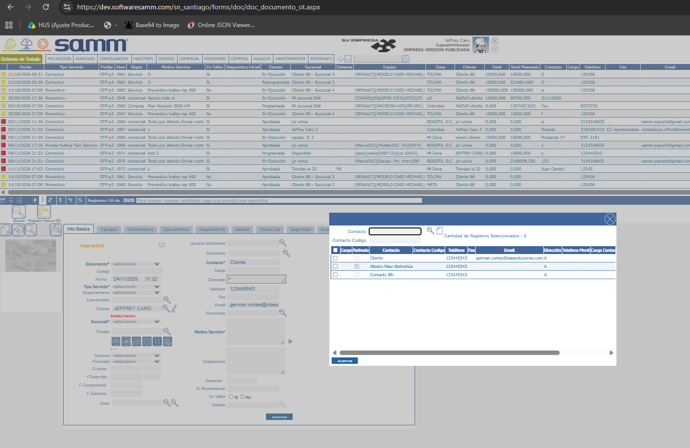
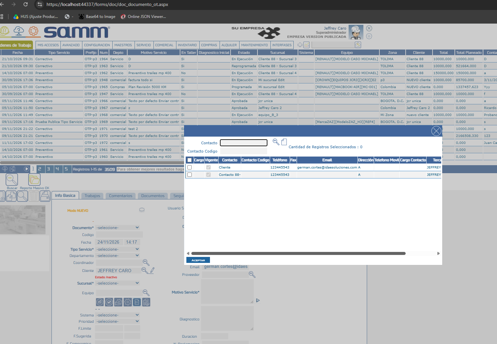
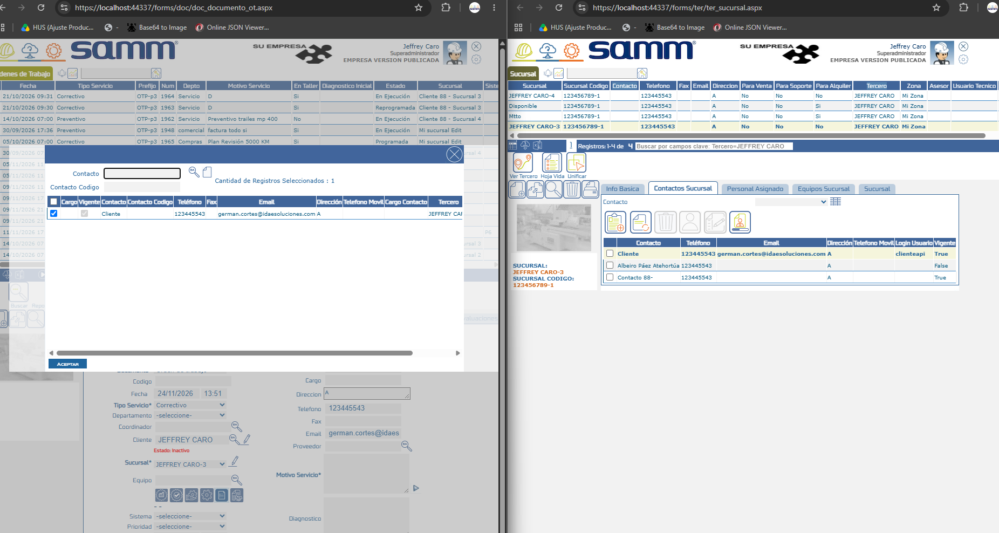

# Contactos Vigentes en los Documentos

Este documento describe cómo funciona el campo **Contactos** de los documentos cuando un contacto ya no trabaja en la empresa del cliente. Antes de esta mejora, la lupa de **Contactos** de las órdenes de trabajo (OT) listaba todos los contactos del tercero, incluso los que tenían marcada la opción **Retirado**, lo que permitía seleccionar contactos no habilitados. Ahora la lupa muestra únicamente los contactos **vigentes**, y los correos de notificación de los documentos también se envían solo a ellos.

:::warning Cambio de significado de la columna
La columna `ter_contacto.accesoActivo` se interpretaba al revés: `1` significaba **retirado**. A partir de esta mejora `1` significa **vigente** (el contacto aún trabaja en la empresa) y `0` significa **retirado**. La etiqueta de la pantalla pasó de "Retirado" a **Vigente**. Los datos existentes se convierten con un script que debe ejecutarse una sola vez por base de datos (ver [Configuración](#configuración)).
:::

## Referencias

- [SO-2272: SOL-34272 Mostrar contactos habilitados en los documentos](https://softwaresamm.atlassian.net/browse/SO-2272) (SAMM NEW)
- [SO-2278: SOL-34272 Enviar correos de documentos solo a contactos vigentes](https://softwaresamm.atlassian.net/browse/SO-2278) (SAMM API)

## Información de Versiones

### Versión de Lanzamiento

:::info **SN 7.1.27.0 · SA 1.2.37.0** (provisional)
Las versiones son provisionales: confirmar con el release que incluya los PR de SO-2272 y SO-2278.
:::

### Versiones Requeridas

| Aplicación    | Versión Mínima        | Descripción                                    |
| ------------- | --------------------- | ---------------------------------------------- |
| SAMMNEW       | >= 7.1.27.0           | Aplicación web (provisional)                   |
| SAMMAPI       | >= 1.2.37.0           | API principal, correos de documentos (provisional) |
| BASE DE DATOS | Script `SO2272.sql`   | Inversión de `ter_contacto.accesoActivo`       |

:::important Importante
SAMMNEW, SAMMAPI y el script de base de datos deben desplegarse **juntos**. Con solo uno de ellos, la lista de contactos y los destinatarios de correo quedan invertidos.
:::

## Requisitos Previos

Antes de iniciar, asegúrese de tener:

- Las aplicaciones actualizadas a las versiones mínimas indicadas
- Una copia de seguridad de cada base de datos de empresa
- Acceso para ejecutar scripts sobre la base de datos de cada empresa

## Información del Servicio

No aplica para esta funcionalidad.

## Configuración

### Paso 1: Respaldar la base de datos

Realice una copia de seguridad de la base de datos de cada empresa antes de ejecutar el script.

### Paso 2: Ejecutar el script de inversión

Ejecute `bd/updates/SO2272.sql` del repositorio `sammapi` en cada base de datos de empresa.

```sql title="Inversión de ter_contacto.accesoActivo (SO2272.sql)"
UPDATE ter_contacto
SET accesoActivo = CASE WHEN accesoActivo = 1 THEN 0 ELSE 1 END;
```

El script ya incluye una guarda: deja una propiedad extendida (`SO2272_accesoActivo_inverted`) en la tabla `ter_contacto` y, si se ejecuta de nuevo, no modifica los datos.

:::warning Una sola vez
Ejecutar la inversión dos veces, o sin desplegar las aplicaciones actualizadas, revierte el significado de la columna. La propiedad extendida evita la doble ejecución en la misma base de datos.
:::

### Paso 3: Desplegar SAMMNEW y SAMMAPI

Despliegue las versiones indicadas en la tabla de versiones requeridas.

## Casos Especiales

:::note Comportamientos particulares
Algunos formularios tienen reglas adicionales sobre qué contactos se listan.
:::

| Caso                                                                 | Comportamiento                                                                                                                                  |
| -------------------------------------------------------------------- | ----------------------------------------------------------------------------------------------------------------------------------------------- |
| OT con **Sucursal** seleccionada                                     | La lupa lista todos los contactos vigentes de la sucursal. El contacto de un usuario con cargo coordinador solo se **preselecciona** al crear la OT, si está vigente. |
| OT con solo el **Cliente** seleccionado                              | La lupa lista los contactos vigentes del cliente.                                                                                               |
| Usuario con contacto asociado (usuario cliente o proveedor)          | En solicitud, cotización, entrada, salida, compras y traslado, la lupa se limita a los contactos del tercero del usuario autenticado.           |
| Usuario interno con un contacto asociado, sin tercero autenticado    | Ya no se limita al tercero del usuario: la lupa usa el cliente seleccionado, o todos los contactos vigentes si no hay cliente.                  |
| Traslado                                                             | La lupa no depende de un tercero: muestra todos los contactos vigentes.                                                                         |
| Contacto creado al asignar un contacto a un tercero                  | Nace **vigente**.                                                                                                                               |

## Resultado Esperado

Una vez desplegada la versión y ejecutado el script:

1. **Lupa de Contactos**: en OT, solicitud, requisición, cotización, entrada, salida, compras y traslado solo aparecen contactos vigentes; los retirados no se pueden buscar ni seleccionar.
2. **Columna Vigente**: la columna que antes se llamaba **Retirado** se llama **Vigente** en las grillas de contactos y en el formulario del contacto (Sí = vigente, No = retirado).
3. **Contactos de la sucursal**: la pestaña **Contactos Sucursal** y la lupa de la OT muestran el mismo criterio de vigencia.
4. **Notificaciones por correo**: los correos que se envían al cambiar el estado de un documento llegan solo a contactos vigentes.

### Antes: la lupa mostraba contactos retirados



### Después: la lupa muestra solo contactos vigentes



### Contactos de la sucursal y lupa de la OT

Un contacto con **Vigente** en `False` (por ejemplo, Albeiro Páez Atehortúa) no aparece en la lupa de la OT.



## Resolución de Problemas

### La lupa de Contactos aparece vacía

Verifique que:

- El script `SO2272.sql` se ejecutó en la base de datos de la empresa y los contactos del tercero tienen `accesoActivo = 1`
- El tercero o la sucursal seleccionados tienen contactos vigentes asociados (pestaña **Contactos Sucursal**)
- El usuario no tiene un contacto asociado que limite la lista al tercero del usuario autenticado

### Aparecen contactos que ya no trabajan en la empresa

Confirme que:

- El contacto tiene **Vigente** = No en el formulario del contacto
- La base de datos tiene el script ejecutado una sola vez (si se ejecutó dos veces, los valores quedaron como antes del cambio)
- SAMMNEW está actualizado a la versión indicada

### Los correos llegan a contactos retirados o no llegan a los vigentes

Revise que:

- SAMMAPI está actualizado a la versión indicada
- El script y las dos aplicaciones se desplegaron al mismo tiempo

## Diccionario de Datos

La columna `accesoActivo` de [ter_contacto](./database/terceros/ter_contacto.md) documenta el nuevo significado.
