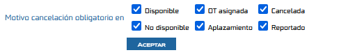

# Motivo de Programación y su Obligatoriedad

Este documento describe cómo funciona el campo **Motivo de programación** en las programaciones de Samm New y cómo configurar para cuáles de los seis tipos de programación el sistema exige su registro. El campo se muestra siempre al crear o editar una programación, ofrece solo los motivos que pertenecen al tipo de programación que se está trabajando, y su obligatoriedad se controla desde Parámetros Generales. Esto permite estandarizar la trazabilidad de los cambios realizados sobre las programaciones.

## Referencias

- [SO-730: SOL-33106 - Parametrización de Obligatoriedad en motivos de cancelación](https://softwaresamm.atlassian.net/browse/SO-730)
- [SO-2218: Mostrar motivos de cancelación de forma parametrizable al crear una nueva programación](https://softwaresamm.atlassian.net/browse/SO-2218)

## Información de Versiones

### Versión de Lanzamiento

:::info **v7.1.14.2**
:::

:::warning Versión provisional
Los ajustes de [SO-2218](https://softwaresamm.atlassian.net/browse/SO-2218) (campo siempre visible, filtro por tipo y obligatoriedad opcional por defecto) aún no tienen versión de lanzamiento asignada. Actualice este valor y la tabla de versiones cuando se libere el release que los incluya.
:::

### Versiones Requeridas

| Aplicación    | Versión Mínima | Descripción            |
| ------------- | -------------- | ---------------------- |
| SAMMAPI       | >= 1.2.31.0    | API principal          |
| SAMM LOGICA   | >= 5.6.26.3    | Lógica de negocio      |
| SAMM CORE     | >= 2.0.25.0    | Core del sistema       |
| CAPA DE DATOS | >= 2.1.15.3    | Capa de acceso a datos |
| BASE DE DATOS | >= C2.1.15.3   | Base de datos          |

## Requisitos Previos

Antes de iniciar la configuración, asegúrese de tener:

- Acceso al módulo `Configuración` → `Aplicación` → `Parámetros Generales` en Samm New
- Permisos de administración sobre los Parámetros Generales del sistema
- Acceso al maestro de motivos (`Motivo de programación`), donde se marca a qué tipos de programación pertenece cada motivo

:::important Importante
Verifique que todos los componentes cumplan con las versiones mínimas indicadas en la tabla anterior antes de habilitar esta configuración, ya que versiones inferiores pueden no mostrar la sección correspondiente.
:::

## Información del Servicio

No aplica para esta funcionalidad.

## Configuración

### Paso 1: Asociar los motivos a los tipos de programación

Las opciones que ve el usuario en el campo dependen del tipo de programación. Cada motivo del maestro se marca con los tipos en los que puede usarse.

1. Abra el maestro de **Motivo de programación**.
2. Cree o edite el motivo.
3. Marque los tipos de programación en los que debe aparecer: `Disponible`, `No disponible`, `OT asignada`, `Aplazamiento`, `Cancelada` o `Reportado`.
4. Guarde los cambios.

:::tip Consejo
Un mismo motivo puede pertenecer a varios tipos. Por ejemplo, un motivo marcado para `OT asignada` aparecerá al editar una programación de tipo OT asignada, pero no al crear una no disponibilidad.
:::

### Paso 2: Activar o desactivar la obligatoriedad del motivo por tipo de programación

Este paso permite definir en cuáles de los seis tipos de programación el sistema exigirá el registro de un motivo al guardar.

1. Ingrese a `Configuración` → `Aplicación` → `Parámetros Generales`.
2. Diríjase al tab **OTS**.
3. Ubique la sección **"Motivo cancelación obligatorio en"**.
4. Encontrará los siguientes seis tipos de programación disponibles para marcar:
   - `Disponible`
   - `No disponible`
   - `OT asignada`
   - `Aplazamiento`
   - `Cancelada`
   - `Reportado`
5. Marque los checkboxes de los tipos de programación en los que desea que el sistema exija el motivo.
6. Guarde los cambios realizados en Parámetros Generales.

:::tip Consejo
Puede combinar varios tipos de programación como obligatorios simultáneamente. Por ejemplo, active la obligatoriedad tanto para `Cancelada` como para `Aplazamiento` si su proceso requiere trazabilidad en ambos escenarios.
:::

## Casos Especiales

:::note Comportamientos Predefinidos
Estos comportamientos se aplican sin configuración adicional.
:::

| Caso | Comportamiento |
| ---- | -------------- |
| Parámetro sin configurar | Si no existe la fila de configuración del parámetro, el motivo es **opcional** en todos los tipos. Esto aplica también al panel de cancelar programación. |
| Tipo obligatorio sin motivos asociados | Si un tipo está marcado como obligatorio pero ningún motivo del maestro pertenece a ese tipo, el campo queda sin opciones y no se podrá guardar. Asocie al menos un motivo en el Paso 1. |
| Edición sin reagendar | El motivo elegido se guarda en la misma programación, que conserva su tipo. Si no se elige un motivo, se mantiene el que ya tenía. |
| Reagendar a una fecha posterior | La programación original pasa a `Aplazamiento` o `Cancelada` con el motivo elegido y se crea una nueva con el mismo motivo. |
| Cambio solo de motivo o comentario | Se actualizan las mismas programaciones (el día, o todos los días si se marcó "otros días") sin desactivarlas ni recrearlas. No se envía correo de programación y el cambio queda en el histórico de la programación. |
| Cambio de fecha, duración, técnico o actividades | Se mantiene el comportamiento anterior: las programaciones se desactivan y se crean nuevas, que conservan el motivo elegido. |

## Resultado Esperado

Una vez completada la configuración:

1. **Campo siempre visible**: El campo **Motivo de programación** aparece al editar una programación y en el asistente **Crear Programación para Varios Días**, sin necesidad de cambiar la fecha.
2. **Opciones según el tipo**: Al editar, solo se listan los motivos del tipo de la programación. En el asistente, la lista cambia al seleccionar `Disponibilidad`, `No disponibilidad` u `OT`.
3. **Obligatoriedad activa**: Para los tipos marcados en "Motivo cancelación obligatorio en", el sistema exige el motivo antes de guardar, haya o no reagendamiento.
4. **Obligatoriedad inactiva**: Para los tipos no marcados, o si el parámetro no está configurado, el campo permanece opcional.
5. **Valor cargado al editar**: Al abrir una programación que ya tiene motivo, el campo se muestra con ese valor seleccionado.
6. **Persistencia de la configuración**: Los cambios realizados en Parámetros Generales se mantienen activos para todos los usuarios hasta que sean modificados nuevamente.

### Vista de Configuración

Video de apoyo https://youtu.be/RzMo4p8DflI

## Resolución de Problemas

### El campo motivo no se solicita como obligatorio a pesar de haber marcado el tipo de programación

Verifique que:

- Los cambios hayan sido guardados correctamente en Parámetros Generales
- El checkbox correspondiente al tipo de programación esté efectivamente marcado
- La sesión del usuario haya sido refrescada tras el cambio (cerrar e iniciar sesión nuevamente)

### El campo motivo no muestra opciones

Confirme que:

- Al menos un motivo del maestro esté marcado para el tipo de programación que se está creando o editando
- En el asistente de varios días, el tipo seleccionado (`Disponibilidad`, `No disponibilidad` u `OT`) sea el esperado

### No se visualiza la sección "Motivo cancelación obligatorio en"

Confirme que:

- Todos los componentes cumplan con las versiones mínimas requeridas (`samm_logica`, `sammapi`, `samm core`, `capa de datos`, `base de datos`)
- El usuario cuenta con permisos de administración sobre Parámetros Generales
