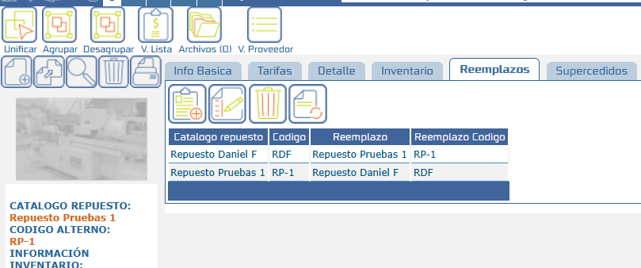
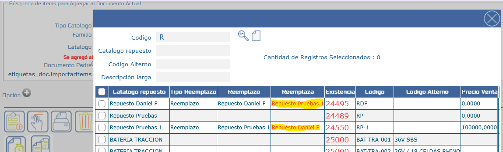
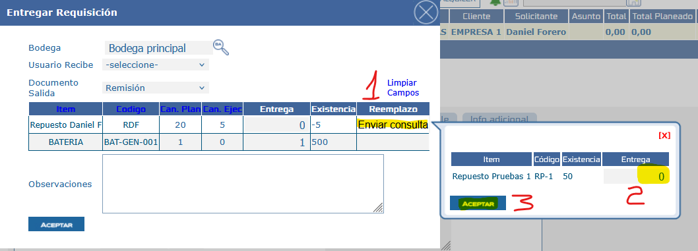
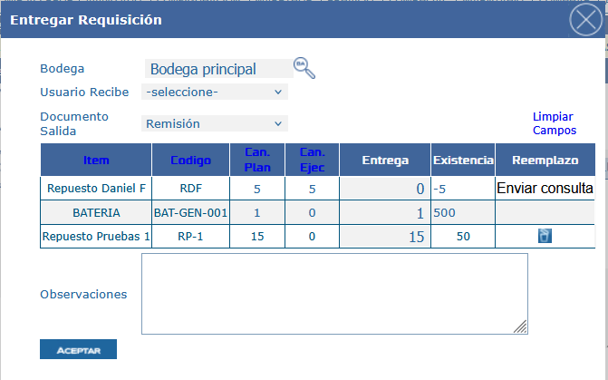
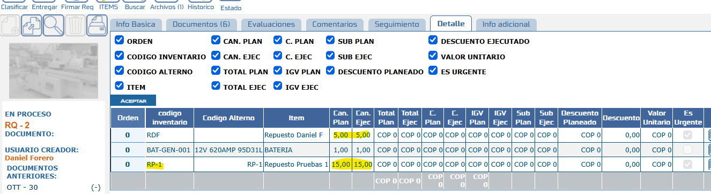

# Reemplazo de Repuestos en Documentos

Este documento describe cómo funcionan los reemplazos y supercedidos de repuestos en SAMM New y cómo se reflejan en el POP de **Entregar Requisición**, permitiendo despachar un repuesto alterno de forma ágil cuando el repuesto solicitado no tiene existencias suficientes o no está vigente.

Los reemplazos y supercedidos se configuran en el tab **Reemplazos** del repuesto y registran qué repuesto puede suplir a otro. Antes, esta información no se aprovechaba al despachar. Ahora se visualiza desde la planeación o adición de ítems y, en las requisiciones, el POP de entrega evalúa las existencias: si no son suficientes, muestra en la columna **Reemplazo** una consulta con los reemplazos disponibles y habilita la captura de la cantidad que se desea tomar de cada uno.

## Referencias

- [SO-472: Repuestos – Reemplazos (SOL-32197) – Se requiere que los reemplazos configurados se reflejen en la pantalla Entregar Requisición (POP) para que el usuario pueda realizar el cambio de referencia de forma ágil](https://softwaresamm.atlassian.net/browse/SO-472)

## Información de Versiones

### Versión de Lanzamiento

:::info **v7.1.22.1**
:::

### Versiones Requeridas

| Aplicación    | Versión Mínima | Descripción       |
| ------------- | -------------- | ----------------- |
| SAMMAPI       | >= 1.2.34.5    | API principal     |
| SAMMNEW       | >= 7.1.22.1    | Aplicación web    |
| SAMM LOGICA   | >= 5.6.28.0    | Lógica de negocio |
| SAMM CORE     | >= 2.0.29.1    | Core del sistema  |
| CAPADATOS     | >= 2.1.21.1    | Capa de datos     |
| BASE DE DATOS | >= C2.1.21.1   | Base de datos     |

## Requisitos Previos

Antes de iniciar la configuración, asegúrese de tener:

- Las aplicaciones actualizadas a las versiones mínimas indicadas en la tabla anterior.
- Acceso a la pantalla de **Repuestos** (tab **Reemplazos**) y a la pantalla **Entregar Requisición**.

:::important Importante
Para que los reemplazos se muestren correctamente en el resto del sistema, la relación debe quedar configurada en ambos repuestos. Por ejemplo, si el repuesto `RDF` es reemplazo del repuesto `RP-1`, el repuesto `RP-1` también debe aparecer como reemplazo de `RDF`.
:::

## Información del Servicio

No aplica para esta funcionalidad.

## Configuración

### Paso 1: Configurar los reemplazos del repuesto

Desde el tab **Reemplazos** del repuesto se asocian los repuestos que pueden suplirlo en caso de que no esté vigente o no tenga existencias.

En el ejemplo, el repuesto con código `RDF` es reemplazo del repuesto `RP-1` y viceversa.

:::important Importante
Esta configuración bidireccional es indispensable para que los reemplazos se visualicen de forma correcta en la pantalla de ítems y en el POP de entrega de requisiciones.
:::

#### Paso 1.1: Visualización en la pantalla de ítems

Al consultar un repuesto que tiene reemplazos, el sistema muestra de qué repuesto es reemplazo.

### Paso 2: Usar los reemplazos en el POP de Entregar Requisición

Al entregar una requisición, si un repuesto no tiene las existencias suficientes para despachar la cantidad solicitada, la columna **Reemplazo** muestra los repuestos con los que se puede despachar por ser reemplazo del repuesto solicitado. Desde esa consulta se indica la cantidad que se desea tomar de cada reemplazo.

#### Paso 2.1: Ajuste de cantidades con el reemplazo

Al agregar cantidades del reemplazo en el POP, se muestra una nueva columna con la **cantidad ajustada** y la forma en que se ajustaría el detalle del documento.

:::note Nota
El detalle del documento no se modifica hasta que se da **Aceptar** en el POP. Solo al confirmar la entrega se reflejan los cambios en el detalle del documento.
:::

## Casos Especiales

No aplica para esta funcionalidad.

## Resultado Esperado

Una vez completada la configuración:

1. **Reemplazos asociados**: el tab **Reemplazos** del repuesto muestra los repuestos que pueden suplirlo y la relación se refleja en ambos repuestos.
2. **Visualización en ítems**: al consultar un repuesto que es reemplazo de otro, la pantalla de ítems indica de cuál repuesto es reemplazo.
3. **Consulta en el POP**: cuando las existencias a entregar no son suficientes, la columna **Reemplazo** del POP de **Entregar Requisición** muestra los reemplazos disponibles.
4. **Captura de cantidades**: se habilita la captura de la cantidad a tomar de cada reemplazo y se muestra la columna con la **cantidad ajustada**.
5. **Detalle sin cambios previos**: el detalle del documento no se modifica mientras no se dé **Aceptar**.
6. **Detalle actualizado**: al confirmar la entrega, el detalle del documento refleja el repuesto de reemplazo y las cantidades ajustadas.

### Detalle del documento tras confirmar la entrega

## Resolución de Problemas

### La columna Reemplazo no muestra reemplazos en el POP

Verifique que:

- El repuesto tiene reemplazos configurados en el tab **Reemplazos**.
- La relación está configurada en ambos repuestos (el reemplazo apunta al repuesto solicitado y viceversa).
- Las existencias del repuesto solicitado son realmente insuficientes para la cantidad a entregar.

### No se habilita la captura de cantidad del reemplazo

Confirme que:

- El repuesto solicitado no tiene existencias suficientes para la cantidad a despachar.
- El repuesto de reemplazo tiene existencias disponibles.
- Las aplicaciones cumplen con las versiones mínimas indicadas en este documento.

### El detalle del documento no refleja el reemplazo

Revise que:

- Se dio **Aceptar** en el POP y se confirmó la entrega, ya que hasta ese momento el detalle no se modifica.
- Se ingresó una cantidad mayor a cero en el reemplazo.

## Errores Conocidos

No aplica para esta funcionalidad.

## QA — Pruebas

| Escenario | Pasos | Resultado esperado |
| --------- | ----- | ------------------ |
| QA-1: Reemplazo bidireccional | 1. Abrir el repuesto `RP-1`, tab **Reemplazos**. 2. Asociar `RDF` como reemplazo. 3. Abrir `RDF` y revisar su tab **Reemplazos**. | `RDF` aparece como reemplazo de `RP-1` y `RP-1` aparece asociado en `RDF`. |
| QA-2: Visualización en ítems | 1. Consultar en la pantalla de ítems un repuesto que es reemplazo de otro. | La pantalla indica de qué repuesto es reemplazo. |
| QA-3: Reemplazo con existencias insuficientes | 1. Crear una requisición con un repuesto sin existencias suficientes y con reemplazos configurados. 2. Abrir **Entregar Requisición** (POP). | La columna **Reemplazo** muestra una consulta con los reemplazos disponibles. |
| QA-4: Ajuste de cantidades | 1. En el POP, abrir la consulta de reemplazos. 2. Ingresar la cantidad a tomar del reemplazo. | Se muestra la columna con la **cantidad ajustada** y el ajuste del detalle del documento. |
| QA-5: Detalle sin cambios sin aceptar | 1. Ingresar cantidades de reemplazo en el POP. 2. Cerrar el POP sin dar **Aceptar**. 3. Revisar el detalle de la requisición. | El detalle del documento permanece sin modificaciones. |
| QA-6: Confirmación de la entrega | 1. Ingresar cantidades de reemplazo en el POP. 2. Dar **Aceptar** y confirmar la entrega. 3. Revisar el detalle de la requisición. | El detalle refleja el repuesto de reemplazo y las cantidades ajustadas. |
| QA-7: Repuesto con existencias suficientes | 1. Abrir el POP con un repuesto que tiene existencias suficientes. | No se requiere reemplazo para despachar la cantidad solicitada. |