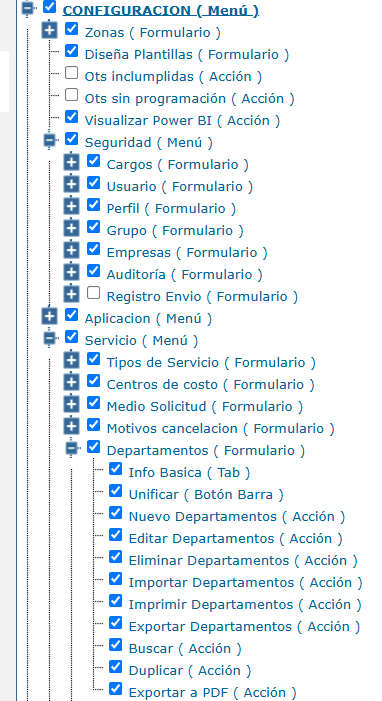

# Unificación de Departamentos de Solicitud

Esta funcionalidad permite unificar un departamento de solicitud de origen con un departamento destino. La operación se realiza **registro por registro**; durante cada ejecución se actualizan las solicitudes, órdenes de trabajo y demás relaciones asociadas, se conserva la información histórica y se evita que el departamento de origen vuelva a utilizarse en registros nuevos.

Antes de esta mejora, no existía un proceso controlado para centralizar departamentos duplicados o equivalentes sin afectar sus relaciones documentales.

## Referencias

- [SO-754: SOL-32329 Funcionalidad de unificación de departamentos de solicitud](https://softwaresamm.atlassian.net/browse/SO-754)

## Información de Versiones

### Versión de Lanzamiento

:::info **SN v7.1.25.0**
:::

### Versiones Requeridas

| Aplicación | Versión mínima | Descripción |
| --- | --- | --- |
| SAMM NEW | >= 7.1.25.0 | Aplicación web |
| SAMM LÓGICA | >= 5.6.28.0 | Lógica de negocio |
| CAPADATOS | >= 2.1.22.1 | Capa de acceso a datos |
| BASE DE DATOS | >= C2.1.22.1 | Base de datos |
| SAMCORE | >= 2.0.30.0 | Núcleo del sistema |
| SAMMAPI | >= 1.2.35.2 | API principal |
| RECURSOS | No aplica | No requiere una versión adicional |

## Requisitos Previos

Antes de ejecutar la unificación, asegúrese de tener:

- Todas las aplicaciones actualizadas a las versiones mínimas indicadas.
- Acceso a SAMM New mediante un usuario autorizado para unificar departamentos.
- Dos o más departamentos de solicitud disponibles para la prueba.
- Identificado el departamento que se conservará como destino.
- Solicitudes u órdenes de trabajo asociadas a los departamentos de origen para validar la actualización de relaciones.

:::important Importante
El permiso debe validarse tanto en la interfaz como en el acceso directo a la funcionalidad. Un usuario no autorizado no debe visualizar el botón ni ejecutar la unificación mediante una URL o llamada directa.
:::

## Evidencias

### Permiso requerido

La siguiente imagen muestra el permiso configurable que debe asignarse al perfil o usuario autorizado para ejecutar la unificación:



### Video del proceso de unificación

El video muestra el proceso completo: ingreso a la pantalla, selección del registro de origen, ubicación del botón `Unificar`, selección del departamento destino, confirmación de la operación y verificación del cambio en las solicitudes asociadas.

En caso de dudas, consulte el siguiente [video de apoyo del proceso de unificación](https://www.youtube.com/watch?v=sepDd7CgnxQ).

:::info Contenido de la demostración
En el video se utiliza `video 1` como departamento de origen y `video 2` como departamento destino. Después de la unificación se comprueba que las solicitudes asociadas al origen muestran el departamento destino.
:::

## Información del Servicio

No aplica para esta funcionalidad.

## Configuración

### Paso 1: Ingresar a Departamentos de solicitud

Acceda a SAMM New con un usuario autorizado y abra la ruta:

```text title="Ruta de la funcionalidad"
/forms/ort/ort_departamentoSolicitud.aspx
```

Ubique en el listado el registro correspondiente al departamento de origen. En las acciones de ese registro, valide que el botón de unificación se encuentre visible y habilitado.

### Paso 2: Iniciar la unificación desde el registro de origen

Localice el departamento de origen y ejecute la acción `Unificar` disponible en ese registro. En la ventana o formulario presentado por el sistema, seleccione el departamento destino al que se trasladarán sus relaciones.

La operación debe repetirse individualmente por cada departamento de origen que se necesite consolidar; la pantalla no permite seleccionar varios departamentos de origen simultáneamente.

:::warning Validación obligatoria
El sistema no debe continuar si no se selecciona un departamento de origen o si no se define correctamente el departamento destino.
:::

### Paso 3: Definir el tratamiento de los archivos

Si los registros relacionados contienen archivos adjuntos y también deben consolidarse, seleccione la opción `Unificar archivos`. Si no existen archivos adjuntos, ejecute la unificación sin seleccionar esta opción.

:::note Nota
La unificación de departamentos y sus relaciones funciona sin scripts ni configuración técnica adicional. La trazabilidad generada por el proceso se conserva en la base de datos.
:::

### Paso 4: Ejecutar la unificación

Confirme la operación y espere la respuesta del sistema. Una vez finalizado el proceso, valide que las solicitudes, órdenes de trabajo y demás asociaciones apunten al departamento destino.

### Paso 5: Validar el resultado

Compruebe que:

1. El departamento de origen ya no esté disponible en nuevas solicitudes.
2. Las solicitudes existentes conserven su información y muestren el departamento destino.
3. Las órdenes de trabajo relacionadas también muestren el departamento destino.
4. Los documentos históricos permanezcan disponibles.
5. La trazabilidad de la unificación se encuentre registrada en la base de datos.

## Casos Especiales

- Si no se selecciona el departamento de origen, el sistema debe impedir la operación y mostrar una validación controlada.
- Los departamentos unificados deben permanecer consultables para efectos históricos, pero no deben estar disponibles para nuevos registros.
- La trazabilidad técnica se consulta en la base de datos y no necesariamente es visible para el cliente desde la interfaz.
- La opción `Unificar archivos` solo debe utilizarse cuando existan archivos adjuntos que deban trasladarse.

## Resultado Esperado

Una vez completada correctamente la unificación:

1. **Departamento consolidado:** todas las solicitudes, órdenes de trabajo y asociaciones de los departamentos de origen apuntan al departamento destino.
2. **Información conservada:** los datos históricos y documentales permanecen disponibles y consultables.
3. **Origen excluido:** los departamentos unificados no aparecen como opción en nuevas solicitudes.
4. **Acceso controlado:** únicamente los usuarios autorizados pueden visualizar y ejecutar la funcionalidad.
5. **Trazabilidad registrada:** la operación queda registrada y puede verificarse mediante una consulta a la base de datos.
6. **Consistencia transaccional:** ante un error real de persistencia, la operación no debe dejar información parcialmente actualizada.

## Resolución de Problemas

### No se muestra el botón de unificación

Verifique que:

- El usuario tenga asignado el permiso correspondiente.
- La sesión se haya iniciado nuevamente después de modificar los permisos.
- SAMM New y sus componentes cumplan las versiones mínimas requeridas.

### El departamento de origen sigue disponible en nuevas solicitudes

Confirme que:

- La unificación haya finalizado correctamente.
- Se esté consultando un registro nuevo y no únicamente información histórica.
- El departamento de origen haya quedado inactivo para nuevos registros.
- La sesión o los datos en pantalla se hayan actualizado después del proceso.

### Las solicitudes u órdenes de trabajo no muestran el departamento destino

Revise que:

- Los registros estuvieran asociados al departamento de origen antes de la unificación.
- La operación no haya presentado un error de persistencia.
- Las relaciones se hayan actualizado en la base de datos.

### Aparece un error al seleccionar `Unificar archivos`

Compruebe si todos los registros relacionados tienen archivos adjuntos. Si no existen archivos que deban trasladarse, repita la prueba sin seleccionar esta opción y registre el comportamiento conocido.

## Errores Conocidos

Al seleccionar `Unificar archivos`, el sistema puede mostrar un error cuando alguno de los registros relacionados no contiene archivos adjuntos. Este mensaje se gestionará mediante una incidencia para evitar que se presente en pantalla.

:::warning Impacto
El error visual no invalida la funcionalidad principal cuando la operación se ejecuta sin seleccionar `Unificar archivos`: los departamentos se consolidan, las relaciones se actualizan y el departamento de origen deja de estar disponible para registros nuevos.
:::

## QA — Pruebas

### Escenario 1: Acceso con un usuario autorizado

**Precondiciones:** Usuario con el permiso de unificación asignado.

Durante la validación se debe comprobar que:

- El permiso se controle mediante el parámetro de seguridad configurable.
- El botón de unificación no sea visible para usuarios sin autorización.
- Se registre el perfil o usuario que ejecuta la acción.

| Paso | Acción | Resultado esperado |
| --- | --- | --- |
| 1 | Asignar el permiso configurable al perfil o usuario de prueba | El permiso queda guardado correctamente |
| 2 | Ingresar a `/forms/ort/ort_departamentoSolicitud.aspx` | La página carga correctamente |
| 3 | Revisar las acciones disponibles | **El botón de unificación se muestra habilitado** |
| 4 | Ubicar un registro de origen y ejecutar la acción `Unificar` | El sistema permite seleccionar el departamento destino para ese registro |
| 5 | Ejecutar la acción y consultar la trazabilidad disponible | Se identifica el perfil o usuario que realizó la operación |

### Escenario 2: Restricción para un usuario sin permiso

**Precondiciones:** Usuario sin el permiso de unificación.

| Paso | Acción | Resultado esperado |
| --- | --- | --- |
| 1 | Ingresar al listado de departamentos de solicitud | El usuario accede solo a las opciones permitidas |
| 2 | Revisar las acciones disponibles | **El botón de unificación no se muestra** |
| 3 | Intentar acceder directamente a la URL o ejecutar la acción | **El backend rechaza el acceso o la ejecución** |

### Escenario 3: Unificación y actualización de documentos asociados

**Precondiciones:** Dos departamentos con solicitudes y órdenes de trabajo asociadas; uno definido como destino.

| Paso | Acción | Resultado esperado |
| --- | --- | --- |
| 1 | Ubicar el registro del departamento de origen y pulsar `Unificar` | Se abre la opción para seleccionar el departamento destino |
| 2 | Seleccionar el departamento destino | El destino queda definido para el registro de origen |
| 3 | Ejecutar la unificación sin seleccionar `Unificar archivos` | La operación finaliza correctamente |
| 4 | Consultar las solicitudes y órdenes de trabajo relacionadas | **Todos los registros muestran el departamento destino** |
| 5 | Consultar la información histórica | Los datos continúan disponibles y sin relaciones rotas |
| 6 | Consultar la trazabilidad en la base de datos | La operación aparece registrada |

### Escenario 4: Exclusión del departamento unificado

**Precondiciones:** Departamento de origen unificado correctamente hacia un departamento destino.

| Paso | Acción | Resultado esperado |
| --- | --- | --- |
| 1 | Crear una nueva solicitud | El formulario carga correctamente |
| 2 | Abrir el selector de departamento | **El departamento de origen no aparece** |
| 3 | Buscar el departamento destino | El departamento destino permanece disponible |

### Escenario 5: Validación sin departamento de origen

**Precondiciones:** Usuario autorizado en la pantalla de unificación.

| Paso | Acción | Resultado esperado |
| --- | --- | --- |
| 1 | No seleccionar un departamento de origen | La selección queda incompleta |
| 2 | Intentar ejecutar la unificación | **El sistema impide la operación y muestra una validación controlada** |
| 3 | Consultar los registros involucrados | La información original permanece sin cambios |

### Escenario 6: Registros sin archivos adjuntos

**Precondiciones:** Solicitudes u órdenes de trabajo relacionadas sin archivos adjuntos.

| Paso | Acción | Resultado esperado |
| --- | --- | --- |
| 1 | Iniciar la unificación desde un registro de origen y seleccionar el destino | La selección es válida |
| 2 | Activar `Unificar archivos` y ejecutar la operación | Puede presentarse el error visual conocido |
| 3 | Repetir el proceso sin activar `Unificar archivos` | **La unificación se completa correctamente** |
| 4 | Consultar solicitudes, órdenes de trabajo y departamentos | Las relaciones apuntan al destino y el origen no está disponible para registros nuevos |

