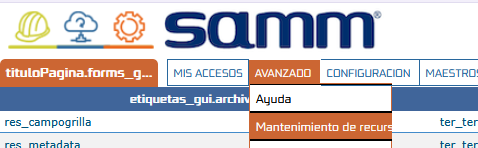
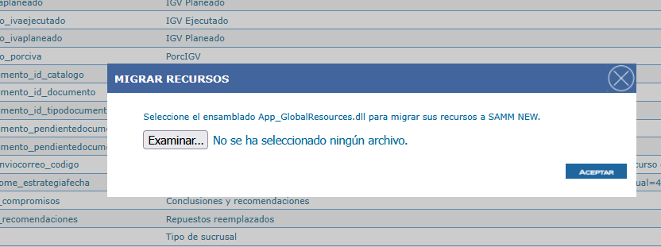

# Migración y Actualización de Recursos

SAMM maneja un archivo de recursos globales (`globalresources.smr`) que contiene los textos y complementos que se muestran en el sitio web, de modo que cada nombre pueda personalizarse. Durante mucho tiempo, la migración y actualización de estos recursos dependió de aplicaciones adicionales.

Este documento describe cómo configurar y utilizar la funcionalidad de **mantenimiento de recursos** de SAMM New, que permite actualizar y migrar los recursos directamente desde la web, sin herramientas externas.

## Referencias

- [SO-2212: Funcionalidad para migrar recursos de SW a SN](https://softwaresamm.atlassian.net/browse/SO-2212)
- [SO-2210: Funcionalidad para migrar recursos de SW a SN](https://softwaresamm.atlassian.net/browse/SO-2210)
- [SO-2206: Formulario para guardar recursos cambiados](https://softwaresamm.atlassian.net/browse/SO-2206)
- [SO-2205: Formulario para actualizar recursos](https://softwaresamm.atlassian.net/browse/SO-2205)

## Información de Versiones

### Versión de Lanzamiento

:::info **v7.1.21.0**
:::

### Versiones Requeridas

| Aplicación    | Versión Mínima | Descripción       |
| ------------- | -------------- | ----------------- |
| SAMMAPI       | >= 1.2.34.4    | API principal     |
| SAMMNEW       | >= 7.1.21.0    | Aplicación web    |
| SAMM LOGICA   | >= 5.6.28.0    | Lógica de negocio |
| CAPA DE DATOS | >= 2.1.21.0    | Capa de datos     |
| SAMM CORE     | >= 2.0.29.0    | Core del sistema  |
| BASE DE DATOS | >= C2.1.21.0   | Base de datos     |

## Requisitos Previos

Antes de iniciar la configuración, asegúrese de tener:

- Acceso al archivo `web.config` del sitio SAMM New.
- Acceso al menú **Avanzado** de la aplicación web.
- Para la migración, el archivo `App_GlobalResources.dll` que se desea migrar.

:::important Importante
La versión **7.1.21.0** de SAMM New (o superior) debe estar desplegada antes de configurar el `web.config`, ya que el menú **Mantenimiento de recursos** solo está disponible una vez aplicada la actualización.
:::

## Información del Servicio

No aplica para esta funcionalidad.

## Configuración

### Paso 1: Modificar el archivo web.config

Se debe agregar el atributo `resourceProviderFactoryType` al elemento `globalization` del archivo `web.config`.

```xml title="web.config - Antes"
<globalization culture="es-CO" enableClientBasedCulture="false" requestEncoding="UTF-8" uiCulture="es-CO">
```

```xml title="web.config - Después"
<globalization culture="es-CO" enableClientBasedCulture="false" requestEncoding="UTF-8" uiCulture="es-CO" resourceProviderFactoryType="website.samm_web.ResourceProviderFactorySamm, samm_new" />
```

:::tip Consejo
Genere una copia de respaldo del `web.config` antes de modificarlo.
:::

### Paso 2: Actualización de recursos

Una vez aplicada la actualización, en el menú **Avanzado** aparece una nueva opción llamada **Mantenimiento de recursos**.



Al ingresar, el módulo se abre por defecto en modo **Buscar**, igual que el resto de los menús de SAMM. Allí se encuentran tres filtros:

| Filtro    | Descripción                                                                                  |
| --------- | -------------------------------------------------------------------------------------------- |
| `archivo` | Archivo de recursos al que pertenece el registro.                                            |
| `clave`   | Identificador del recurso.                                                                   |
| `valor`   | Texto que se muestra en la web. Es el campo que se puede personalizar si así se desea.       |

:::note Archivos de uso frecuente
Los archivos que normalmente se consultan son `res_metadata` y `res.grilla`.

en caso de tener dudas consultar este video https://youtu.be/pghkBXrKM9A

:::

### Paso 3: Migración de recursos

Para migrar recursos desde un archivo existente:

1. En **Mantenimiento de recursos**, haga clic en el botón **Migrar**.
2. El sistema abrirá el explorador de archivos. Seleccione el archivo `App_GlobalResources.dll` (archivo a migrar).
3. Haga clic en **Aceptar**.



Al finalizar, el sistema muestra un mensaje con el resumen de la migración:

```text title="Ejemplo de mensaje de migración completada"
Migración completada. Nuevos: 13; actualizados: 103; iguales: 6347; omitidos: 9; imágenes agregadas: 0; plantillas agregadas: 0
```

:::tip Consejo
Los valores del mensaje cambian según el contenido del archivo migrado. Revise el resumen para confirmar cuántos recursos fueron agregados (`nuevos`) y cuántos fueron modificados (`actualizados`).
:::

En caso de tener dudas por favor consultar el siguiente video https://youtu.be/qhu54nB4-so


## Casos Especiales

No aplica para esta funcionalidad.

## Resultado Esperado

Una vez completada la configuración:

1. **Archivo web.config actualizado**: el sitio utiliza el proveedor de recursos `ResourceProviderFactorySamm` definido en `resourceProviderFactoryType`.
2. **Menú disponible**: la opción **Mantenimiento de recursos** aparece en el menú **Avanzado**.
3. **Búsqueda de recursos**: es posible filtrar por `archivo`, `clave` y `valor`, y consultar los archivos `res_metadata` y `res.grilla`.
4. **Migración exitosa**: al seleccionar `App_GlobalResources.dll`, el sistema muestra el mensaje **Migración completada** con el resumen de recursos procesados.

### Menú Mantenimiento de recursos


### Selección del archivo a migrar


## Resolución de Problemas

### No aparece el menú Mantenimiento de recursos

Verifique que:

- La versión de SAMM New desplegada sea **7.1.21.0** o superior.
- Las demás aplicaciones cumplan las versiones mínimas de la tabla de **Versiones Requeridas**.
- El usuario tenga acceso al menú **Avanzado**.
- Se haya cerrado e iniciado nuevamente la sesión tras la actualización.

### El sitio presenta errores o no refleja los recursos después de modificar el web.config

Confirme que:

- El atributo `resourceProviderFactoryType` esté escrito exactamente como se indica en el **Paso 1**, sin espacios ni caracteres adicionales.
- El elemento `globalization` quede correctamente cerrado (`/>`).
- Se haya guardado el `web.config` y el sitio se haya reiniciado.

### La migración no se completa

Revise que:

- El archivo seleccionado sea `App_GlobalResources.dll`.
- El archivo sea accesible desde el equipo en el que se ejecuta el navegador.
- Las versiones de las aplicaciones cumplan los mínimos requeridos.

### No se encuentran los recursos esperados al buscar

Verifique que:

- El filtro `archivo` corresponda al archivo correcto (por ejemplo, `res_metadata` o `res.grilla`).
- Los filtros `clave` y `valor` no estén limitando en exceso el resultado.
- La migración previa se haya completado correctamente.

## Errores Conocidos

No aplica para esta funcionalidad.

## QA — Pruebas

### Escenario 1: Configuración del web.config

1. Abra el `web.config` del sitio SAMM New.
2. Agregue el atributo `resourceProviderFactoryType` al elemento `globalization` según el **Paso 1**.
3. Guarde el archivo y reinicie el sitio.

**Resultado esperado**: el sitio inicia sin errores y utiliza el proveedor de recursos de SAMM.

### Escenario 2: Visualización del menú

1. Inicie sesión en SAMM New 7.1.21.0.
2. Ingrese al menú **Avanzado**.

**Resultado esperado**: se muestra la opción **Mantenimiento de recursos** y, al ingresar, el módulo abre en modo **Buscar** con los filtros `archivo`, `clave` y `valor`.

### Escenario 3: Búsqueda de recursos

1. En **Mantenimiento de recursos**, filtre por `archivo` con el valor `res_metadata`.
2. Repita la búsqueda con `res.grilla`.
3. Filtre por una `clave` o `valor` conocido.

**Resultado esperado**: el listado muestra únicamente los recursos que coinciden con los filtros aplicados.

### Escenario 4: Personalización de un valor

1. Busque un recurso y modifique su `valor`.
2. Guarde el cambio.
3. Navegue a la pantalla de la web donde se muestra ese texto.

**Resultado esperado**: la web muestra el nuevo valor personalizado.

### Escenario 5: Migración de recursos

1. En **Mantenimiento de recursos**, haga clic en **Migrar**.
2. Seleccione el archivo `App_GlobalResources.dll` y haga clic en **Aceptar**.

**Resultado esperado**: el sistema muestra el mensaje **Migración completada** con los totales de recursos nuevos, actualizados, iguales, omitidos, imágenes agregadas y plantillas agregadas.