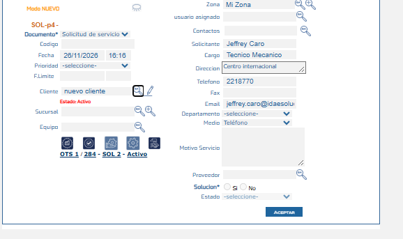
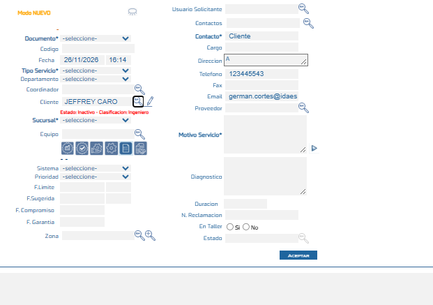
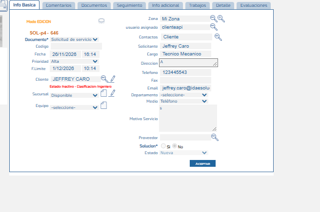

# Estado y Clasificación del Tercero en Documentos

Este documento describe cómo se muestra el **estado** y la **clasificación** del tercero junto al campo **Cliente** en los formularios de documentos de SAMM New. Antes de esta mejora, el formulario solo mostraba el estado cuando el tercero no estaba activo y la clasificación registrada en el tercero no se mostraba en ningún momento. Ahora el usuario ve ambos datos, cuando están diligenciados, al crear o editar el documento.

## Referencias

- [SO-2259: SOL-29333 | Visualización del estado y clasificación del tercero](https://softwaresamm.atlassian.net/browse/SO-2259)

## Información de Versiones

### Versión de Lanzamiento

:::info **SN 7.1.27.0 (provisional)**
:::

:::warning Versión provisional
La versión de lanzamiento es provisional; confirmarla con la fix version real al liberar.
:::

### Versiones Requeridas

| Aplicación | Versión Mínima | Descripción    |
| ---------- | -------------- | -------------- |
| SAMMNEW    | >= 7.1.27.0    | Aplicación web |

:::note Nota
No hay cambios en base de datos, SAMM API ni SAMM LOGICA: la clasificación ya existe en el tercero (`ter_tercero.clasificacion`) y se lee con las librerías actuales.
:::

## Requisitos Previos

Antes de usar la funcionalidad, asegúrese de tener:

- SAMM New actualizado a la versión mínima indicada
- El tercero con la **Clasificación** diligenciada en el formulario de terceros (campo opcional)
- Permiso para crear o editar documentos de los tipos listados en [Formularios Afectados](#formularios-afectados)

## Configuración

No requiere configuración: el comportamiento aplica a todos los clientes de forma automática. Solo se debe registrar la clasificación en el tercero.

### Paso 1: Registrar la clasificación del tercero

En el formulario del tercero, diligencie el campo **Clasificación**. Si se deja vacío, el documento no muestra clasificación para ese tercero.

### Paso 2: Seleccionar el cliente en el documento

Al crear o editar un documento, seleccione el tercero en el campo **Cliente**. Debajo del campo aparece el mensaje en rojo con el estado y la clasificación, en este formato:

```text title="Formato del mensaje"
Estado: <estado del tercero> - Clasificacion: <clasificación del tercero>
```

### Formularios Afectados

El mensaje aparece en los formularios de documento de:

- Solicitud
- Orden de trabajo
- Cotización
- Requisición
- Entrada
- Salida
- Alquiler

:::note Nota
En Entrada, Salida y Alquiler el mensaje se agregó como un campo nuevo debajo de **Cliente**. En Requisición ya existía el espacio, pero no se llenaba.
:::

## Casos Especiales

:::note Comportamientos Predefinidos
Cada parte del mensaje se muestra solo si tiene valor. Si ninguna tiene valor, el mensaje se oculta.
:::

| Estado del tercero | Clasificación | Mensaje mostrado                              |
| ------------------ | ------------- | --------------------------------------------- |
| Con estado         | Diligenciada  | `Estado: <estado> - Clasificacion: <valor>`   |
| Con estado         | Vacía         | `Estado: <estado>`                            |
| Sin estado         | Diligenciada  | `Clasificacion: <valor>`                      |
| Sin estado         | Vacía         | No se muestra el mensaje                      |

:::tip Consejo
Un tercero activo también muestra su estado (`Estado: Activo`). Antes de esta mejora solo se mostraban los estados distintos de activo.
:::

## Resultado Esperado

Una vez instalada la versión:

1. **Estado y clasificación**: al seleccionar un cliente con ambos datos, el documento muestra `Estado: ... - Clasificacion: ...`.
2. **Solo estado**: si el tercero no tiene clasificación, solo se muestra el estado.
3. **Edición**: al abrir un documento existente, el mensaje se muestra de inmediato con los datos actuales del tercero.

### Solicitud nueva con tercero sin clasificación



### Orden de trabajo nueva con estado y clasificación



### Solicitud en modo edición



## Resolución de Problemas

### No aparece la clasificación

Verifique que:

- El tercero tenga el campo **Clasificación** diligenciado en el formulario de terceros
- El cliente seleccionado en el documento sea el tercero que se editó
- La aplicación esté en la versión mínima indicada

### No aparece ningún mensaje

Confirme que:

- Se haya seleccionado un cliente en el documento
- El tercero tenga estado o clasificación diligenciados; si ambos están vacíos el mensaje se oculta
