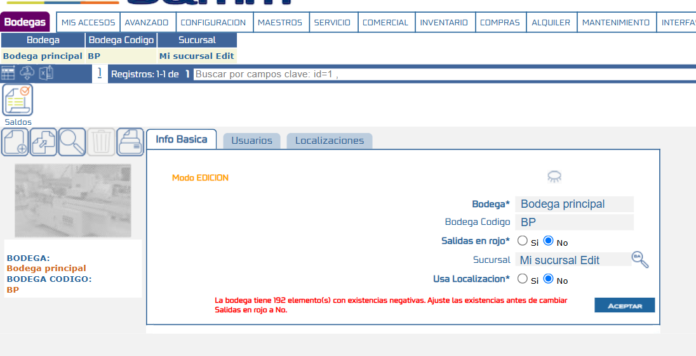

# Validación de Existencias Negativas al Desactivar Salidas en Rojo

Este documento describe la validación que ejecuta el formulario de **Bodegas** cuando se cambia el parámetro **Salidas en rojo** de **Sí** a **No**, para evitar que una bodega quede configurada sin salidas en rojo mientras todavía tiene existencias negativas.

## Referencias

- [SO-464: SOL-25371 | Validación y restricción del parámetro "permitir salidas en rojo" según existencias en bodega](https://softwaresamm.atlassian.net/browse/SO-464)

## Información de Versiones

### Versión de Lanzamiento

:::info **v7.1.26.0 (provisional)**
:::

### Versiones Requeridas

| Aplicación | Versión Mínima | Descripción              |
| ---------- | -------------- | ------------------------ |
| SAMMNEW    | >= 7.1.26.0    | Aplicación web principal |

:::important Importante
La versión de lanzamiento es provisional hasta que se confirme el release que incluye SO-464.
:::

## Requisitos Previos

Antes de iniciar, asegúrese de tener:

- Acceso al formulario de **Bodegas** con permiso para editar
- Una bodega existente con **Salidas en rojo** en **Sí**

:::note Información
La validación solo aplica al editar una bodega ya guardada. No se ejecuta al crear una bodega nueva ni cuando el valor cambia de **No** a **Sí**.
:::

## Configuración

### Paso 1: Cambiar Salidas en rojo a No

En el formulario de la bodega, pestaña **Info Básica**, seleccione **No** en el campo **Salidas en rojo** y pulse **Aceptar**.

### Paso 2: Revisar el resultado de la validación

Antes de guardar, el sistema cuenta los elementos de la bodega (`cat_catalogo_bodega`) que están activos y tienen `existencia` menor que cero.

| Situación                                      | Comportamiento                                                  |
| ---------------------------------------------- | --------------------------------------------------------------- |
| La bodega no tiene existencias negativas       | El cambio se guarda normalmente                                 |
| La bodega tiene uno o más elementos negativos  | No se guarda y se muestra el mensaje junto al botón **Aceptar** |

Mensaje mostrado:

> La bodega tiene N elemento(s) con existencias negativas. Ajuste las existencias antes de cambiar Salidas en rojo a No.

Donde `N` es la cantidad de elementos activos con existencia negativa en la bodega.

### Paso 3: Ajustar las existencias

Corrija las existencias negativas mediante los movimientos de inventario (documentos) que correspondan. Las existencias por elemento se consultan en la pestaña de existencias del inventario del elemento.

:::tip Consejo
Repita el Paso 1 cuando todas las existencias de la bodega sean mayores o iguales a cero.
:::

## Casos Especiales

:::note Comportamientos Predefinidos
La validación tiene un alcance acotado.
:::

| Caso                                  | Comportamiento                                                                     |
| ------------------------------------- | ---------------------------------------------------------------------------------- |
| Bodega nueva o duplicada              | No se valida                                                                       |
| Cambio de **No** a **Sí**             | No se valida                                                                       |
| Elementos inactivos                   | No se cuentan                                                                      |
| Disposición horizontal del formulario | La validación está implementada en la disposición vertical (`formsV`) del formulario |

## Resultado Esperado

Una vez aplicada la validación:

1. **Cambio bloqueado**: una bodega con existencias negativas conserva **Salidas en rojo = Sí** hasta que se ajusten las existencias.
2. **Aviso claro**: el mensaje aparece dentro del formulario e indica cuántos elementos tienen existencia negativa.
3. **Cambio permitido**: sin existencias negativas, el cambio a **No** se guarda con normalidad.

### Mensaje de validación

## Resolución de Problemas

### El cambio a No no se guarda y aparece el mensaje

Verifique que:

- Los elementos de la bodega no tengan `existencia` menor que cero
- Los movimientos de ajuste se hayan registrado en la bodega correcta

### El mensaje no aparece pero el cambio no se guarda

Confirme que:

- Los campos obligatorios del formulario estén completos
- El usuario tenga permiso para editar la bodega

## Documentación Relacionada

- Diccionario de datos: [`gen_bodega`](./database/general/gen_bodega.md) y [`cat_catalogo_bodega`](./database/catalogo/cat_catalogo_bodega.md)
