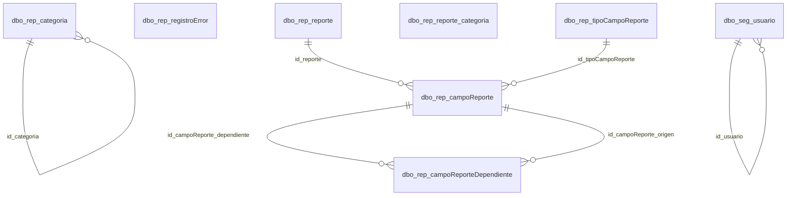

# Diccionario de Datos - Report Services

Diccionario de datos de la base de datos `rep_basica` del Utilitario de Reportes (Report Services). Guarda el catálogo de reportes y formatos que se generan en SSRS, sus categorías, los filtros (parámetros) de cada reporte, los usuarios sincronizados desde SAMM y la bitácora de errores de generación. Los objetos viven en `IDAE.UTIL.ReportService.DBObjects`; los datos se migran desde la base de SAMM con los scripts de `Migration/`.

## Estadísticas

- **Total de tablas**: 8
- **Módulos**: 1
- **Base de datos**: SQL Server (`rep_basica`)

## Convenciones

- Tablas en el esquema `dbo` con prefijo por dominio (`rep_` reportes, `seg_` seguridad) y nombres en español camelCase; las llaves foráneas se llaman `id_<tabla>`.
- Todas las tablas tienen `id` (INT IDENTITY, PK), `uid`/`eid` (multiempresa), auditoría (`id_usuario_creo`, `id_usuario_modifico`, `fechaCreacion`, `fechaModificacion`) y `active` (borrado lógico).
- Por cada tabla del catálogo existen las vistas `view_<tabla>` (columnas de las FK expandidas) y `view_<tabla>_base`, el tipo `typ_<tabla>` y los procedimientos `sel_<tablas>_m`, `act_<tabla>`, `ins_<tabla>_bulk` y `upd_<tabla>_bulk`, que usa el backend (`sr_api`) de forma genérica.
- `rep_registroError` es la excepción: la escribe directamente el backend (EF) y no tiene vistas, tipo ni procedimientos.
- `source_id` lo agregan los scripts de migración con el `id` del registro en la base de SAMM de origen.

## Mapa de Relaciones

Todas las tablas y sus relaciones (sin columnas ni relaciones de auditoría). El detalle de columnas está en el diagrama ER de cada módulo.

## Módulos

### Tablas (`dbo`)

Catálogo de reportes, categorías, filtros, usuarios y bitácora de errores del Utilitario de Reportes.

[Diagrama ER del módulo](./tables/er-diagram.md)

- [dbo.rep_campoReporte](./tables/rep-campo-reporte.md) - Filtros (parámetros SSRS) de cada reporte, que el utilitario muestra en el formulario de filtros.
- [dbo.rep_campoReporteDependiente](./tables/rep-campo-reporte-dependiente.md) - Dependencias entre filtros de un reporte: el filtro dependiente carga sus opciones según el valor del filtro origen (ej. sucursales del cliente seleccionado).
- [dbo.rep_categoria](./tables/rep-categoria.md) - Categorías (carpetas) que agrupan los reportes en el menú. Son jerárquicas: `id_categoria` apunta a la categoría padre y 0 es la raíz.
- [dbo.rep_registroError](./tables/rep-registro-error.md) - Bitácora de errores del Utilitario de Reportes: cada falla al generar un reporte o formato y cualquier error 500 del API. Se consulta en Configuración → Errores.
- [dbo.rep_reporte](./tables/rep-reporte.md) - Reportes y formatos de impresión que se generan en SSRS. El orden dentro de su categoría y en el menú de reportes se define arrastrándolos en Configuración.
- [dbo.rep_reporte_categoria](./tables/rep-reporte-categoria.md) - Reportes que se muestran dentro de cada categoría, con el código de subtipo de documento SAMM con el que se resuelven los formatos.
- [dbo.rep_tipoCampoReporte](./tables/rep-tipo-campo-reporte.md) - Catálogo de tipos de filtro: Texto, Numero, Fecha, Tabla Foranea, Bit, Tabla Foranea_mul (selección múltiple) y fecha_fh (fecha y hora).
- [dbo.seg_usuario](./tables/seg-usuario.md) - Usuarios sincronizados desde SAMM. El backend valida que el usuario del token exista y esté habilitado; los permisos de configuración se leen del árbol de funcionalidades de SAMM.

---

**Nota**: Este diccionario se regenera con la skill `data-dictionary` de IDAE.ClaudeConfig; las descripciones se mantienen en `data-dictionary/products/reportservice.json`.
