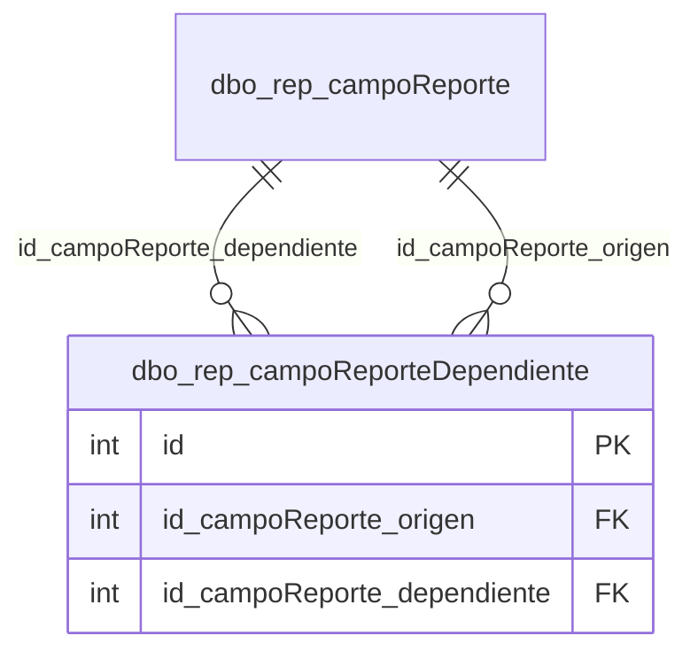

# dbo.rep_campoReporteDependiente

## Descripción

Dependencias entre filtros de un reporte: el filtro dependiente carga sus opciones según el valor del filtro origen (ej. sucursales del cliente seleccionado).

**Módulo**: Tablas  
**Nombre en base de datos**: `[dbo].[rep_campoReporteDependiente]`

## Estructura de la Tabla

| Columna | Tipo | Nulo | Clave | Default | Descripción |
|---------|------|------|-------|---------|-------------|
| campoReporteDependiente | VARCHAR(300) | ✗ | - | - | Nombre de la dependencia |
| campoReporteDependiente_codigo | VARCHAR(100) | ✓ | - | - | Código opcional de la dependencia |
| id_campoReporte_origen | INT | ✗ | FK | ((0)) | Filtro cuyo valor condiciona al dependiente |
| id_campoReporte_dependiente | INT | ✗ | FK | ((0)) | Filtro que se recarga según el origen |

### Columnas Estándar

| Columna | Tipo | Nulo | Descripción |
|---------|------|------|-------------|
| id | INT | ✗ | Clave primaria auto-incremental |
| uid | VARCHAR(500) | ✗ | Control multiempresa (User ID) |
| eid | VARCHAR(50) | ✗ | Control multiempresa (Entity ID) |
| id_usuario_modifico | INT | ✗ | Usuario que modificó el registro por última vez |
| id_usuario_creo | INT | ✗ | Usuario que creó el registro |
| fechaModificacion | DATETIME | ✗ | Fecha y hora de la última modificación |
| fechaCreacion | SMALLDATETIME | ✗ | Fecha y hora de creación |
| active | BIT | ✗ | Borrado lógico: 1 = activo, 0 = eliminado |

## Diagrama ER

Tabla y sus relaciones directas (sin las columnas de auditoría).

## Relaciones

### Relaciones Salientes (Foreign Keys)

| Columna | Referencia | Constraint |
|---------|------------|------------|
| id_campoReporte_dependiente | [`dbo.rep_campoReporte`](../tables/rep-campo-reporte.md).id | `FK_rep_campoReporteDependiente_id_campoReporte_dependiente` |
| id_campoReporte_origen | [`dbo.rep_campoReporte`](../tables/rep-campo-reporte.md).id | `FK_rep_campoReporteDependiente_id_campoReporte_origen` |

### Relaciones Entrantes

*Ninguna tabla referencia a esta tabla.*

---

**Nota**: Documentación generada desde el esquema real de la base de datos `rep_basica` con la skill `data-dictionary` (IDAE.ClaudeConfig).
