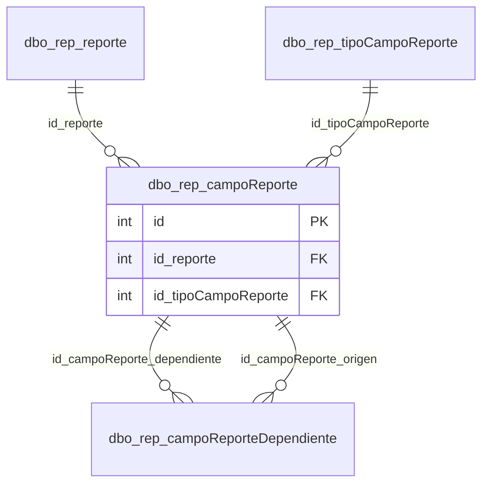

# dbo.rep_campoReporte

## Descripción

Filtros (parámetros SSRS) de cada reporte, que el utilitario muestra en el formulario de filtros.

**Módulo**: Tablas  
**Nombre en base de datos**: `[dbo].[rep_campoReporte]`

## Estructura de la Tabla

| Columna | Tipo | Nulo | Clave | Default | Descripción |
|---------|------|------|-------|---------|-------------|
| campoReporte | VARCHAR(300) | ✗ | - | - | Nombre visible del filtro |
| campoReporte_codigo | VARCHAR(100) | ✓ | - | - | Nombre del parámetro en el RDL (ej. `p_fecha_fh`) |
| id_reporte | INT | ✗ | FK | ((0)) | Reporte al que pertenece el filtro |
| id_tipoCampoReporte | INT | ✗ | FK | ((0)) | Tipo de control del filtro (texto, número, fecha, tabla foránea…) |
| tabla | VARCHAR(50) | ✗ | - | ('') | Tabla de SAMM de la que se cargan las opciones (tipos de tabla foránea) |
| valorDefecto | VARCHAR(100) | ✗ | - | ('') | Valor inicial del filtro (en fechas, un rango relativo) |
| esParametro | BIT | ✗ | - | ((1)) | 1 = se muestra como filtro y se envía a SSRS |
| esSerie | BIT | ✗ | - | ((0)) | El campo es una serie de los gráficos del reporte |
| parametroTotal | BIT | ✗ | - | ((1)) | El parámetro aplica a todo el reporte (no solo a una sección o subreporte) |
| condicion | VARCHAR(100) | ✓ | - | - | Condición adicional para filtrar las opciones del parámetro |

### Columnas Estándar

| Columna | Tipo | Nulo | Descripción |
|---------|------|------|-------------|
| id | INT | ✗ | Clave primaria auto-incremental |
| uid | VARCHAR(500) | ✗ | Control multiempresa (User ID) |
| eid | VARCHAR(50) | ✗ | Control multiempresa (Entity ID) |
| id_usuario_modifico | INT | ✗ | Usuario que modificó el registro por última vez |
| id_usuario_creo | INT | ✗ | Usuario que creó el registro |
| fechaModificacion | DATETIME | ✗ | Fecha y hora de la última modificación |
| fechaCreacion | SMALLDATETIME | ✗ | Fecha y hora de creación |
| active | BIT | ✗ | Borrado lógico: 1 = activo, 0 = eliminado |
| source_id | INT | ✓ | Id del registro en la base de SAMM de origen (lo agrega la migración) |

## Diagrama ER

Tabla y sus relaciones directas (sin las columnas de auditoría).

## Relaciones

### Relaciones Salientes (Foreign Keys)

| Columna | Referencia | Constraint |
|---------|------------|------------|
| id_reporte | [`dbo.rep_reporte`](../tables/rep-reporte.md).id | `FK_rep_campoReporte_id_reporte` |
| id_tipoCampoReporte | [`dbo.rep_tipoCampoReporte`](../tables/rep-tipo-campo-reporte.md).id | `FK_rep_campoReporte_id_tipoCampoReporte` |

### Relaciones Entrantes

| Tabla | Columna | Constraint |
|-------|---------|------------|
| [`dbo.rep_campoReporteDependiente`](../tables/rep-campo-reporte-dependiente.md) | id_campoReporte_dependiente | `FK_rep_campoReporteDependiente_id_campoReporte_dependiente` |
| [`dbo.rep_campoReporteDependiente`](../tables/rep-campo-reporte-dependiente.md) | id_campoReporte_origen | `FK_rep_campoReporteDependiente_id_campoReporte_origen` |

---

**Nota**: Documentación generada desde el esquema real de la base de datos `rep_basica` con la skill `data-dictionary` (IDAE.ClaudeConfig).
