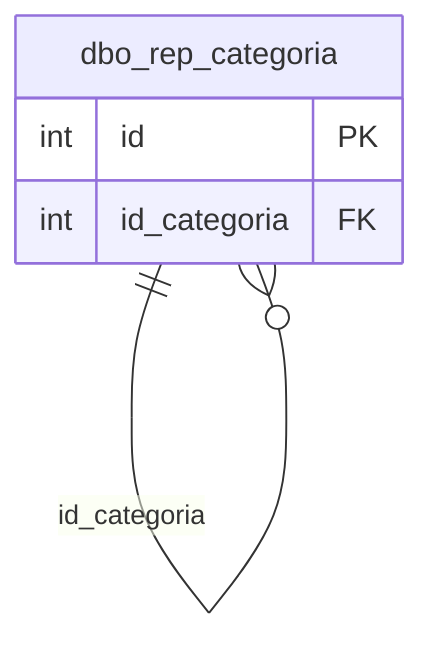

# dbo.rep_categoria

## Descripción

Categorías (carpetas) que agrupan los reportes en el menú. Son jerárquicas: `id_categoria` apunta a la categoría padre y 0 es la raíz.

**Módulo**: Tablas  
**Nombre en base de datos**: `[dbo].[rep_categoria]`

## Estructura de la Tabla

| Columna | Tipo | Nulo | Clave | Default | Descripción |
|---------|------|------|-------|---------|-------------|
| categoria | VARCHAR(300) | ✗ | - | - | Nombre de la categoría |
| categoria_codigo | VARCHAR(100) | ✓ | - | - | Código opcional de la categoría |
| id_categoria | INT | ✗ | FK | ((0)) | Categoría padre (0 = primer nivel) |

### Columnas Estándar

| Columna | Tipo | Nulo | Descripción |
|---------|------|------|-------------|
| id | INT | ✗ | Clave primaria auto-incremental |
| uid | VARCHAR(500) | ✗ | Control multiempresa (User ID) |
| eid | VARCHAR(50) | ✗ | Control multiempresa (Entity ID) |
| id_usuario_modifico | INT | ✗ | Usuario que modificó el registro por última vez |
| id_usuario_creo | INT | ✗ | Usuario que creó el registro |
| fechaModificacion | DATETIME | ✗ | Fecha y hora de la última modificación |
| fechaCreacion | SMALLDATETIME | ✗ | Fecha y hora de creación |
| active | BIT | ✗ | Borrado lógico: 1 = activo, 0 = eliminado |
| source_id | INT | ✓ | Id del registro en la base de SAMM de origen (lo agrega la migración) |

## Diagrama ER

Tabla y sus relaciones directas (sin las columnas de auditoría).

## Relaciones

### Relaciones Salientes (Foreign Keys)

| Columna | Referencia | Constraint |
|---------|------------|------------|
| id_categoria | [`dbo.rep_categoria`](../tables/rep-categoria.md).id | `FK_rep_categoria_id_categoria` |

### Relaciones Entrantes

| Tabla | Columna | Constraint |
|-------|---------|------------|
| [`dbo.rep_categoria`](../tables/rep-categoria.md) | id_categoria | `FK_rep_categoria_id_categoria` |

## Notas Técnicas

- El registro con `id` 0 es la raíz técnica del árbol y no se administra.
- Solo se puede eliminar una categoría vacía (sin subcategorías ni reportes activos).

---

**Nota**: Documentación generada desde el esquema real de la base de datos `rep_basica` con la skill `data-dictionary` (IDAE.ClaudeConfig).
