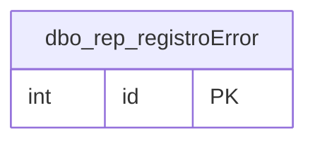

# dbo.rep_registroError

## Descripción

Bitácora de errores del Utilitario de Reportes: cada falla al generar un reporte o formato y cualquier error 500 del API. Se consulta en Configuración → Errores.

**Módulo**: Tablas  
**Nombre en base de datos**: `[dbo].[rep_registroError]`

## Estructura de la Tabla

| Columna | Tipo | Nulo | Clave | Default | Descripción |
|---------|------|------|-------|---------|-------------|
| codigoReferencia | VARCHAR(20) | ✗ | - | - | Código que se muestra al usuario para reportar la falla y buscarla en la bitácora |
| id_reporte | INT | ✓ | - | - | Reporte que se intentaba generar (si aplica) |
| estadoHttp | INT | ✗ | - | ((500)) | Código de estado HTTP con el que respondió el API |
| metodo | VARCHAR(10) | ✗ | - | ('') | Método HTTP de la petición |
| ruta | VARCHAR(500) | ✗ | - | ('') | Ruta del API que falló |
| mensaje | NVARCHAR(2000) | ✗ | - | ('') | Mensaje del error |
| detalle | NVARCHAR(MAX) | ✓ | - | - | Detalle técnico: respuesta cruda de SSRS y traza de la excepción |

### Columnas Estándar

| Columna | Tipo | Nulo | Descripción |
|---------|------|------|-------------|
| id | INT | ✗ | Clave primaria auto-incremental |
| uid | VARCHAR(500) | ✗ | Control multiempresa (User ID) |
| eid | VARCHAR(50) | ✗ | Control multiempresa (Entity ID) |
| id_usuario_modifico | INT | ✗ | Usuario que modificó el registro por última vez |
| id_usuario_creo | INT | ✗ | Usuario que creó el registro |
| fechaModificacion | DATETIME | ✗ | Fecha y hora de la última modificación |
| fechaCreacion | DATETIME | ✗ | Fecha y hora de creación |
| active | BIT | ✗ | Borrado lógico: 1 = activo, 0 = eliminado |

## Diagrama ER

Tabla y sus relaciones directas (sin las columnas de auditoría).

## Relaciones

### Relaciones Salientes (Foreign Keys)

*Esta tabla no tiene relaciones salientes (aparte de las columnas de auditoría).*

### Relaciones Entrantes

*Ninguna tabla referencia a esta tabla.*

## Notas Técnicas

- La escribe el backend (EF) en un contexto independiente para no fallar si el error vino de la base.
- Los errores 401/403 no se registran.

---

**Nota**: Documentación generada desde el esquema real de la base de datos `rep_basica` con la skill `data-dictionary` (IDAE.ClaudeConfig).
