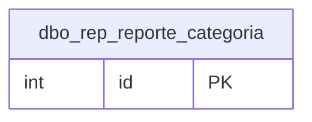

# dbo.rep_reporte_categoria

## Descripción

Reportes que se muestran dentro de cada categoría, con el código de subtipo de documento SAMM con el que se resuelven los formatos.

**Módulo**: Tablas  
**Nombre en base de datos**: `[dbo].[rep_reporte_categoria]`

## Estructura de la Tabla

| Columna | Tipo | Nulo | Clave | Default | Descripción |
|---------|------|------|-------|---------|-------------|
| reporte_categoria | VARCHAR(300) | ✗ | - | - | Código de subtipo de documento SAMM (ej. `OTT`, `ort_reporteTecnico`, `equ_equipo`). Con él, el servicio de formatos obtiene los formatos que aplican al objeto desde el que se abre el utilitario; obligatorio para formatos |
| id_categoria | INT | ✗ | - | ((0)) | Categoría en la que se muestra el reporte |
| id_reporte | INT | ✗ | - | ((0)) | Reporte asignado |

### Columnas Estándar

| Columna | Tipo | Nulo | Descripción |
|---------|------|------|-------------|
| id | INT | ✗ | Clave primaria auto-incremental |
| uid | VARCHAR(500) | ✗ | Control multiempresa (User ID) |
| eid | VARCHAR(50) | ✗ | Control multiempresa (Entity ID) |
| id_usuario_modifico | INT | ✗ | Usuario que modificó el registro por última vez |
| id_usuario_creo | INT | ✗ | Usuario que creó el registro |
| fechaModificacion | DATETIME | ✗ | Fecha y hora de la última modificación |
| fechaCreacion | SMALLDATETIME | ✗ | Fecha y hora de creación |
| active | BIT | ✗ | Borrado lógico: 1 = activo, 0 = eliminado |
| source_id | INT | ✓ | Id del registro en la base de SAMM de origen (lo agrega la migración) |

## Diagrama ER

Tabla y sus relaciones directas (sin las columnas de auditoría).

## Relaciones

### Relaciones Salientes (Foreign Keys)

*Esta tabla no tiene relaciones salientes (aparte de las columnas de auditoría).*

### Relaciones Entrantes

*Ninguna tabla referencia a esta tabla.*

## Notas Técnicas

- Al mover un reporte a otra categoría se conserva su código de subtipo; las asignaciones nuevas sugieren el código más usado de la categoría.
- La tabla no tiene llaves foráneas declaradas: la integridad la controla el backend.

---

**Nota**: Documentación generada desde el esquema real de la base de datos `rep_basica` con la skill `data-dictionary` (IDAE.ClaudeConfig).
