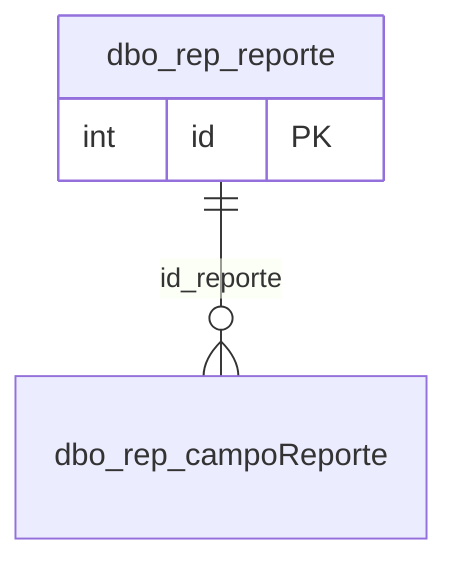

# dbo.rep_reporte

## Descripción

Reportes y formatos de impresión que se generan en SSRS. El orden dentro de su categoría y en el menú de reportes se define arrastrándolos en Configuración.

**Módulo**: Tablas  
**Nombre en base de datos**: `[dbo].[rep_reporte]`

## Estructura de la Tabla

| Columna | Tipo | Nulo | Clave | Default | Descripción |
|---------|------|------|-------|---------|-------------|
| reporte | VARCHAR(300) | ✗ | - | - | Nombre visible del reporte o formato |
| reporte_codigo | VARCHAR(100) | ✓ | - | - | Nombre del archivo RDL en SSRS (se publica como `SammNew.\<código\>`) |
| esFormato | BIT | ✗ | - | ((0)) | 1 = formato de impresión de un documento SAMM; 0 = reporte |
| tieneGraficos | BIT | ✗ | - | ((0)) | El reporte incluye gráficos |
| cabecera | VARCHAR(300) | ✗ | - | ('') | Tabla de SAMM a la que pertenece el formato (ej. `doc_documento`) |
| orden | INT | ✗ | - | ((0)) | Posición del reporte dentro de su categoría (1..n); los reportes sin orden se muestran por nombre |
| basica | BIT | ✗ | - | ((0)) | Reporte básico estándar de SAMM (no personalizado del cliente) |

### Columnas Estándar

| Columna | Tipo | Nulo | Descripción |
|---------|------|------|-------------|
| id | INT | ✗ | Clave primaria auto-incremental |
| uid | VARCHAR(500) | ✗ | Control multiempresa (User ID) |
| eid | VARCHAR(50) | ✗ | Control multiempresa (Entity ID) |
| id_usuario_modifico | INT | ✗ | Usuario que modificó el registro por última vez |
| id_usuario_creo | INT | ✗ | Usuario que creó el registro |
| fechaModificacion | DATETIME | ✗ | Fecha y hora de la última modificación |
| fechaCreacion | SMALLDATETIME | ✗ | Fecha y hora de creación |
| active | BIT | ✗ | Borrado lógico: 1 = activo, 0 = eliminado |
| source_id | INT | ✓ | Id del registro en la base de SAMM de origen (lo agrega la migración) |

## Diagrama ER

Tabla y sus relaciones directas (sin las columnas de auditoría).

## Relaciones

### Relaciones Salientes (Foreign Keys)

*Esta tabla no tiene relaciones salientes (aparte de las columnas de auditoría).*

### Relaciones Entrantes

| Tabla | Columna | Constraint |
|-------|---------|------------|
| [`dbo.rep_campoReporte`](../tables/rep-campo-reporte.md) | id_reporte | `FK_rep_campoReporte_id_reporte` |

## Notas Técnicas

- Eliminar un reporte también lo retira de todas sus categorías (`rep_reporte_categoria`).

---

**Nota**: Documentación generada desde el esquema real de la base de datos `rep_basica` con la skill `data-dictionary` (IDAE.ClaudeConfig).
