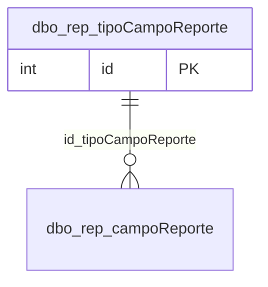

# dbo.rep_tipoCampoReporte

## Descripción

Catálogo de tipos de filtro: Texto, Numero, Fecha, Tabla Foranea, Bit, Tabla Foranea_mul (selección múltiple) y fecha_fh (fecha y hora).

**Módulo**: Tablas  
**Nombre en base de datos**: `[dbo].[rep_tipoCampoReporte]`

## Estructura de la Tabla

| Columna | Tipo | Nulo | Clave | Default | Descripción |
|---------|------|------|-------|---------|-------------|
| tipoCampoReporte | VARCHAR(300) | ✗ | - | - | Nombre del tipo de filtro |
| tipoCampoReporte_codigo | VARCHAR(100) | ✓ | - | - | Código opcional del tipo |

### Columnas Estándar

| Columna | Tipo | Nulo | Descripción |
|---------|------|------|-------------|
| id | INT | ✗ | Clave primaria auto-incremental |
| uid | VARCHAR(500) | ✗ | Control multiempresa (User ID) |
| eid | VARCHAR(50) | ✗ | Control multiempresa (Entity ID) |
| id_usuario_modifico | INT | ✗ | Usuario que modificó el registro por última vez |
| id_usuario_creo | INT | ✗ | Usuario que creó el registro |
| fechaModificacion | DATETIME | ✗ | Fecha y hora de la última modificación |
| fechaCreacion | SMALLDATETIME | ✗ | Fecha y hora de creación |
| active | BIT | ✗ | Borrado lógico: 1 = activo, 0 = eliminado |
| source_id | INT | ✓ | Id del registro en la base de SAMM de origen (lo agrega la migración) |

## Diagrama ER

Tabla y sus relaciones directas (sin las columnas de auditoría).

## Relaciones

### Relaciones Salientes (Foreign Keys)

*Esta tabla no tiene relaciones salientes (aparte de las columnas de auditoría).*

### Relaciones Entrantes

| Tabla | Columna | Constraint |
|-------|---------|------------|
| [`dbo.rep_campoReporte`](../tables/rep-campo-reporte.md) | id_tipoCampoReporte | `FK_rep_campoReporte_id_tipoCampoReporte` |

---

**Nota**: Documentación generada desde el esquema real de la base de datos `rep_basica` con la skill `data-dictionary` (IDAE.ClaudeConfig).
