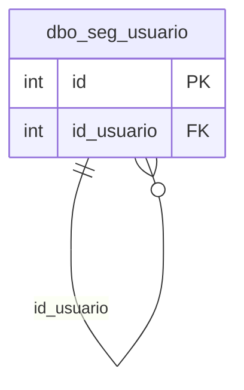

# dbo.seg_usuario

## Descripción

Usuarios sincronizados desde SAMM. El backend valida que el usuario del token exista y esté habilitado; los permisos de configuración se leen del árbol de funcionalidades de SAMM.

**Módulo**: Tablas  
**Nombre en base de datos**: `[dbo].[seg_usuario]`

## Estructura de la Tabla

| Columna | Tipo | Nulo | Clave | Default | Descripción |
|---------|------|------|-------|---------|-------------|
| usuario | VARCHAR(300) | ✗ | - | - | Nombre de usuario |
| usuario_codigo | VARCHAR(100) | ✓ | - | - | Código opcional del usuario |
| clave | VARCHAR(64) | ✓ | - | ('') | Clave cifrada |
| nombre | VARCHAR(100) | ✓ | - | ('') | Nombre completo |
| email | VARCHAR(100) | ✗ | - | ('') | Correo electrónico |
| id_usuario | INT | ✗ | FK | ((0)) | Usuario padre |
| habilitado | BIT | ✗ | - | ((1)) | 0 = el usuario no puede ingresar al utilitario |

### Columnas Estándar

| Columna | Tipo | Nulo | Descripción |
|---------|------|------|-------------|
| id | INT | ✗ | Clave primaria auto-incremental |
| uid | VARCHAR(500) | ✗ | Control multiempresa (User ID) |
| eid | VARCHAR(50) | ✗ | Control multiempresa (Entity ID) |
| id_usuario_modifico | INT | ✗ | Usuario que modificó el registro por última vez |
| id_usuario_creo | INT | ✗ | Usuario que creó el registro |
| fechaModificacion | DATETIME | ✗ | Fecha y hora de la última modificación |
| fechaCreacion | SMALLDATETIME | ✗ | Fecha y hora de creación |
| active | BIT | ✗ | Borrado lógico: 1 = activo, 0 = eliminado |
| source_id | INT | ✓ | Id del registro en la base de SAMM de origen (lo agrega la migración) |

## Diagrama ER

Tabla y sus relaciones directas (sin las columnas de auditoría).

## Relaciones

### Relaciones Salientes (Foreign Keys)

| Columna | Referencia | Constraint |
|---------|------------|------------|
| id_usuario | [`dbo.seg_usuario`](../tables/seg-usuario.md).id | `FK_seg_usuario_id_usuario` |

### Relaciones Entrantes

| Tabla | Columna | Constraint |
|-------|---------|------------|
| [`dbo.seg_usuario`](../tables/seg-usuario.md) | id_usuario | `FK_seg_usuario_id_usuario` |

---

**Nota**: Documentación generada desde el esquema real de la base de datos `rep_basica` con la skill `data-dictionary` (IDAE.ClaudeConfig).
