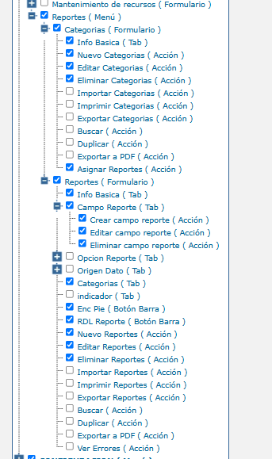

# Configuración de Categorías, Reportes y Bitácora de Errores

Este documento describe cómo habilitar y usar el módulo de **Configuración** de Report Services. Desde él se organizan las categorías y sus reportes (incluidos los filtros de cada reporte) y se consulta la bitácora de errores de generación. Antes, la organización del catálogo solo podía hacerse desde SAMM y el detalle de un error 500 solo se conocía revisando los logs del servidor de la API (`sr_api`) y de SSRS. Ahora el usuario ve un mensaje claro con un código de referencia, y el equipo de soporte encuentra el detalle técnico de la falla en la misma aplicación.

## Referencias

- [SO-2104: Gestionar errores de formatos y configurar categorías, reportes y filtros en Report Services](https://softwaresamm.atlassian.net/browse/SO-2104)
- [SO-2260: Registrar permisos de configuración de Report Services en el árbol de funcionalidades](https://softwaresamm.atlassian.net/browse/SO-2260)

## Información de Versiones

### Versión de Lanzamiento

:::info **v0.6.0**
:::

### Versiones Requeridas

| Aplicación           | Versión Mínima | Descripción                                                    |
| -------------------- | -------------- | -------------------------------------------------------------- |
| REPORT SERVICES      | >= 0.6.0       | Utilitario de Reportes (`sr_web` y `sr_api`)                   |
| SAMMAPI              | >= 1.2.35.2    | Expone los permisos por `api/util/mobsp`                       |
| BASE DE DATOS SAMM   | Scripts SO-2260 | Acciones de permiso y procedimiento `_reportservice_permissions` |
| BASE DE DATOS REPORTES | Script `rep_registroError` | Tabla de la bitácora de errores                     |

## Requisitos Previos

Antes de iniciar la configuración, asegúrese de tener:

- Report Services desplegado (ver [Despliegue en IIS](./deploy-iis-readme.md)), con `sr_api` apuntando a la SAMM API en `ProjectSettings:OriginSystem:BaseRoute`.
- Acceso de escritura a la base de datos de SAMM y a la base de datos de reportes (`rep_basica` o la del cliente).
- Un usuario con acceso al árbol de funcionalidades de SAMM para asignar permisos por perfil.

:::important Importante
Sin el procedimiento `_reportservice_permissions` en la base de datos de SAMM, Report Services no puede leer los permisos. En ese caso no se muestra la opción **Configuración** y el API responde `403` a toda creación, edición o eliminación de categorías, reportes y filtros.
:::

## Información del Servicio

:::note Información
El navegador solo se comunica con `sr_api`. Para conocer los permisos, `sr_api` consulta a la SAMM API (`util/mobsp/_reportservice_permissions`) con el token del usuario y guarda el resultado en caché durante 2 minutos. La misma información decide qué ve la pantalla y qué operaciones acepta el API.
:::

### Parámetros del Servicio

| Endpoint (`sr_api`)                                   | Método | Descripción                                                         |
| ----------------------------------------------------- | ------ | ------------------------------------------------------------------- |
| `/api/report-service/permission`                      | GET    | Permisos del usuario sobre la configuración                         |
| `/api/report-service/error-log`                       | GET    | Bitácora de errores, filtrable por `dateFrom`, `dateTo`, `keyword`, `page` y `pageSize` |
| `/api/report-service/error-log/{id}`                  | GET    | Detalle técnico de un error                                         |
| `/api/report-service/category/{id}/reports`           | POST   | Crea un reporte dentro de la categoría                              |
| `/api/report-service/category/{id}/reports/{idReport}` | PUT   | Mueve u ordena un reporte (`idCategorySource`, `position`)          |

### Request

```bash title="Consultar los permisos del usuario"
curl --location 'https://dominio/sr_api/api/report-service/permission' \
--header 'Authorization: Bearer [TOKEN]'
```

### Response

```json title="Permisos del usuario (extracto)"
{
  "status": "Ok",
  "statusCode": 200,
  "data": [
    { "id": 391, "nombreControl": "rep_categoria", "nombreComando": "ver" },
    { "id": 3165, "nombreControl": "rep_categoria", "nombreComando": "asignarReportes" },
    { "id": 1898, "nombreControl": "inc_campoReporte", "nombreComando": "ver" },
    { "id": 1951, "nombreControl": "inc_campoReporte", "nombreComando": "crear" },
    { "id": 3166, "nombreControl": "rep_reporte", "nombreComando": "verErrores" }
  ]
}
```

Cuando falla la generación de un reporte, el API responde con el **código de referencia** del error registrado, sin exponer el detalle técnico:

```json title="Respuesta de un error de generación"
{
  "status": "InternalServerError",
  "statusCode": 500,
  "message": "InternalServerError",
  "referenceCode": "A1B2C3D4"
}
```

:::tip
`referenceCode` es el dato que el usuario debe reportar a soporte. Con él se busca el error en **Configuración → Errores**.
:::

## Configuración

### Paso 1: Ejecutar los scripts de base de datos

Ejecute en la **base de datos de SAMM** los scripts de SO-2260, en este orden:

```sql title="SAMM: registra las acciones y el procedimiento de permisos"
-- 1. Acciones 'Asignar Reportes' (rep_categoria) y 'Ver Errores' (rep_reporte), asignadas al perfil 1
:r capadatos\sps\SO-2260\SO_2260_1.sql
-- 2. Procedimiento _reportservice_permissions
:r capadatos\sps\SO-2260\SO_2260_2.sql
```

Ejecute en la **base de datos de reportes** la tabla de la bitácora:

```sql title="Reportes: tabla e índices de la bitácora de errores"
:r Idae.Util.ReportService.DBObjects\Tables\rep_registroError\DDL\Create.sql
:r Idae.Util.ReportService.DBObjects\Indexes\rep_registroError\DDL\Create.sql
```

:::tip Consejo
Todos los scripts se pueden ejecutar varias veces sin riesgo: no duplican funcionalidades, permisos ni objetos.
:::

### Paso 2: Asignar los permisos por perfil

En SAMM, en el árbol de funcionalidades del perfil, marque las opciones que correspondan bajo **Reportes (Menú)**.



| Funcionalidad SAMM                              | Habilita en Report Services                                        |
| ----------------------------------------------- | ------------------------------------------------------------------ |
| Categorias (Formulario)                         | Ver el árbol de categorías y reportes                              |
| Nuevo / Editar / Eliminar Categorias            | Crear subcategorías, editar y eliminar categorías                  |
| Asignar Reportes (Acción de Categorias)         | Arrastrar reportes para moverlos u ordenarlos, y asignarlos a una categoría |
| Reportes (Formulario)                           | Ver el detalle de un reporte                                       |
| Nuevo / Editar / Eliminar Reportes              | Crear, editar y eliminar reportes                                  |
| Campo Reporte (Tab) y sus acciones              | Ver, crear, editar y eliminar los filtros de un reporte            |
| Ver Errores (Acción de Reportes)                | Consultar la bitácora de errores                                   |

:::note
Crear un reporte desde una categoría exige **Nuevo Reportes** y además **Asignar Reportes**, porque el reporte queda asignado a esa categoría.
:::

### Paso 3: Ingresar a la configuración

En el menú lateral de Report Services aparece la opción **Configuración**, solo si el perfil tiene al menos un permiso de configuración. La opción conserva los parámetros con los que se abrió el utilitario desde SAMM, y **Volver a reportes** regresa al mismo punto.

### Paso 4: Organizar categorías y reportes

La sección **Categorías y reportes** muestra un árbol con las categorías (`rep_categoria`) y, dentro de cada una, sus reportes (`rep_reporte_categoria`). Al seleccionar un elemento, su información se muestra a la derecha.

| Acción                  | Cómo se hace                                                                 |
| ----------------------- | ---------------------------------------------------------------------------- |
| Crear categoría raíz    | Botón **Nuevo** junto al buscador                                            |
| Crear subcategoría      | Ícono de carpeta con "+" al pasar el mouse sobre la categoría                |
| Crear reporte           | Ícono de documento con "+" sobre la categoría; se diligencia también el **Código de subtipo SAMM**; al guardar, el reporte queda seleccionado en la pestaña **Filtros** |
| Editar                  | Seleccionar la categoría o el reporte en el árbol                            |
| Eliminar                | Papelera al final de la línea, con confirmación                              |
| Mover un reporte        | Arrastrarlo (agarre ⋮⋮) hasta otra categoría                                 |
| Ordenar reportes        | Arrastrarlo sobre otro reporte; una línea indica si queda antes o después    |
| Quitar de la categoría  | Arrastrarlo hasta **Sin categoría**                                          |
| Buscar                  | Escribir en el buscador; la **x** o `Esc` limpian la búsqueda                |

:::tip Consejo
El arrastre también funciona con teclado: enfoque el agarre, presione espacio o enter, use las flechas para elegir el destino y vuelva a presionar espacio o enter.
:::

#### Código de subtipo SAMM

Cada reporte dentro de una categoría tiene un **código de subtipo SAMM** (`rep_reporte_categoria.reporte_categoria`), por ejemplo `OTT`, `ort_reporteTecnico` o `equ_equipo`. Con ese código, el servicio de formatos obtiene los formatos que aplican al documento desde el que se abre el utilitario. Se edita al seleccionar el reporte, en **Información básica → Ubicación en «Categoría»**. Es obligatorio cuando el reporte es formato de impresión.

:::important Importante
Si un formato queda con un código de subtipo incorrecto, deja de aparecer al abrir el utilitario desde ese documento en SAMM.
:::

### Paso 5: Configurar los filtros de un reporte

Seleccione el reporte y abra la pestaña **Filtros**. Cada filtro corresponde a un parámetro del RDL (`rep_campoReporte`): nombre, parámetro (por ejemplo `p_fecha_fh`), tipo, tabla origen, valor por defecto, condición y las marcas *Es parámetro*, *Es serie* y *Parámetro total*. Los cambios se reflejan de inmediato en el formulario de filtros del dashboard. Para las dependencias entre filtros, vea [Dependencia entre filtros](./dependency-between-filters.md).

### Paso 6: Consultar la bitácora de errores

En **Configuración → Errores** se listan, del más reciente al más antiguo, las fallas de generación de reportes y formatos, y cualquier error 500 del API. Se puede filtrar por rango de fechas y por código de referencia o texto del mensaje. **Ver detalle** muestra el reporte, el usuario, el estado HTTP, la ruta, el mensaje y el **detalle técnico** (respuesta de SSRS y traza). Desde ahí el detalle se puede **Copiar** o **Descargar** como `error-<código>.txt`.

## Casos Especiales

:::note Comportamientos Predefinidos
Reglas que aplican Report Services y su API, independientemente de la pantalla desde donde se opere.
:::

| Caso                               | Campo/Valor                     | Descripción                                                                                     |
| ---------------------------------- | ------------------------------- | ----------------------------------------------------------------------------------------------- |
| Eliminar categoría                 | Subcategorías o reportes activos | Solo se eliminan categorías vacías; la papelera aparece deshabilitada y el API responde `400`    |
| Eliminar reporte                   | `rep_reporte_categoria`         | También se retira el reporte de todas sus categorías                                             |
| Reportes sin categoría             | Nodo **Sin categoría**          | Agrupa los reportes activos que no están en ninguna categoría                                    |
| Mover un reporte                   | `reporte_categoria`             | Conserva su código de subtipo SAMM; las asignaciones nuevas sugieren el código más usado de la categoría |
| Orden de los reportes              | `rep_reporte.orden`             | El orden se guarda en el reporte y el menú del dashboard lo respeta; los reportes sin orden se muestran por nombre |
| Consultas del dashboard            | Métodos `GET`                   | No exigen permisos de configuración, para que la consulta de reportes no se vea afectada           |
| Perfil superadministrador          | Perfil 1                        | No tiene acceso implícito: se le asignan explícitamente las acciones (los scripts ya lo hacen con las nuevas) |

## Resultado Esperado

Una vez completada la configuración:

1. **Mensaje claro al usuario**: cuando un formato no se genera, en lugar del error 500 en rojo aparece un aviso con el código de referencia.
2. **Diagnóstico sin acceso al servidor**: el error aparece en **Configuración → Errores** con el detalle de SSRS, y se puede copiar o descargar.
3. **Catálogo administrable**: categorías, reportes y filtros se crean, editan, mueven y ordenan desde el árbol, y los cambios se reflejan en el menú de reportes.
4. **Acceso controlado**: cada opción aparece y funciona solo si el perfil SAMM la tiene asignada.

## Resolución de Problemas

### No aparece la opción Configuración

Verifique que:

- Los scripts de SO-2260 se ejecutaron en la base de datos de SAMM a la que apunta la SAMM API.
- El perfil del usuario tiene marcado al menos el formulario **Categorias** o la acción **Ver Errores**.
- Pasaron al menos 2 minutos desde el cambio de permisos (caché de `sr_api`), o se reinició el sitio.

### Guardar o eliminar responde "No tienes permisos para realizar esta acción"

Confirme que:

- El perfil tiene la acción correspondiente (Nuevo, Editar o Eliminar) en el formulario o tab correcto. Los filtros dependen del tab **Campo Reporte**, no del formulario Reportes.
- Para crear un reporte, el perfil tiene **Nuevo Reportes** y **Asignar Reportes**.

### El error no muestra código de referencia o no aparece en la bitácora

Revise que:

- La tabla `rep_registroError` existe en la base de datos de reportes configurada en `sr_api`.
- El log de `sr_api` (carpeta `Logs`) no registra el mensaje "Error log could not be saved".

### No se puede eliminar una categoría

Verifique que:

- La categoría no tiene subcategorías ni reportes. Mueva los reportes a otra categoría o arrástrelos a **Sin categoría** antes de eliminarla.

### Un formato no aparece al abrir el utilitario desde un documento de SAMM

Confirme que:

- El formato está en una categoría y su **Código de subtipo SAMM** corresponde al documento (por ejemplo `OTT` para órdenes de trabajo).
- El formato está marcado como **Es formato de impresión**.

Para la estructura de las tablas involucradas, vea el [Diccionario de datos de Report Services](./database/index.md).
